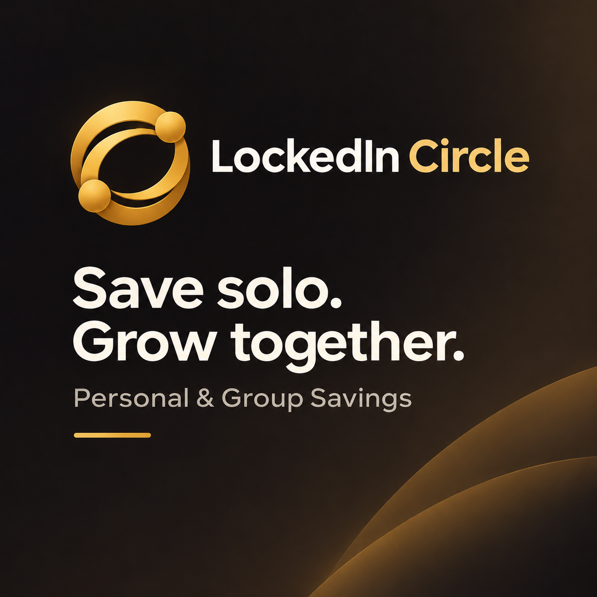
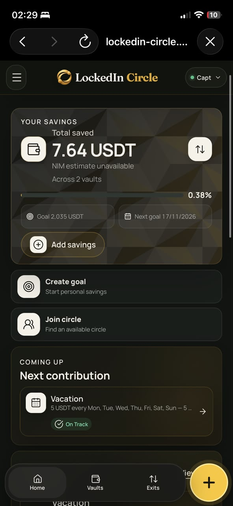
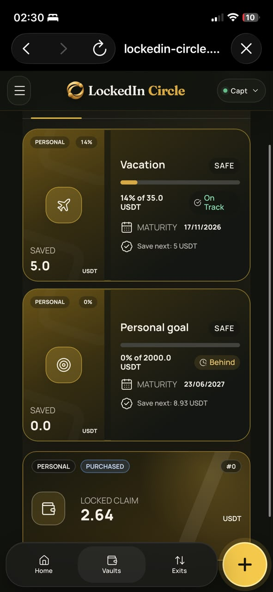
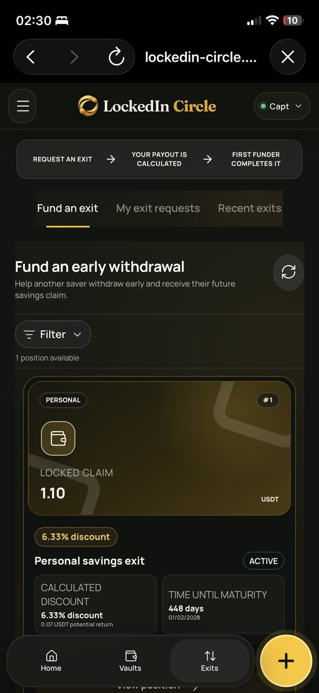
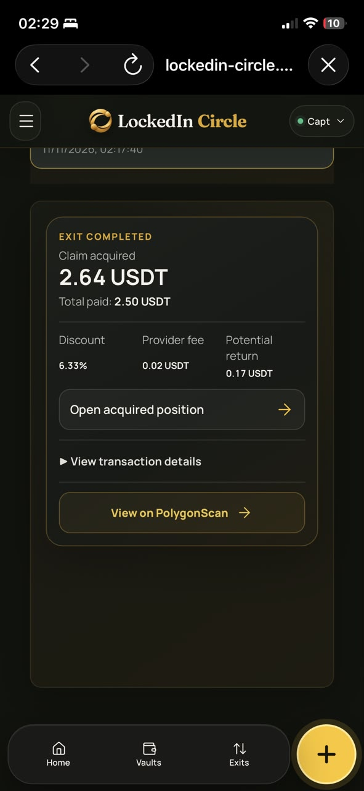
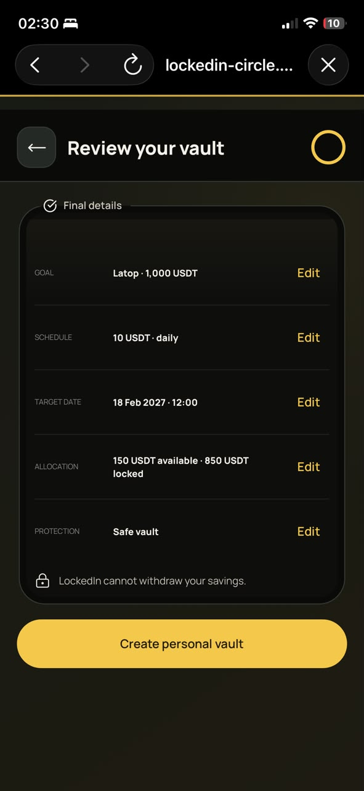

# LockedIn Circle

> Save better, together. Stay locked in.

| Field | Value |
| --- | --- |
| Category | Save |
| Pricing | Free |
| Team name | Captain |
| Team members | _Not provided — optional_ |
| X account | CaptainonX |
| Heard about it via | X |
| Contact email | samsonkel1234@gmail.com |
| GitHub login | @01cap-tain |
| Submitted at | 2026-11-11T04:37:53.722Z |

## Links

| Link | URL |
| --- | --- |
| Repo | [https://github.com/01cap-tain/LockedIn.git](<https://github.com/01cap-tain/LockedIn.git>) |
| Demo | [https://lockedin-circle.onrender.com/](<https://lockedin-circle.onrender.com/>) |
| Video | [https://vimeo.com/1245647843](<https://vimeo.com/1245647843>) |
| Skool post | [https://www.skool.com/miniappscompetition/introducing-lockedin-circle?p=fe57fa91](<https://www.skool.com/miniappscompetition/introducing-lockedin-circle?p=fe57fa91>) |
| Social post | [https://x.com/CaptainonX/status/2120371460510208085?a=-E3M5H25vuLKX4gPhrw&s=20](<https://x.com/CaptainonX/status/2120371460510208085?a=-E3M5H25vuLKX4gPhrw&s=20>) |

## Description

LockedIn Circle helps individuals and groups build consistent saving habits with goal-based vaults, emergency funds and transparent early exits. Built for Nimiq Pay users.

## Builder story

_Not provided — optional_

## Thumbnail

## Screenshots

---

_Generated from the submission form. `submission.yaml` in this folder is the machine-readable source of truth._
