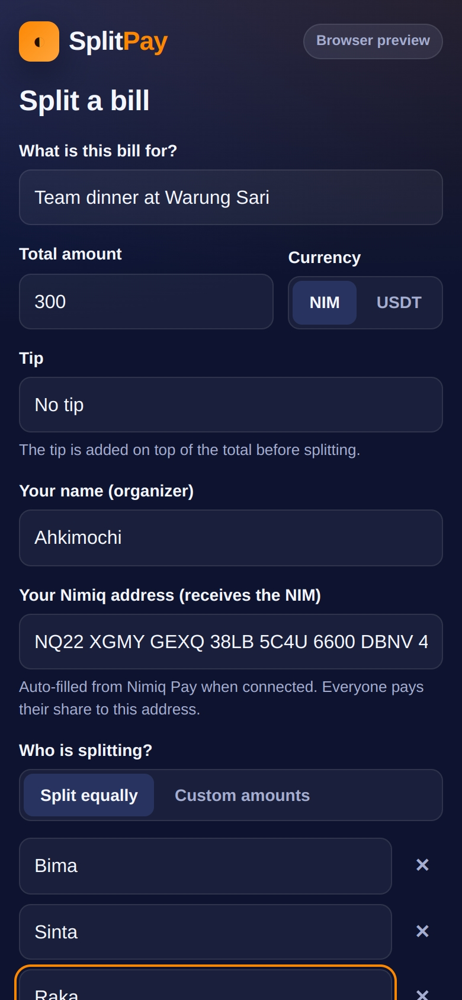
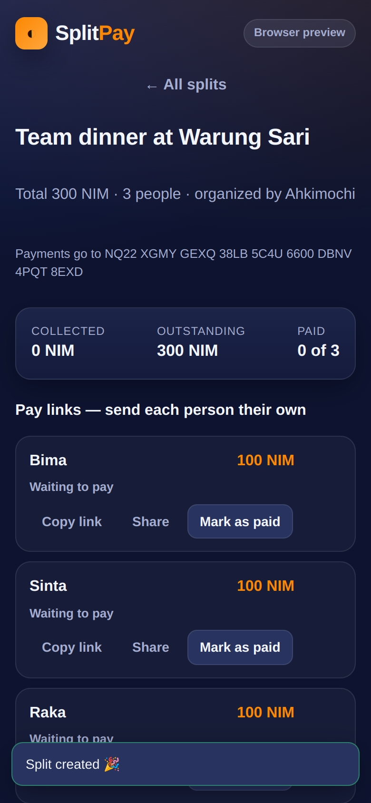

# SplitPay

> Split any bill with friends in NIM (and USDT) — everyone pays their share in one tap.

| Field | Value |
| --- | --- |
| Category | Pay |
| Pricing | Free |
| Team name | _Not provided — optional_ |
| Team members | _Not provided — optional_ |
| X account | _Not provided — optional_ |
| Heard about it via | _Not provided — optional_ |
| Contact email | zonanyaman766@gmail.com |
| GitHub login | @Ahkimochi |
| Submitted at | 2026-11-10T13:31:06.142Z |

## Links

| Link | URL |
| --- | --- |
| Repo | [https://github.com/Ahkimochi/Nimiq-splitpay](<https://github.com/Ahkimochi/Nimiq-splitpay>) |
| Demo | [https://ahkimochi.github.io/Nimiq-splitpay/](<https://ahkimochi.github.io/Nimiq-splitpay/>) |
| Video | [https://youtube.com/shorts/bhMXweNYsrw?feature=share](<https://youtube.com/shorts/bhMXweNYsrw?feature=share>) |
| Skool post | _Not provided — optional_ |
| Social post | _Not provided — optional_ |

## Description

Split bills effortlessly with SplitPay. Create payment links, track contributions, and settle shared expenses instantly with NIM or USDT on Polygon. No sign-up, no hassle!

## Builder story

_Not provided — optional_

## Thumbnail

## Screenshots

---

_Generated from the submission form. `submission.yaml` in this folder is the machine-readable source of truth._
