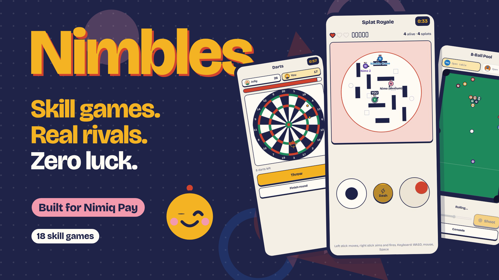
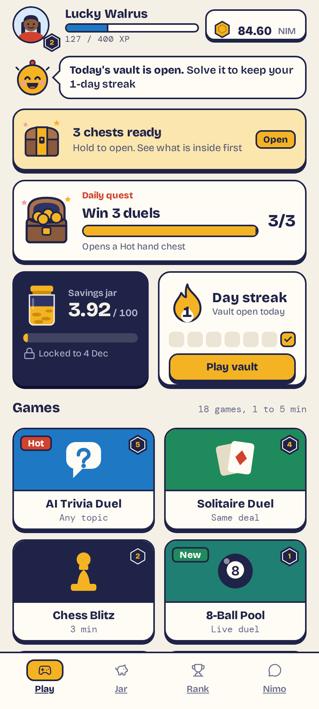
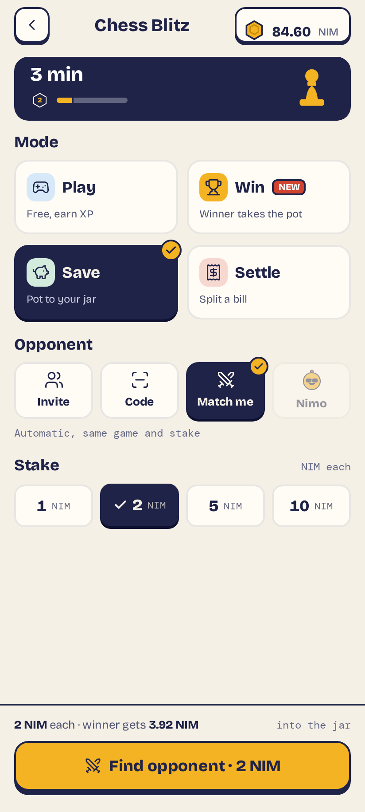
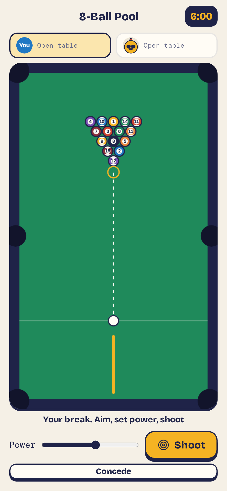
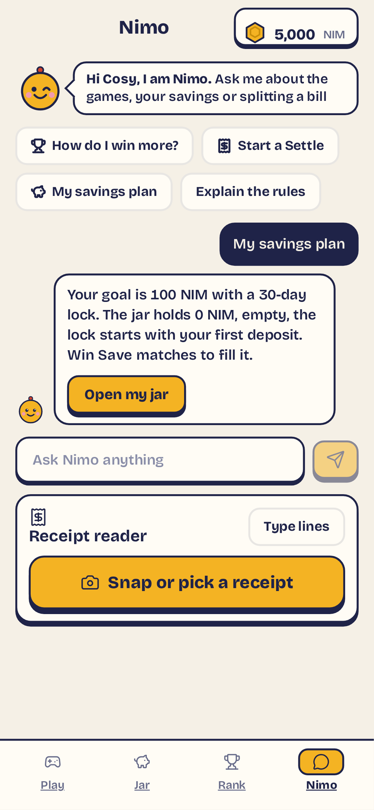
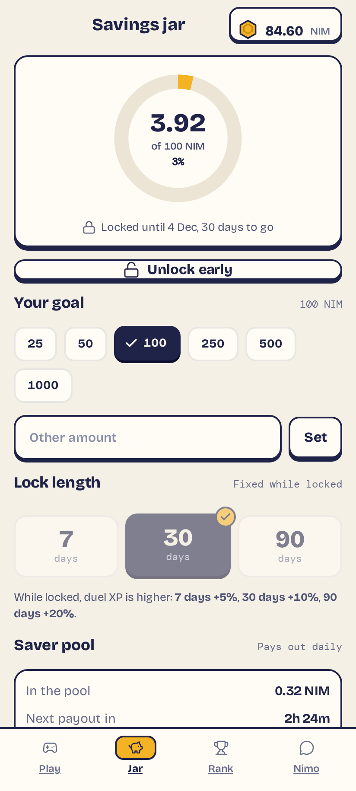

# Nimbles

> Skill games with real stakes. No luck, just you.

| Field | Value |
| --- | --- |
| Category | Earn |
| Pricing | Free |
| Team name | _Not provided — optional_ |
| Team members | _Not provided — optional_ |
| X account | chrisgold__ |
| Heard about it via | X |
| Contact email | chrisgoldog@gmail.com |
| GitHub login | @AshThunder |
| Submitted at | 2026-11-04T23:00:33.886Z |

## Links

| Link | URL |
| --- | --- |
| Repo | [https://github.com/AshThunder/nimbles](<https://github.com/AshThunder/nimbles>) |
| Demo | [https://nimbles-mainnet.fly.dev](<https://nimbles-mainnet.fly.dev>) |
| Video | [https://youtu.be/v1JuvUIOjI0?si=DBTvV7WVHCgDcb8n](<https://youtu.be/v1JuvUIOjI0?si=DBTvV7WVHCgDcb8n>) |
| Skool post | _Not provided — optional_ |
| Social post | [https://x.com/ChrisGold__/status/2118115862087422109?a=X-f3dWsE34Lty8zsahE&s=19](<https://x.com/ChrisGold__/status/2118115862087422109?a=X-f3dWsE34Lty8zsahE&s=19>) |

## Description

18 skill-only games inside Nimiq Pay: Darts, Speed Math, Solitaire, Carrom, Splat Royale and more. Play free or stake NIM against real rivals. No dice, no random draws, just aim, timing and fast thinking. Lock winnings in a savings jar and earn from a pool funded by a 2% pot fee.

## Builder story

I grew up on quick phone games, where most of what's called "play to earn" is really a slot machine with nicer graphics. With Nimbles I wanted the opposite: games where the better player always wins, with money moving as easily as a text message. Nimiq made that possible, because payments settle in seconds and the app runs inside a wallet people already have.

The hardest part was keeping luck out. I dropped Ludo, Yahtzee and Bingo because dice decide those. I made chest rewards fixed and earned rather than random, and I built Settle so two players agree on the terms, winner-takes-all or a split, before anyone stakes. I also didn't want winnings to vanish straight into the next game, so I added the savings jar. You lock NIM for 7, 30 or 90 days and earn from a pool funded by a small 2% fee on every pot.

Nimbles grew from one game into 18 in a couple of weeks, then went live on mainnet with a signed sign-in and an escrow that pays winners automatically. Nimo, the little host, teaches each game and shows you your stats, so the first match never feels like a test.

## Thumbnail

## Screenshots

---

_Generated from the submission form. `submission.yaml` in this folder is the machine-readable source of truth._
