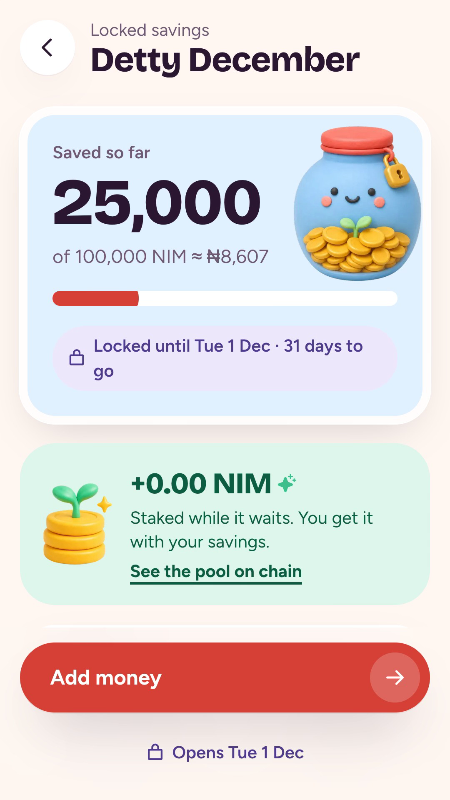
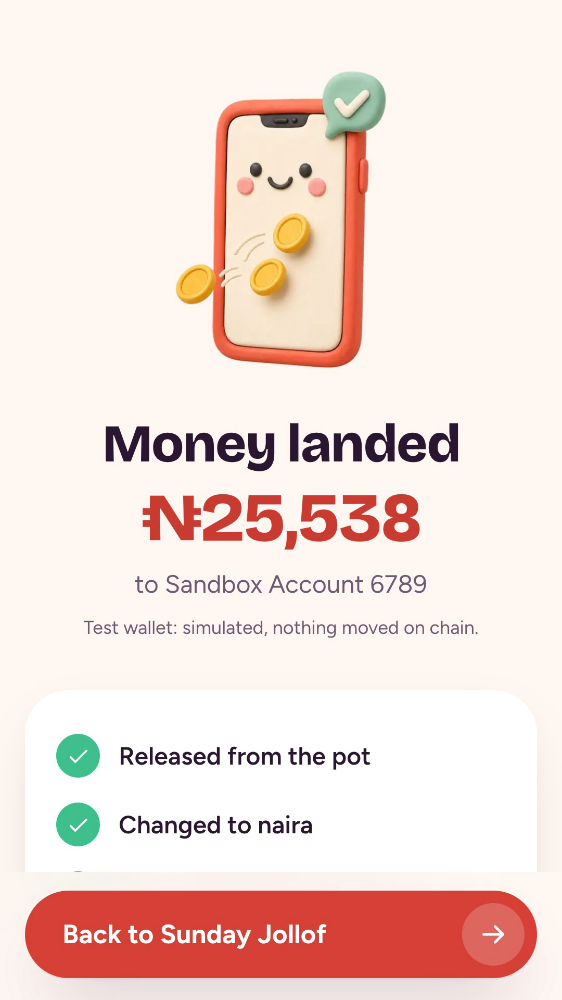
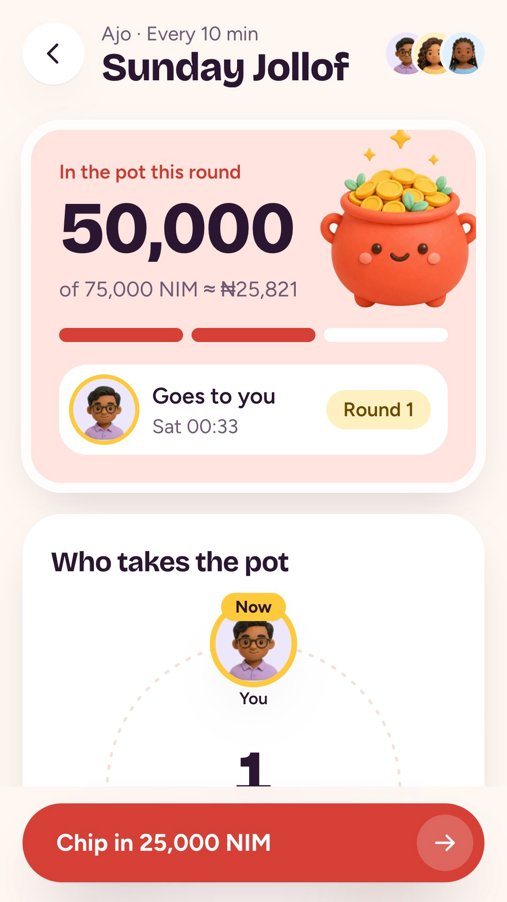
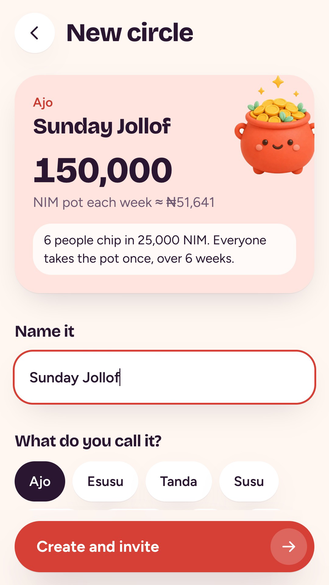
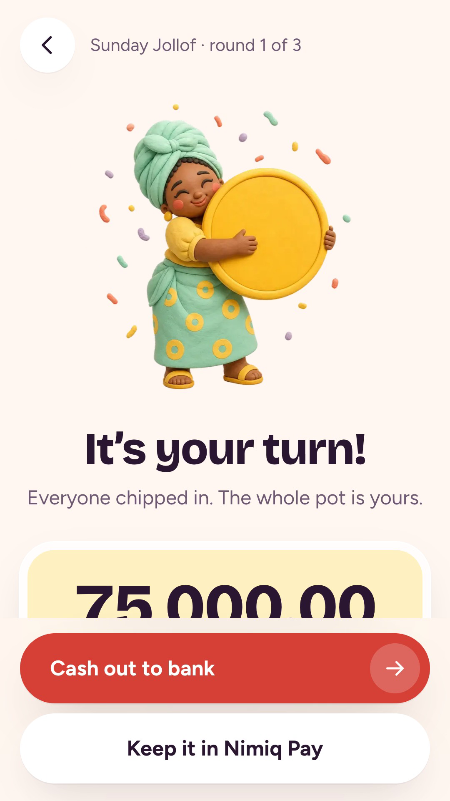

# AKilii

> Save with your people, right inside Nimiq Pay.

| Field | Value |
| --- | --- |
| Category | Save |
| Pricing | Freemium |
| Team name | _Not provided — optional_ |
| Team members | _Not provided — optional_ |
| X account | Real_sweetone |
| Heard about it via | Skool |
| Contact email | Petersoncaleb275@gmail.com |
| GitHub login | @Calebux |
| Submitted at | 2026-11-01T07:50:23.683Z |

## Links

| Link | URL |
| --- | --- |
| Repo | [https://github.com/Calebux/nimiq-circle](<https://github.com/Calebux/nimiq-circle>) |
| Demo | [https://akilii.xyz](<https://akilii.xyz>) |
| Video | [https://youtube.com/shorts/Umc2TkJ83Dw?feature=share](<https://youtube.com/shorts/Umc2TkJ83Dw?feature=share>) |
| Skool post | [https://www.skool.com/miniappscompetition/title-akilii-is-live-your-savings-circle-now-inside-nimiq-pay?p=3b0ca52e](<https://www.skool.com/miniappscompetition/title-akilii-is-live-your-savings-circle-now-inside-nimiq-pay?p=3b0ca52e>) |
| Social post | _Not provided — optional_ |

## Description

▎ Akilii brings the savings circle (ajo, esusu, tanda, susu, chama) to Nimiq Pay: friends you trust chip in NIM or USDT each round, one person takes the whole pot, waiting NIM earns staking rewards, and payouts cash out to any Nigerian bank via KhalkosPay. Saving alone? Lock mone

## Builder story

_Not provided — optional_

## Thumbnail

## Screenshots

---

_Generated from the submission form. `submission.yaml` in this folder is the machine-readable source of truth._
