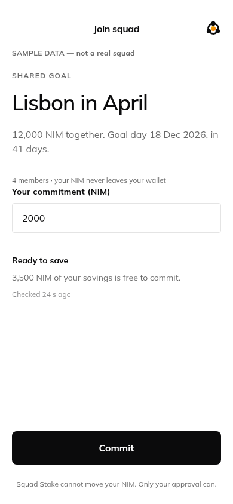
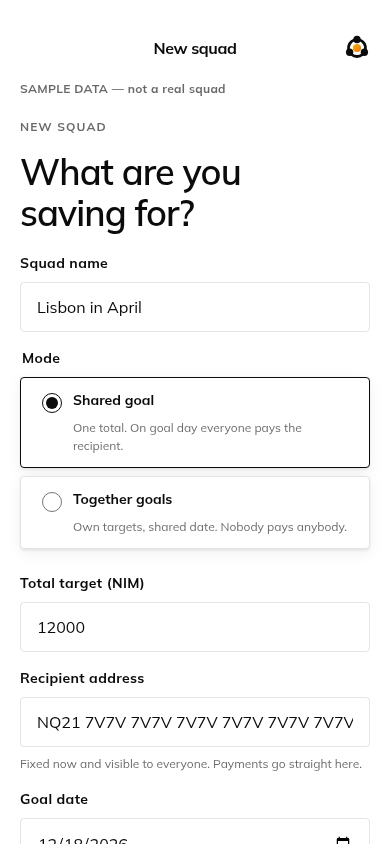
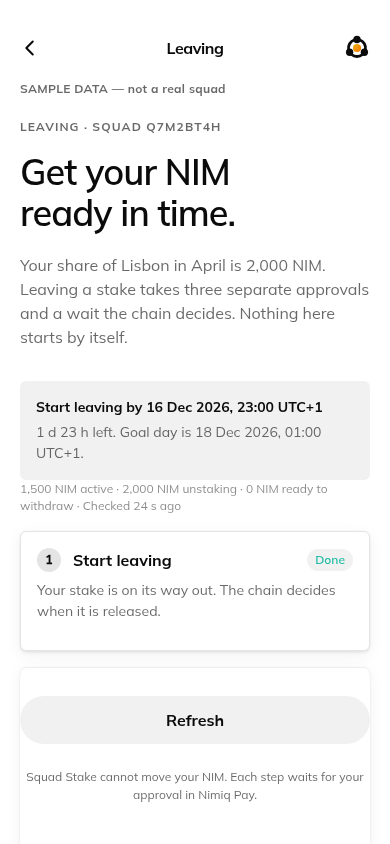
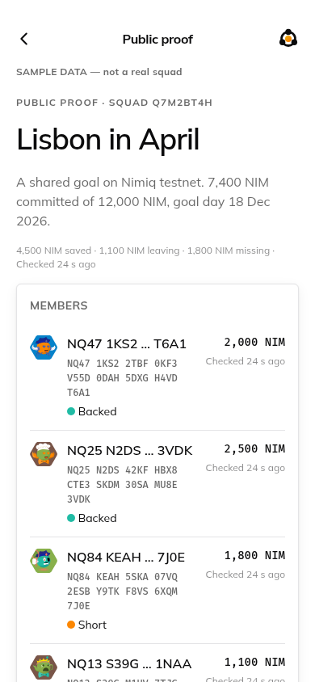
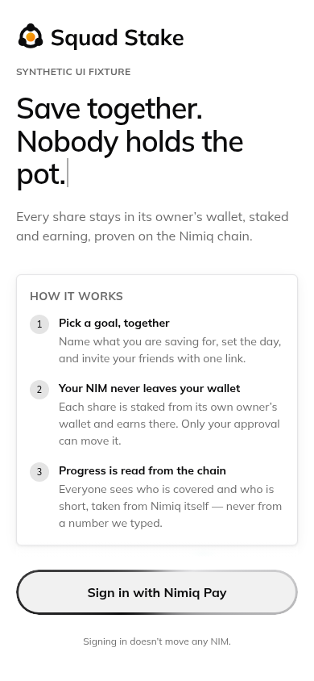

# SquadStake

> Pool goals, not money.

| Field | Value |
| --- | --- |
| Category | Save |
| Pricing | Free |
| Team name | _Not provided — optional_ |
| Team members | _Not provided — optional_ |
| X account | x.com/LazyGenius_1st |
| Heard about it via | x |
| Contact email | aghaken25@gmail.com |
| GitHub login | @DrApkFile |
| Submitted at | 2026-11-11T07:07:46.297Z |

## Links

| Link | URL |
| --- | --- |
| Repo | [https://github.com/DrApkFile/Squad-Stake](<https://github.com/DrApkFile/Squad-Stake>) |
| Demo | [https://squad-stake.vercel.app](<https://squad-stake.vercel.app>) |
| Video | [https://youtu.be/iYhnj-aDvJ8?si=fzeg75IsQTfvyto5](<https://youtu.be/iYhnj-aDvJ8?si=fzeg75IsQTfvyto5>) |
| Skool post | _Not provided — optional_ |
| Social post | [https://x.com/LazyGenius_1st/status/2120398049759703197?a=ydPkdgvcoDbUTDK-21g&s=20](<https://x.com/LazyGenius_1st/status/2120398049759703197?a=ydPkdgvcoDbUTDK-21g&s=20>) |

## Description

Groups save together without one person holding the money. Each member’s share stays staked in their own Nimiq wallet, earning while they wait, and everyone’s progress is verified on-chain. For friends, families and anyone saving as a group.

## Builder story

_Not provided — optional_

## Thumbnail

## Screenshots

---

_Generated from the submission form. `submission.yaml` in this folder is the machine-readable source of truth._
