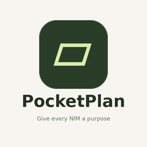
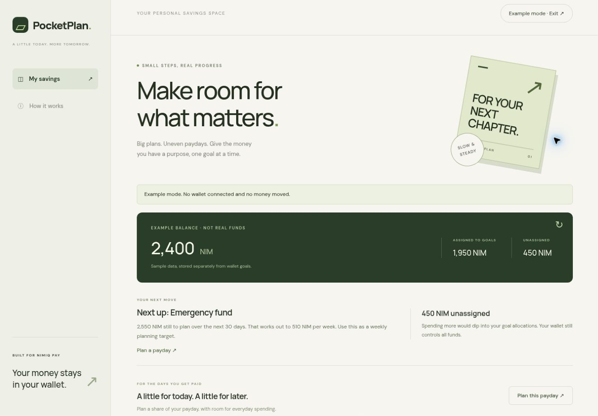
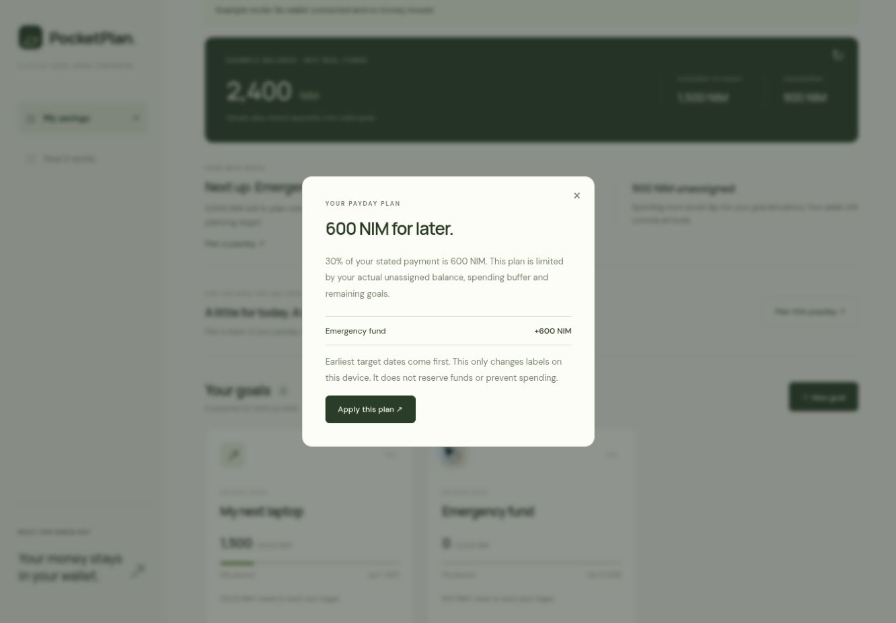
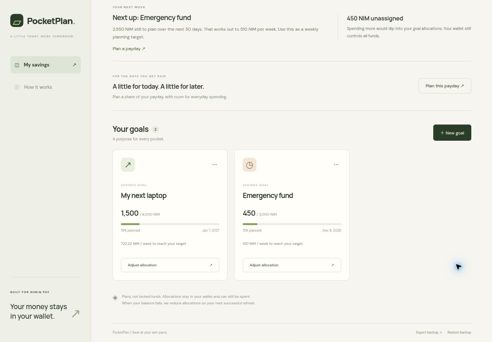
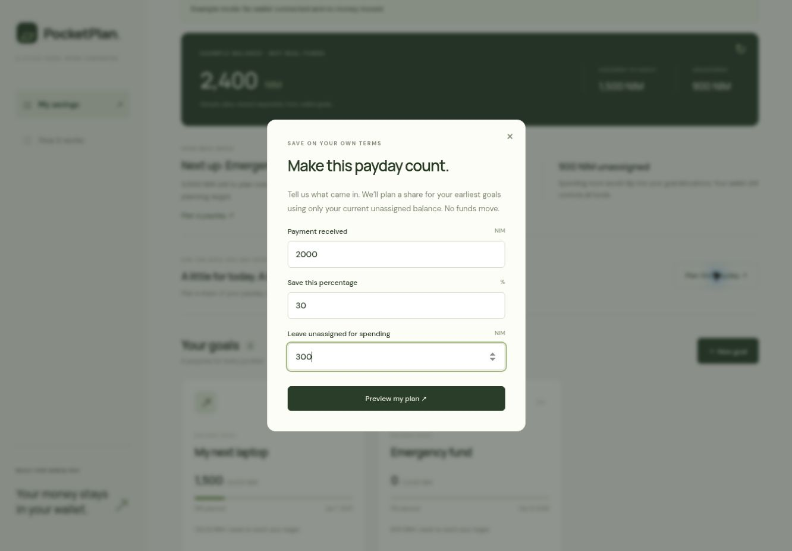

# PocketPlan

> Give every NIM a purpose

| Field | Value |
| --- | --- |
| Category | Save |
| Pricing | Free |
| Team name | _Not provided — optional_ |
| Team members | _Not provided — optional_ |
| X account | areyourcrrypt |
| Heard about it via | _Not provided — optional_ |
| Contact email | areyourmedayanth@gmail.com |
| GitHub login | @Fraeiy |
| Submitted at | 2026-11-11T07:26:41.981Z |

## Links

| Link | URL |
| --- | --- |
| Repo | [https://github.com/Fraeiy/pocketplan](<https://github.com/Fraeiy/pocketplan>) |
| Demo | [https://pocketplan-psi.vercel.app/](<https://pocketplan-psi.vercel.app/>) |
| Video | [https://vimeo.com/1245708850](<https://vimeo.com/1245708850>) |
| Skool post | _Not provided — optional_ |
| Social post | [https://x.com/areyourcrrypt/status/2120417710198907347](<https://x.com/areyourcrrypt/status/2120417710198907347>) |

## Description

PocketPlan helps you plan savings around uneven paydays by connecting to Nimiq Pay. Create goals, prioritize upcoming deadlines, and allocate your balance toward what matters most without locking your funds.

## Builder story

I’m a computer engineering student in Nigeria who builds practical tools. With irregular income, knowing your balance doesn’t always tell you what you can afford to spend. I built PocketPlan to make that clearer: give existing NIM a purpose, work toward specific goals and keep room for everyday expenses

## Thumbnail

## Screenshots

---

_Generated from the submission form. `submission.yaml` in this folder is the machine-readable source of truth._
