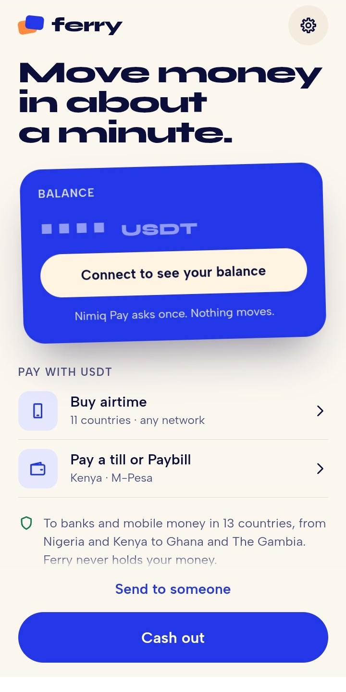
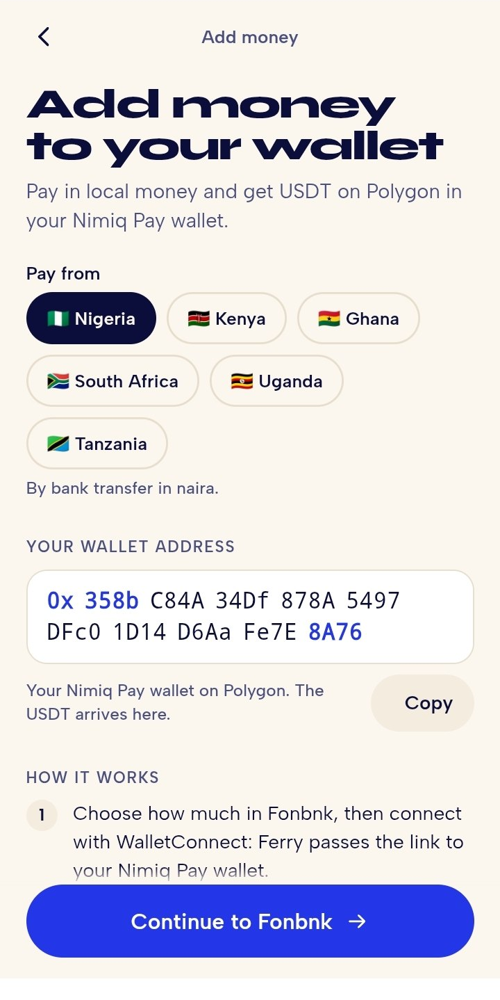
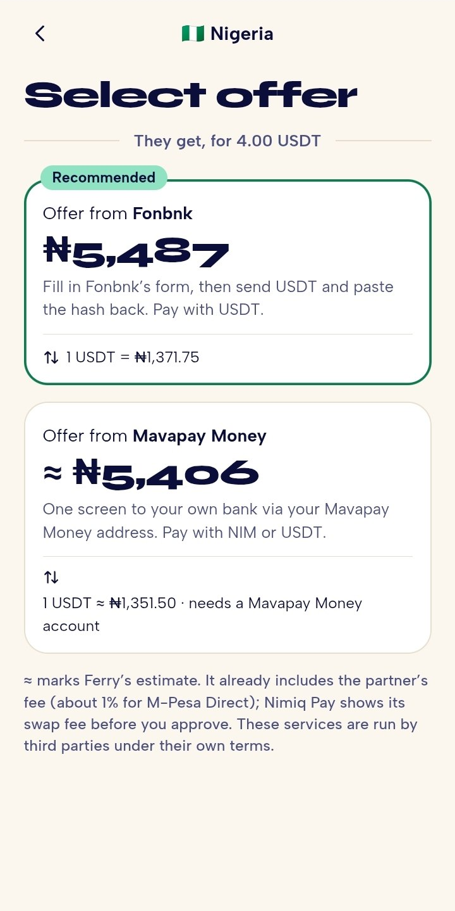
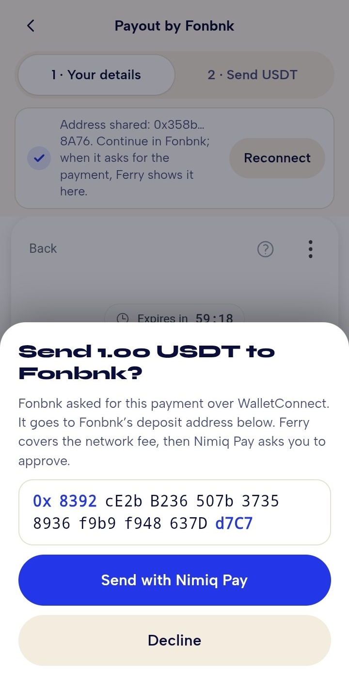
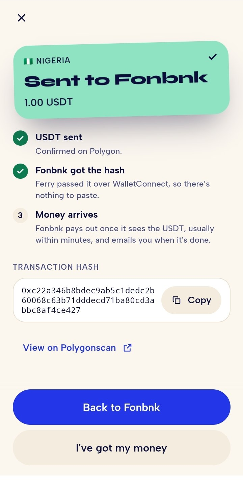

# Ferry

> Your crypto, spendable where you live.

| Field | Value |
| --- | --- |
| Category | On/Off-Ramp |
| Pricing | Free |
| Team name | Team Aurora |
| Team members | _Not provided — optional_ |
| X account | ola_nuell |
| Heard about it via | X |
| Contact email | emmanuelolamiye@gmail.com |
| GitHub login | @Manuel-dev01 |
| Submitted at | 2026-11-09T10:59:01.885Z |

## Links

| Link | URL |
| --- | --- |
| Repo | [https://github.com/Manuel-dev01/ferry](<https://github.com/Manuel-dev01/ferry>) |
| Demo | [https://ferry-beta.vercel.app/](<https://ferry-beta.vercel.app/>) |
| Video | [https://youtu.be/1jK75IjuX-M](<https://youtu.be/1jK75IjuX-M>) |
| Skool post | [https://www.skool.com/miniappscompetition/ferry-is-live?p=7f37de10](<https://www.skool.com/miniappscompetition/ferry-is-live?p=7f37de10>) |
| Social post | [https://x.com/ola_nuell/status/2119726284121030869?s=20](<https://x.com/ola_nuell/status/2119726284121030869?s=20>) |

## Description

Ferry lets you cash out USDT or NIM to banks, mobile money and airtime in 13 countries, or add money by bank transfer, without leaving Nimiq Pay. It's self-custodial: funds go straight from your wallet to the payout partner, with one approval and gas covered.

## Builder story

I live where crypto and everyday money don't meet easily. Rent, school fees and airtime get paid in naira or shillings, not USDT. Nimiq Pay made holding NIM and USDT simple, but getting it out still meant leaving the wallet for an exchange or a P2P trade with a stranger. That gap is what Ferry closes.

I set one rule from day one: Ferry never touches the money. Funds go straight from your wallet to the payout partner, every payment needs your tap, and nothing pops up on page load.

The hardest part was a wall I didn't expect. Fonbnk's form only connects wallets over WalletConnect, and Nimiq Pay can't do that inside Fonbnk's frame. So Ferry became that wallet: you copy a link, paste it, approve once, and Ferry hands the transaction hash back automatically.

The first real payout landed in a Nigerian bank on October 28. Since then, real people have cashed out through Ferry, and every cash-out is public on Proof of Ferry.

## Thumbnail

## Screenshots

---

_Generated from the submission form. `submission.yaml` in this folder is the machine-readable source of truth._
