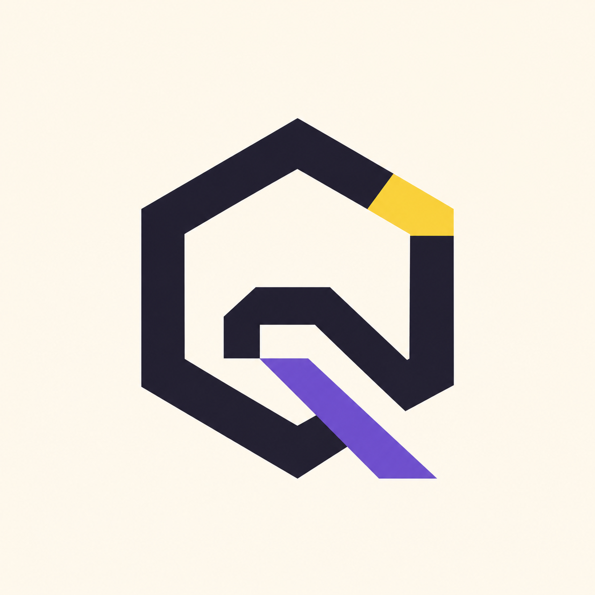
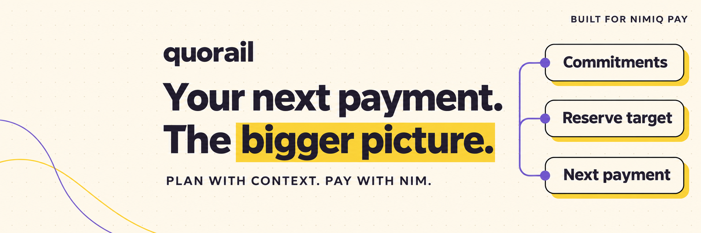
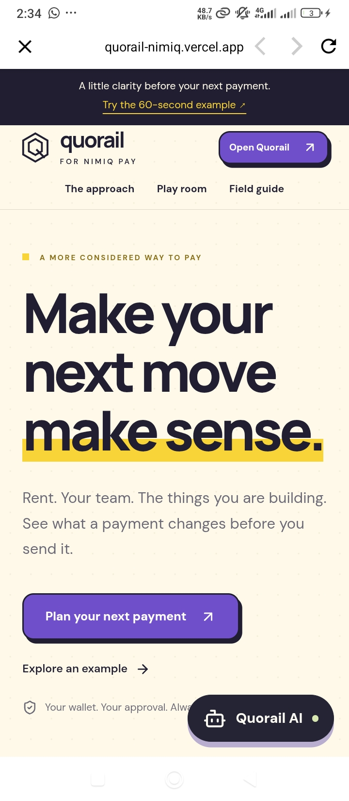
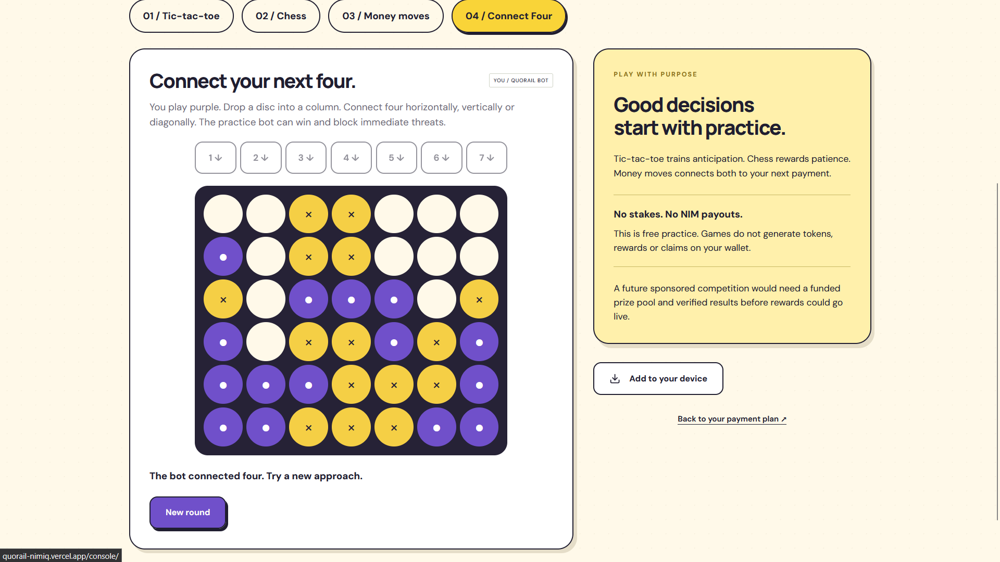
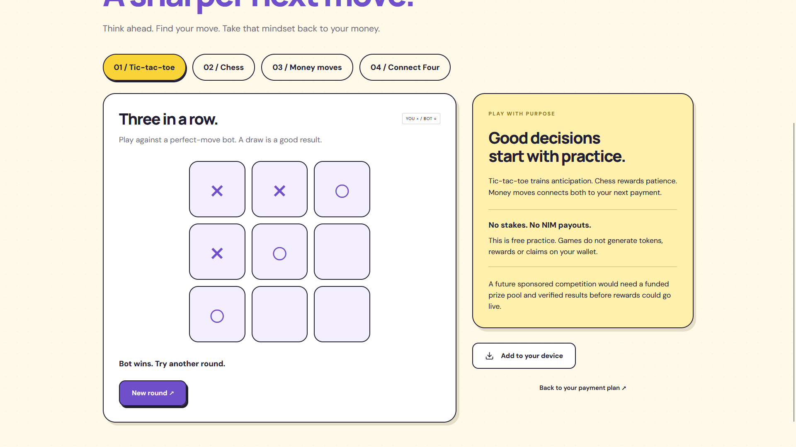
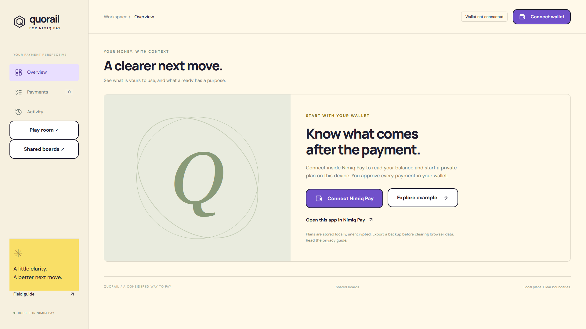
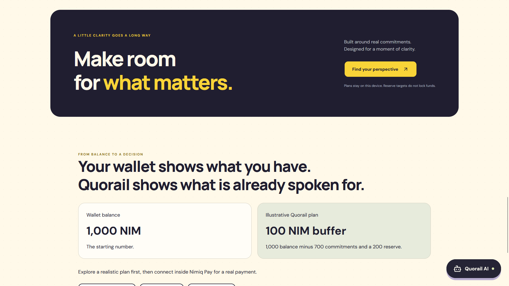

# Quorail

> Know what your next NIM payment leaves behind.

| Field | Value |
| --- | --- |
| Category | Pay |
| Pricing | Free |
| Team name | Team Quorail |
| Team members | Jayking, Web3Supporter, Angel Rapture, Mount Josh |
| X account | Quorail @__official__1, @angelraptunde, @instators |
| Heard about it via | Nimiq community and X |
| Contact email | Pauljayking1@gmail.com |
| GitHub login | @Paulos-ui |
| Submitted at | 2026-11-11T14:03:03.739Z |

## Links

| Link | URL |
| --- | --- |
| Repo | [https://github.com/Paulos-ui/quorail-nimiq](<https://github.com/Paulos-ui/quorail-nimiq>) |
| Demo | [https://quorail-nimiq.vercel.app/](<https://quorail-nimiq.vercel.app/>) |
| Video | [https://vimeo.com/1245614859?share=copy&fl=sv&fe=ci](<https://vimeo.com/1245614859?share=copy&fl=sv&fe=ci>) |
| Skool post | _Not provided — optional_ |
| Social post | [https://x.com/__Official__1/status/2120471845635871012](<https://x.com/__Official__1/status/2120471845635871012>) |

## Description

Quorail helps freelancers, independent builders and small teams plan NIM payments around upcoming commitments and reserve targets. Preview each payment’s impact before approving it inside Nimiq Pay, then track its on-chain receipt alongside your plan.

## Builder story

We are a team of five builders collaborating across different countries, backgrounds, and time zones. Our team includes Jayking (Software Engineer), Angelraptumde (Software Engineer, UK), Web3 Supporter (Marketing and Community), Skiii Josh (Builder, Germany), and our fifth contributor.

We came together around a shared belief: cryptocurrency payments should be more than sending and receiving funds. They should help people make informed financial decisions and we have a strong decision building on Nimiq.

The Problem We Wanted to Solve

Traditional crypto wallets show balances and transaction histories, but they rarely account for upcoming responsibilities.

A freelancer might have enough NIM to make a payment today without realizing that rent, subscriptions, or team expenses are approaching tomorrow.

The problem isn't necessarily a lack of money. It's a lack of financial context before making a payment.

What We Built

Quorail connects payment planning with Nimiq Pay, allowing users to track commitments, establish reserve targets, preview payment consequences, manage recurring expenses, and verify transactions.

We also introduced Quorail AI, an optional assistant that helps users explore financial scenarios without controlling their funds.

For teams, shared planning and collection tools make coordinating responsibilities easier.

Throughout development, we focused on one principle: users must always retain control of their wallets and payment approvals.

Why It Matters

Our ambition is to make Quorail more than another Web3 dashboard.

We want it to become a practical financial companion for creators, freelancers, builders, and everyday Nimiq users.

Building across borders taught us the importance of collaboration, but it also reinforced why accessible, user-controlled payment tools matter.

We didn't build Quorail to replace your wallet. We built it to make the decisions around your next payment clearer.

Quorail. Your next payment. The bigger picture.

## Thumbnail

## Screenshots

---

_Generated from the submission form. `submission.yaml` in this folder is the machine-readable source of truth._
