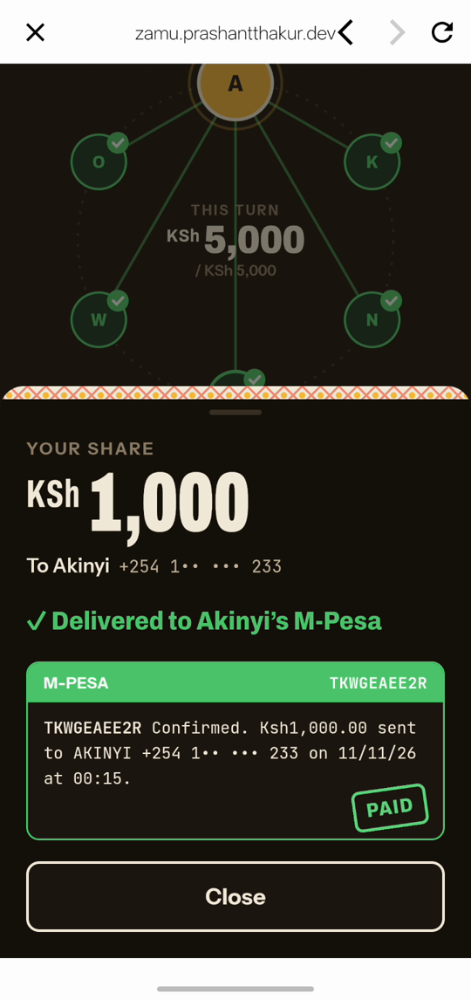
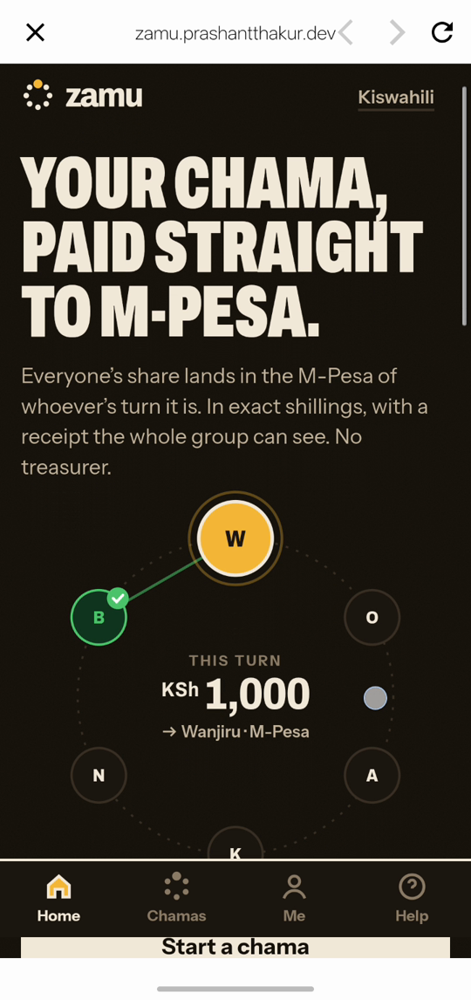
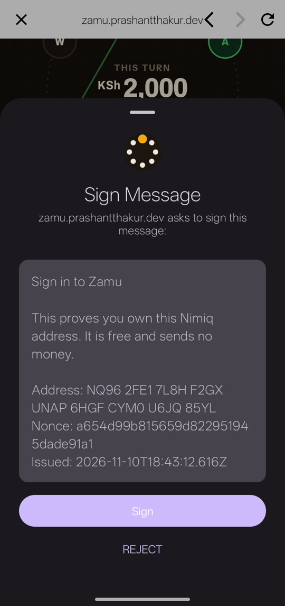
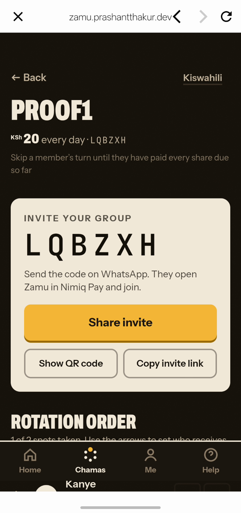
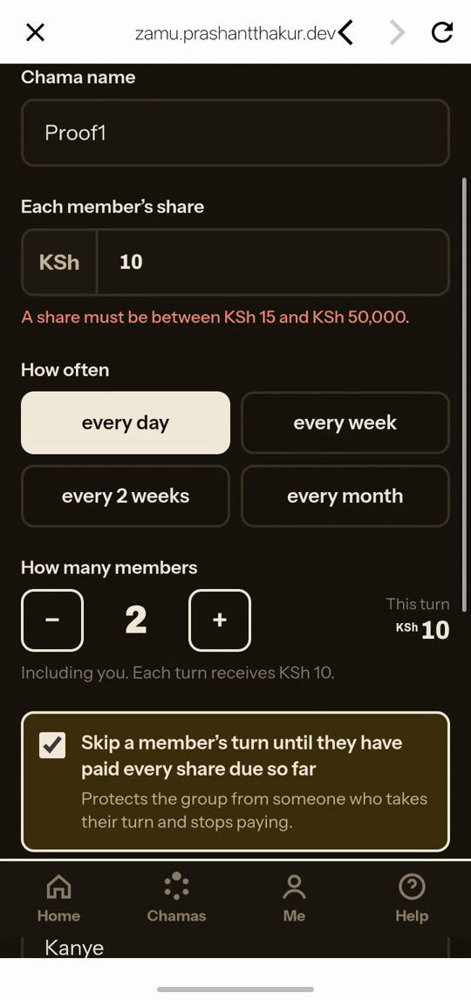

# Zamu

> Your chama, paid straight to M-Pesa.

| Field | Value |
| --- | --- |
| Category | Save |
| Pricing | Free |
| Team name | _Not provided — optional_ |
| Team members | _Not provided — optional_ |
| X account | 2730Thakur12618 |
| Heard about it via | Nimiq Community |
| Contact email | prashant101007@gmail.com |
| GitHub login | @Prashant-thakur77 |
| Submitted at | 2026-11-10T19:38:16.280Z |

## Links

| Link | URL |
| --- | --- |
| Repo | [https://github.com/Prashant-thakur77/Zamu](<https://github.com/Prashant-thakur77/Zamu>) |
| Demo | [https://zamu.prashantthakur.dev](<https://zamu.prashantthakur.dev>) |
| Video | [https://youtu.be/l7_HeIk76Ig](<https://youtu.be/l7_HeIk76Ig>) |
| Skool post | [https://www.skool.com/miniappscompetition/zamu-a-chama-that-pays-straight-to-m-pesa-save?p=8f616483](<https://www.skool.com/miniappscompetition/zamu-a-chama-that-pays-straight-to-m-pesa-save?p=8f616483>) |
| Social post | [https://x.com/2730Thakur12618/status/2120233985637060966](<https://x.com/2730Thakur12618/status/2120233985637060966>) |

## Description

A chama (Kenyan rotating savings group) inside Nimiq Pay: each round, members pay with NIM or USDT and the shillings land straight in the M-Pesa of whoever's turn it is, with a receipt the whole group sees. For Kenyan and diaspora chamas who want to save together without trusting

## Builder story

Chamas are how millions of Kenyans save, but almost every one depends on a single treasurer holding the money. I wanted the money to go straight from each member to whoever's turn it is, with proof everyone can see. Zamu uses Nimiq Pay's payLightningInvoice to turn NIM or USDT into shillings in M-Pesa, signed agreements with nimiq.sign(), and a skip rule so nobody can take their turn and stop paying.

## Thumbnail

## Screenshots

---

_Generated from the submission form. `submission.yaml` in this folder is the machine-readable source of truth._
