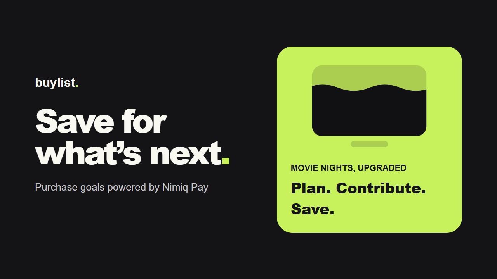
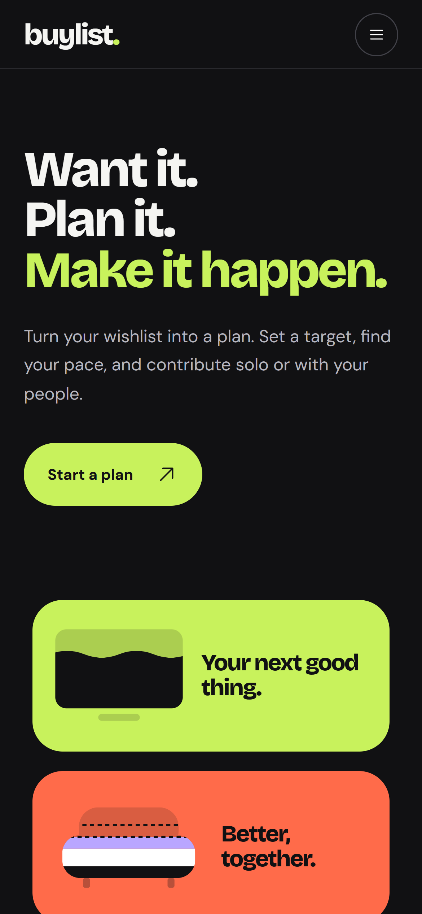
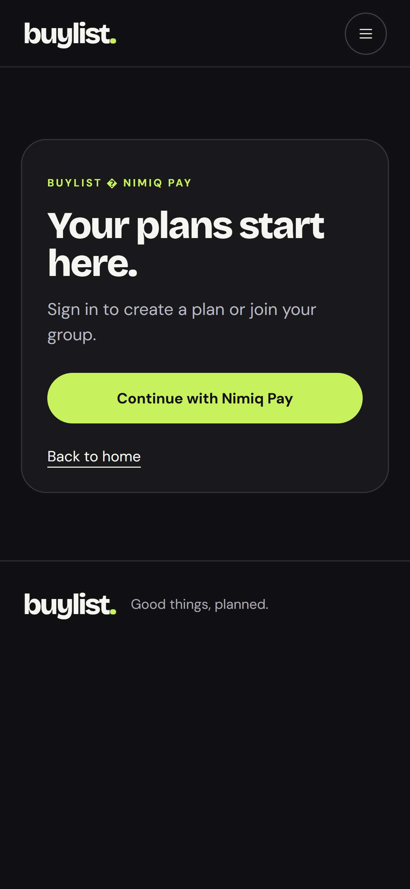
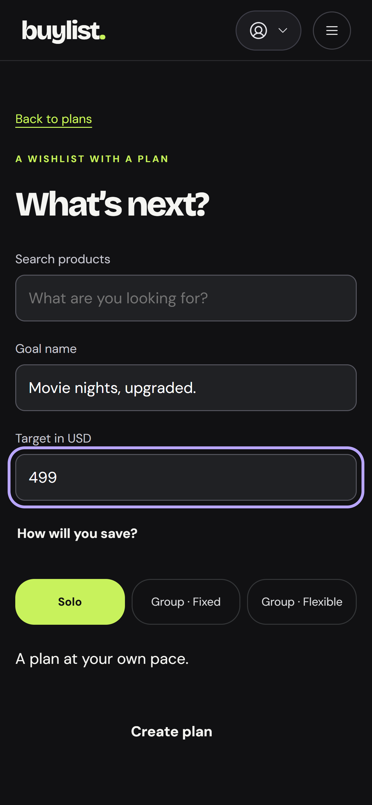
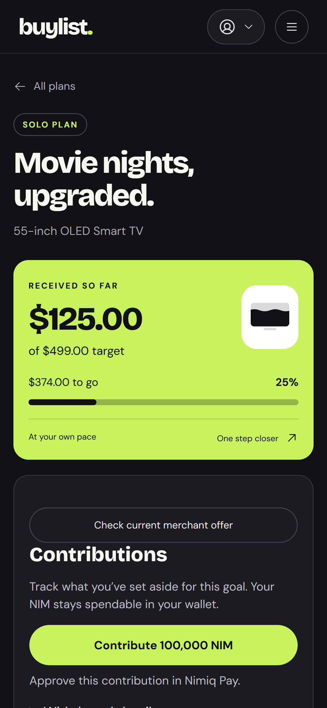
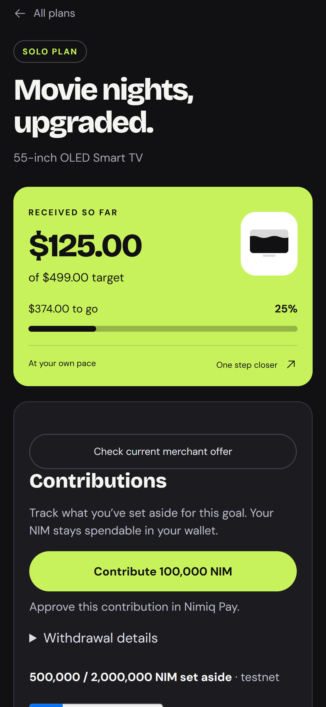

# BuyList.plan

> Want it, plan it, make it happen.

| Field | Value |
| --- | --- |
| Category | Save |
| Pricing | Free |
| Team name | _Not provided — optional_ |
| Team members | _Not provided — optional_ |
| X account | 0xrushya |
| Heard about it via | _Not provided — optional_ |
| Contact email | jadhav.rushikesh.ggl@gmail.com |
| GitHub login | @Rushikesh0125 |
| Submitted at | 2026-11-10T16:03:07.803Z |

## Links

| Link | URL |
| --- | --- |
| Repo | [https://github.com/Rushikesh0125/buylist-nimiq/tree/main](<https://github.com/Rushikesh0125/buylist-nimiq/tree/main>) |
| Demo | [https://buylist-nimiq-staging.jadhav-rushikesh-ggl.workers.dev](<https://buylist-nimiq-staging.jadhav-rushikesh-ggl.workers.dev>) |
| Video | [https://youtu.be/m3kf18gWBdY](<https://youtu.be/m3kf18gWBdY>) |
| Skool post | _Not provided — optional_ |
| Social post | _Not provided — optional_ |

## Description

Turn your wishlist into a plan. Set a target to save per week/month towards your wish. find your pace and contribute solo or with your people towards achieving your planned goal.

## Builder story

My TV started showing blue lines a few months ago. Money was tight, so I told myself I’d replace it next month. Four months later, the lines were still there, and the new TV was still on my list.

I knew what I wanted to buy and roughly what it would cost. What I didn’t have was a plan for how much to set aside or when I’d actually have enough. So I built Buylist to turn “I’ll buy it next month” into a savings goal with a schedule and a way to see my progress.

I built it into Nimiq Pay so each contribution can go directly into staking with the user’s approval. Buylist uses the schedule to suggest when to start unstaking, so the money has time to become available when it’s time to buy. The TV is still on my list. This time, it has a plan.

## Thumbnail

## Screenshots

---

_Generated from the submission form. `submission.yaml` in this folder is the machine-readable source of truth._
