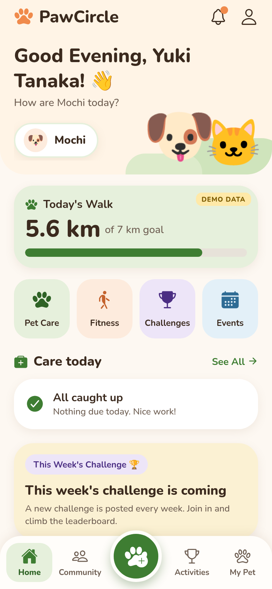
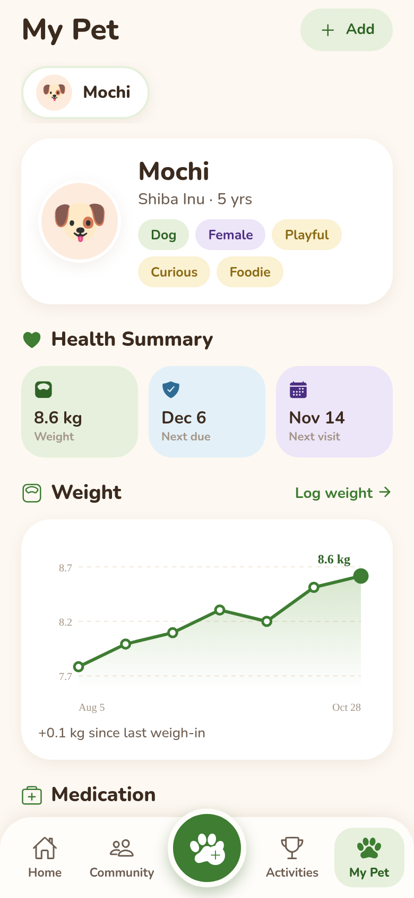
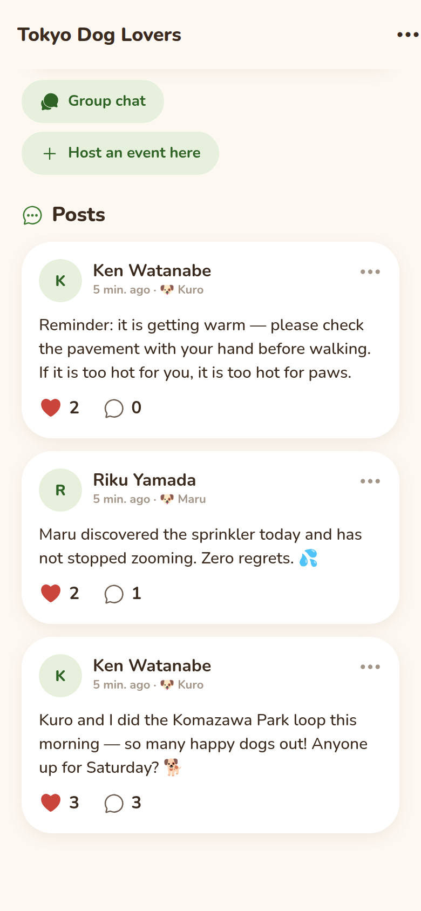
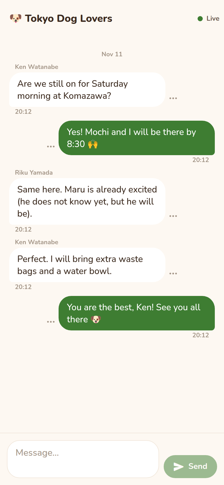
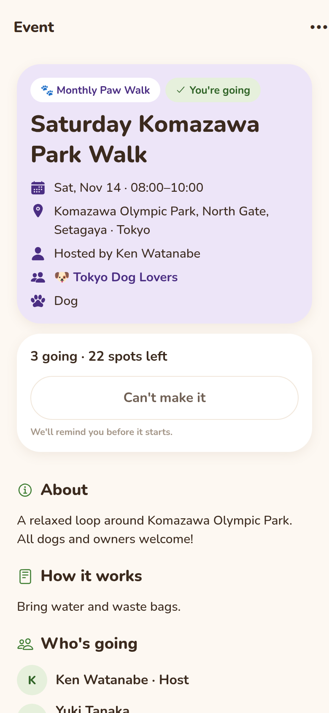

# PawCircle

> Your Pet's World, All in One Circle. 🐾

| Field | Value |
| --- | --- |
| Category | Off-theme |
| Pricing | Freemium |
| Team name | Totla |
| Team members | sujal das |
| X account | sujalda16406892 |
| Heard about it via | I hear it from my friend |
| Contact email | dassujal276@gmail.com |
| GitHub login | @Sujal-das-00 |
| Submitted at | 2026-11-11T11:24:20.466Z |

## Links

| Link | URL |
| --- | --- |
| Repo | [https://github.com/Sujal-das-00/pet-care.git](<https://github.com/Sujal-das-00/pet-care.git>) |
| Demo | [https://pet-care-btot.onrender.com](<https://pet-care-btot.onrender.com>) |
| Video | [https://youtu.be/ytndFDQKiQo?si=6rx2vmMPXcz7zEnr](<https://youtu.be/ytndFDQKiQo?si=6rx2vmMPXcz7zEnr>) |
| Skool post | [https://www.skool.com/miniappscompetition/introducing-pawcircle?p=e52b3429](<https://www.skool.com/miniappscompetition/introducing-pawcircle?p=e52b3429>) |
| Social post | [https://x.com/sujalda16406892/status/2120477071415861425?a=wU6IrU__WUTsTih4ClA&s=20](<https://x.com/sujalda16406892/status/2120477071415861425?a=wU6IrU__WUTsTih4ClA&s=20>) |

## Description

Pawcircle is an all-in-one pet wellness and community platform where pet parents can manage health reminders, track care, discover communities, join meetups, participate in challenges, and connect with fellow pet lovers. ❤️

## Builder story

The Story Behind Pawcircle 🐾

I've had a pet since I was very young. He was a dog, and honestly, he was more than just a pet to me. He was a part of my everyday life.Long story short

one day, he got sick, and unfortunately, I couldn't save him. Losing him hit me really hard. I felt a kind of emptiness that I couldn't really explain. I slowly stopped going out, stopped meeting friends, and just wanted to stay by myself.

My family and friends kept encouraging me to go outside, meet people, hang out, and get back to my normal life. At first, I didn't really feel like doing any of that, but eventually, I started going out again. Spending time with people, making new memories, and reconnecting with others helped me feel better.

That's when I realised how much happiness and energy pets bring into our lives, and how important it is to have people around us who understand that bond.

I started thinking about all the pet parents out there. 
How do they manage their pets' health? 
Where do they find other pet parents? 
Where can they take their pets, meet people, and create memories together?

And that's how Pawcircle started.

I wanted to build a place where pet parents could take better care of their pets, connect with other pet lovers, discover communities, attend meetups, participate in challenges, and simply enjoy life with their furry companions.

I lost a friend, but that experience gave me an idea to build something that could bring happiness to thousands of other pet parents.

That's what Pawcircle means to me. ❤️🐾

## Thumbnail

## Screenshots

---

_Generated from the submission form. `submission.yaml` in this folder is the machine-readable source of truth._
