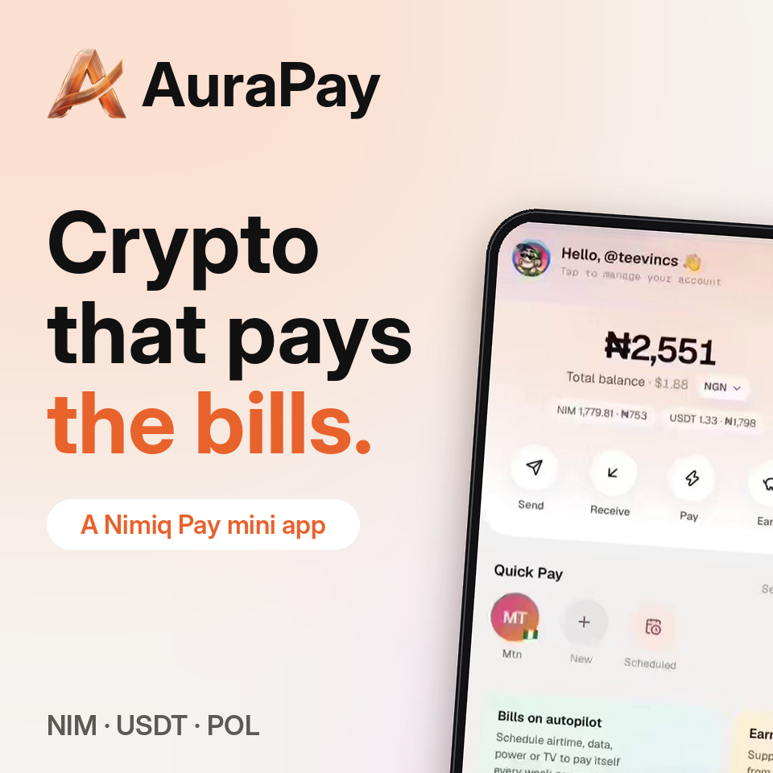
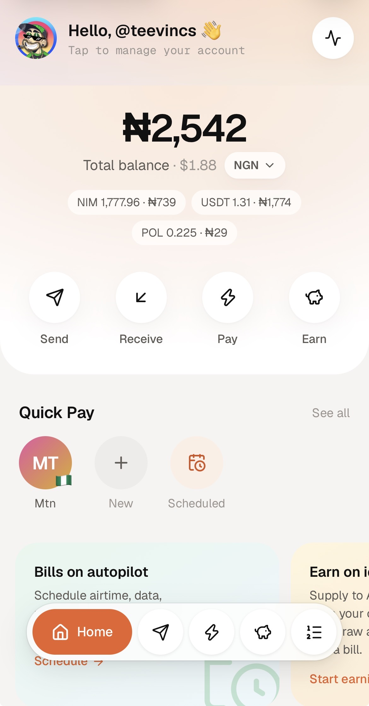
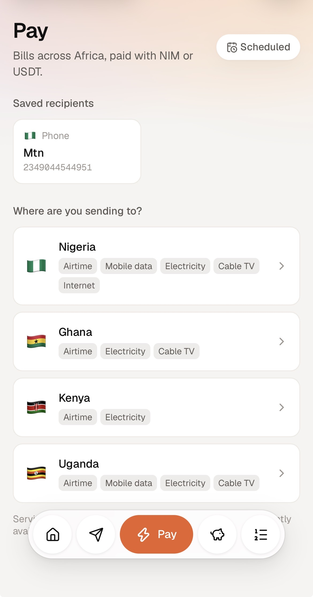
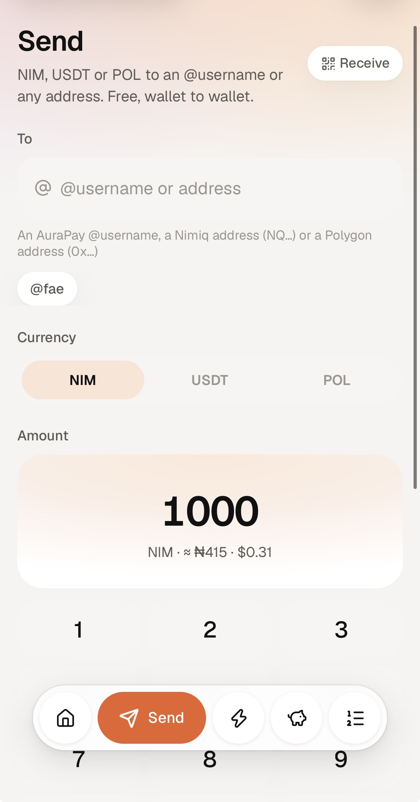
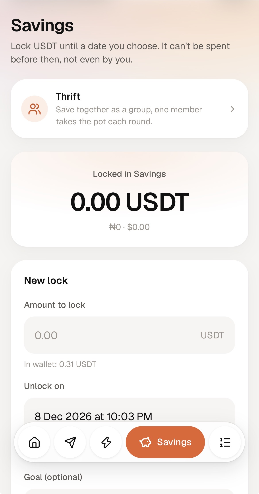
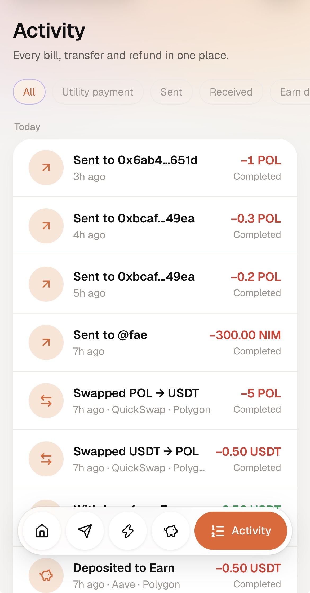

# AuraPay

> Your crypto, working for real life.

| Field | Value |
| --- | --- |
| Category | Save |
| Pricing | Free |
| Team name | _Not provided — optional_ |
| Team members | _Not provided — optional_ |
| X account | fwteevincs |
| Heard about it via | X |
| Contact email | teevincs@gmail.com |
| GitHub login | @TeevincsCrypt |
| Submitted at | 2026-11-08T21:31:41.760Z |

## Links

| Link | URL |
| --- | --- |
| Repo | [https://github.com/teevincscrypt/aurapay](<https://github.com/teevincscrypt/aurapay>) |
| Demo | [https://www.useaurapay.site/](<https://www.useaurapay.site/>) |
| Video | [https://youtu.be/9tIvuAcZQls?si=E5krJ1ZSBB88YWld](<https://youtu.be/9tIvuAcZQls?si=E5krJ1ZSBB88YWld>) |
| Skool post | _Not provided — optional_ |
| Social post | [https://x.com/useaurapay/status/2117011279286284612?s=46](<https://x.com/useaurapay/status/2117011279286284612?s=46>) |

## Description

AuraPay is a Nimiq Pay mini app for Africa: buy airtime, data, electricity and cable TV with NIM or USDT; send to @usernames or any address; save in time-locked vaults and group thrifts; earn yield on Aave; and swap on Polygon. All from your own wallet, with no AuraPay fees.

## Builder story

_Not provided — optional_

## Thumbnail

## Screenshots

---

_Generated from the submission form. `submission.yaml` in this folder is the machine-readable source of truth._
