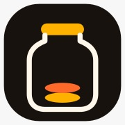
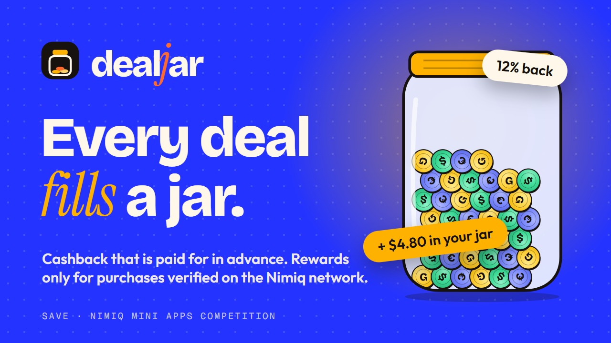
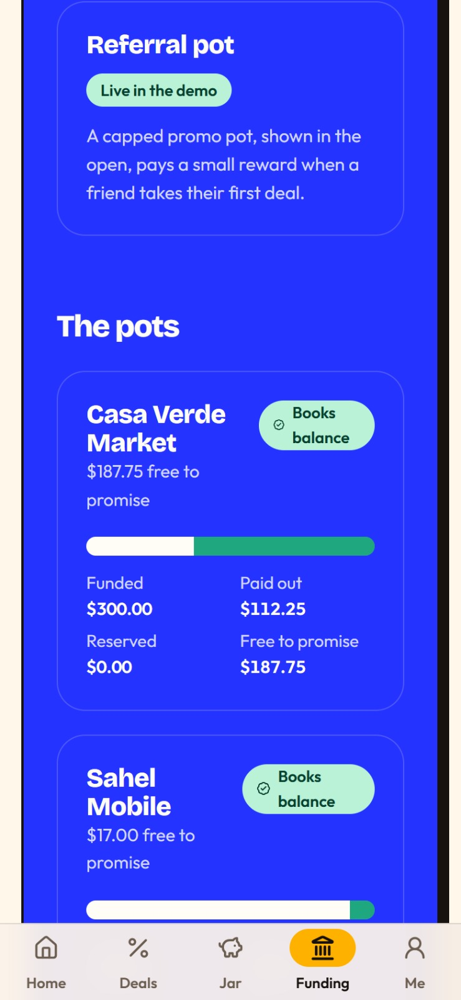
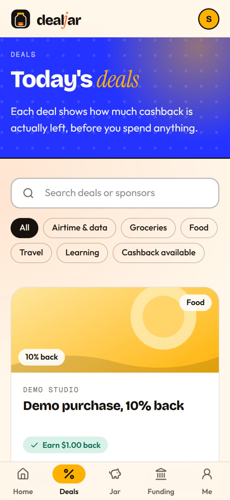
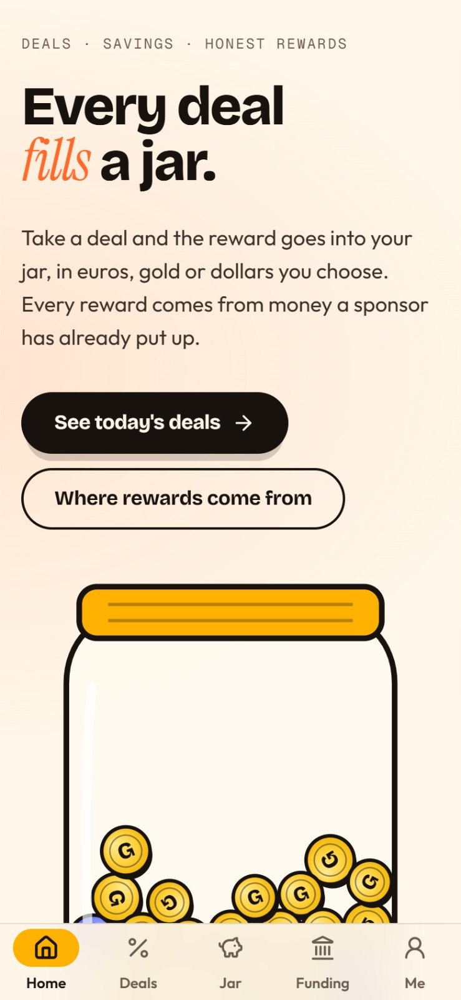
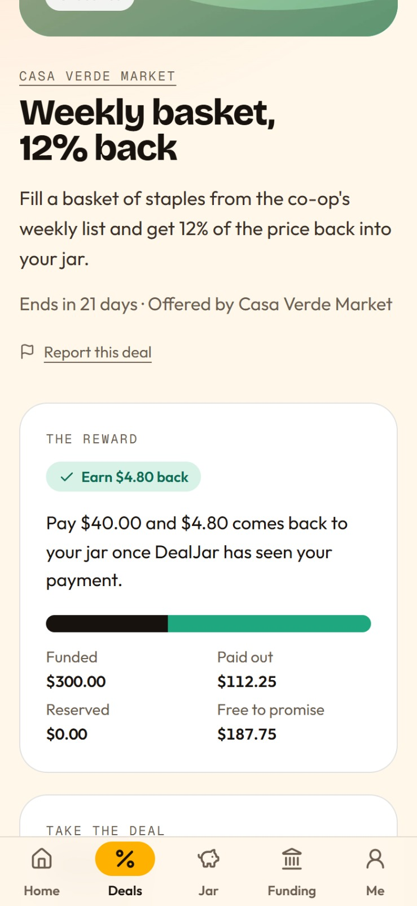

# DealJar

> Spend NIM. Stack rewards.

| Field | Value |
| --- | --- |
| Category | Save |
| Pricing | Free |
| Team name | _Not provided — optional_ |
| Team members | _Not provided — optional_ |
| X account | bylinespace |
| Heard about it via | X |
| Contact email | adam21426384@gmail.com |
| GitHub login | @adam21426384 |
| Submitted at | 2026-11-11T06:10:30.534Z |

## Links

| Link | URL |
| --- | --- |
| Repo | [https://github.com/adam21426384/Deal-Jar.git](<https://github.com/adam21426384/Deal-Jar.git>) |
| Demo | [https://dealjar.onrender.com/](<https://dealjar.onrender.com/>) |
| Video | [https://youtu.be/hohm7A_ioSo](<https://youtu.be/hohm7A_ioSo>) |
| Skool post | [https://www.skool.com/miniappscompetition/dealjar-is-live-spend-nim-stack-rewards](<https://www.skool.com/miniappscompetition/dealjar-is-live-spend-nim-stack-rewards>) |
| Social post | [https://x.com/bylinespace/status/2120397137737576531?a=b6xyFybz_RCZXZMslEw&s=20](<https://x.com/bylinespace/status/2120397137737576531?a=b6xyFybz_RCZXZMslEw&s=20>) |

## Description

pend NIM on a deal, earn cashback into your jar. Sponsors fund a visible pot before you spend a single coin. Every reward is verified on the Nimiq blockchain before it’s paid. Hold it in dollars, euros or gold, then cash out in NIM.

## Builder story

I spend a lot of time on deal sites and cashback apps. The pattern is always the same: you get a reward, it sits in some platform’s account, you need to hit a minimum before you can touch it, and by the time you cash out the platform has already made money off your balance sitting there.

I wanted to flip that. What if the cashback went straight into something you actually own, the moment the purchase was verified? No platform holding your money. No minimum. No mystery about whether the pot actually exists.

The hardest part of cashback is trust. You don’t know if the reward will actually pay out until you’ve already spent the money. So I built DealJar around one rule: a reward is only ever promised out of money a sponsor has already put in, and it’s only paid after the Nimiq blockchain confirms the purchase. The pot balance is visible before you spend anything. If the pot is empty, the deal says so.

The savings part came naturally. Once the cashback lands, most people just leave it. I added the jar so it doesn’t have to sit still. Hold it in dollars, move it into euros or gold, set a goal, cash out in NIM when you’re ready.

Nimiq Pay made this possible without building payment infrastructure from scratch. The wallet handles the hard part. I just had to build something worth paying for.

## Thumbnail

## Screenshots

---

_Generated from the submission form. `submission.yaml` in this folder is the machine-readable source of truth._
