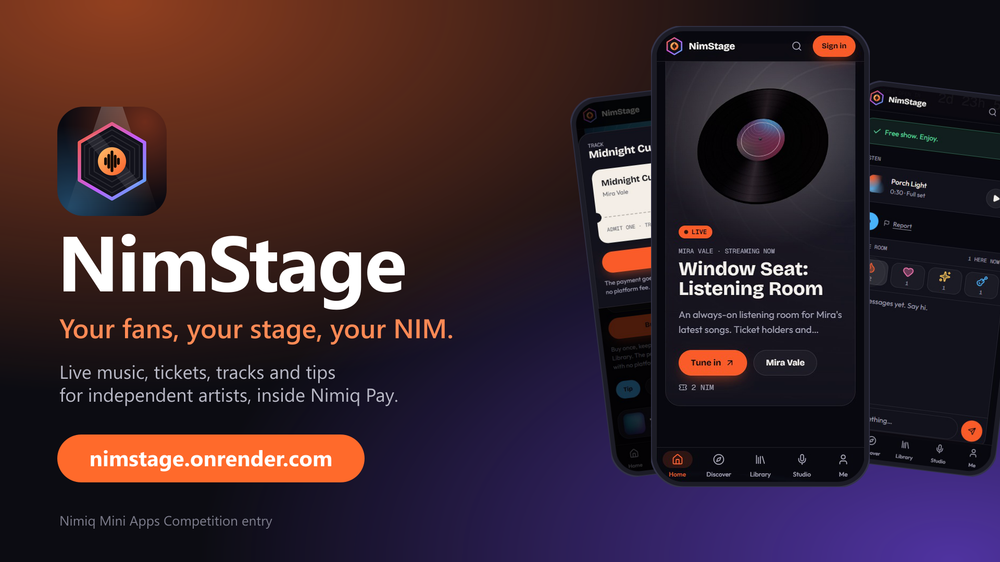
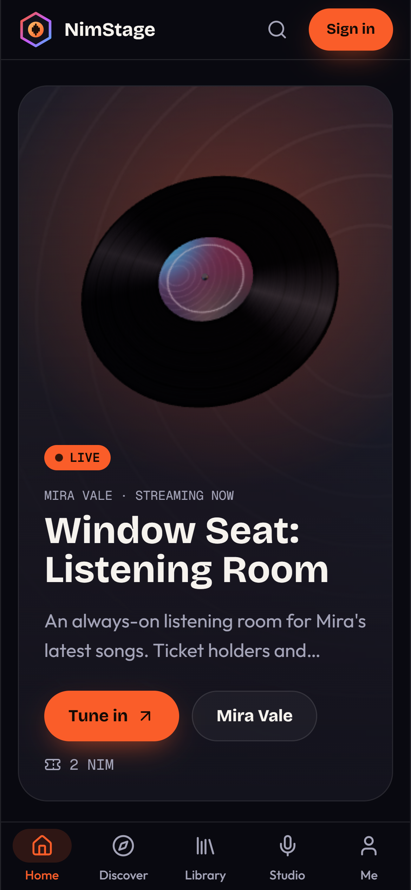
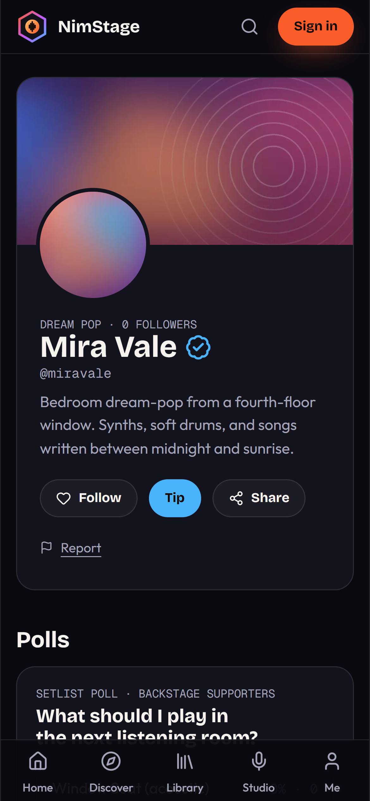
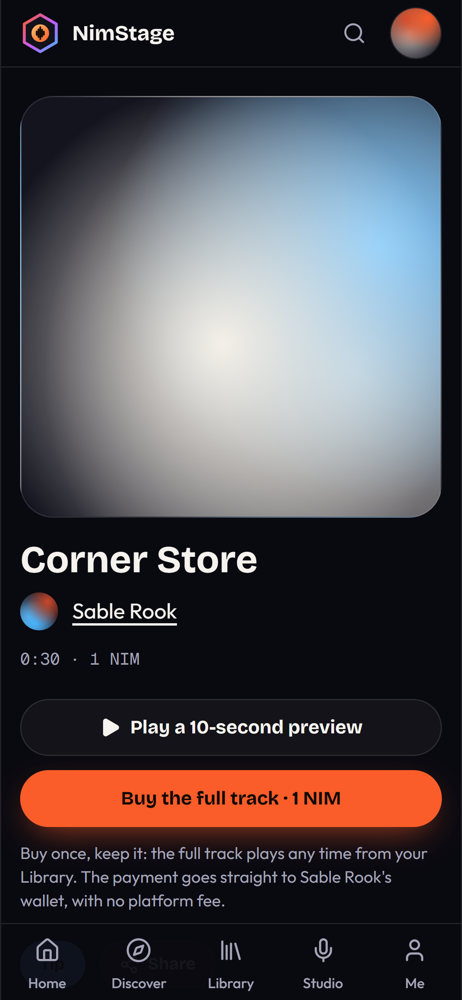
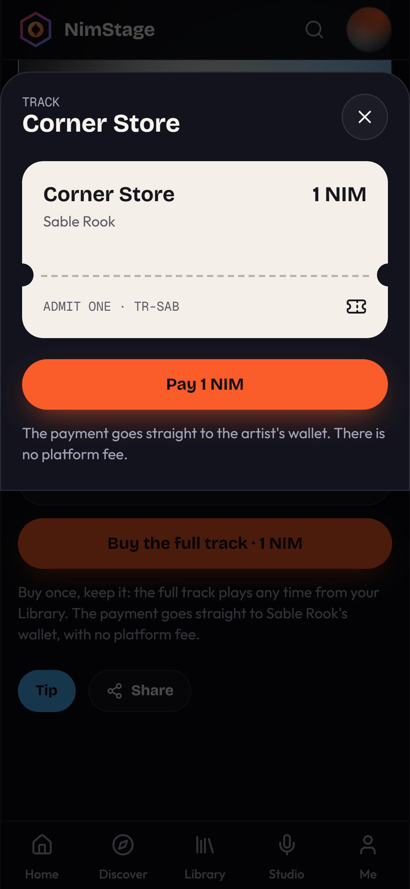
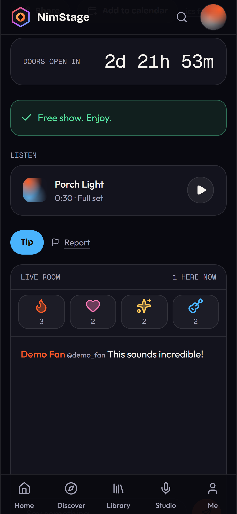

# NimStage

> Your fans, your stage, your NIM.

| Field | Value |
| --- | --- |
| Category | Earn |
| Pricing | Free |
| Team name | Mahmood |
| Team members | _Not provided — optional_ |
| X account | _Not provided — optional_ |
| Heard about it via | _Not provided — optional_ |
| Contact email | avaram.hasan@gmail.com |
| GitHub login | @avaramahmood |
| Submitted at | 2026-11-09T09:19:15.777Z |

## Links

| Link | URL |
| --- | --- |
| Repo | [https://github.com/avaramahmood/nimstage](<https://github.com/avaramahmood/nimstage>) |
| Demo | [https://nimstage.onrender.com/](<https://nimstage.onrender.com/>) |
| Video | [https://youtu.be/2W7IChLpXgc?si=VUnGRm7S03ViCtV7](<https://youtu.be/2W7IChLpXgc?si=VUnGRm7S03ViCtV7>) |
| Skool post | [https://www.skool.com/miniappscompetition/nimstage-your-fans-your-stage-your-nim?p=d56642e7](<https://www.skool.com/miniappscompetition/nimstage-your-fans-your-stage-your-nim?p=d56642e7>) |
| Social post | [https://www.instagram.com/reel/Dfg-5VnzrQk/?utm_source=ig_web_copy_link&cplk=NTc4MTIwNjQ2YQ==](<https://www.instagram.com/reel/Dfg-5VnzrQk/?utm_source=ig_web_copy_link&cplk=NTc4MTIwNjQ2YQ==>) |

## Description

NimStage is where independent musicians go live, sell tracks and tickets, and build a fanbase, all paid in NIM straight to their own wallet. There's no platform fee, so fans can back artists with any size of payments and artists keep every coin.

## Builder story

Many people are too hasty or shy to post themselves singing to the world because they have another image built that can be shattered with unexpected musical talent.
Indie producers, artists also struggle with engagement with just enough die hard fans to keep going but not enough revenue from platforms. Fans are willing to pay minismal amounts to support them but addition of platforms for money collection is another obstacle.

## Thumbnail

## Screenshots

---

_Generated from the submission form. `submission.yaml` in this folder is the machine-readable source of truth._
