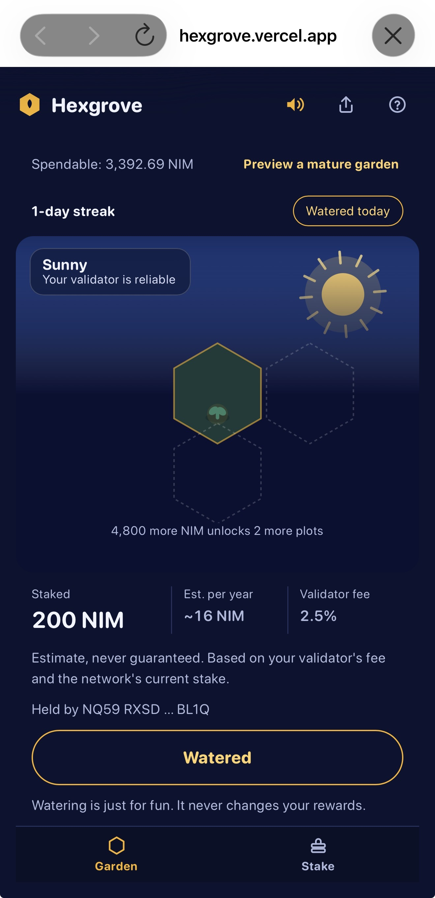
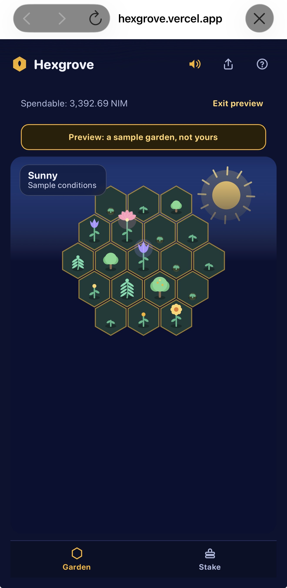
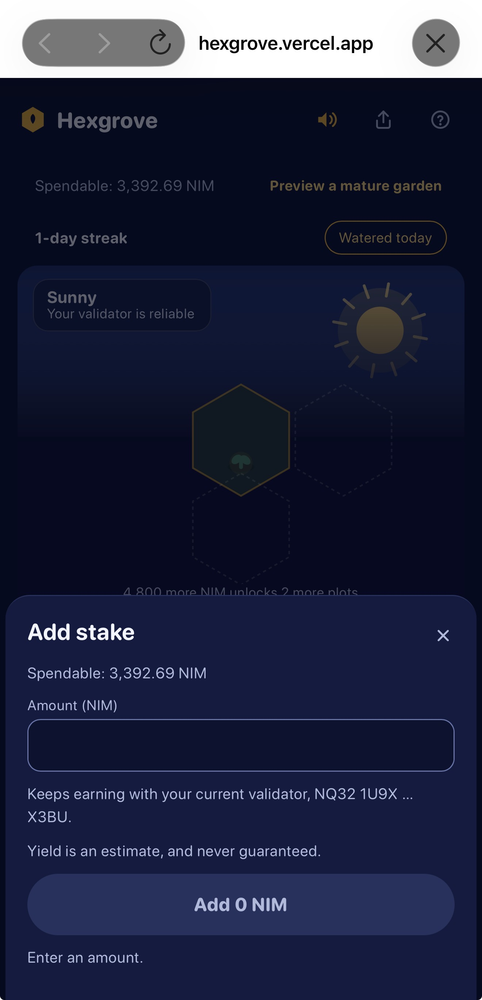
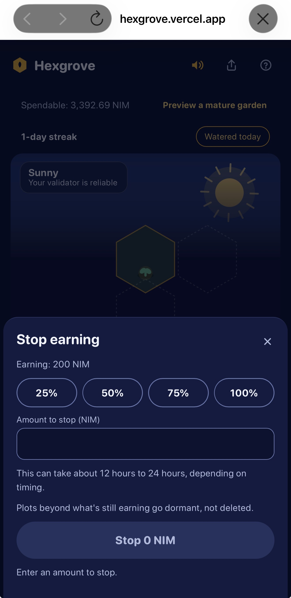
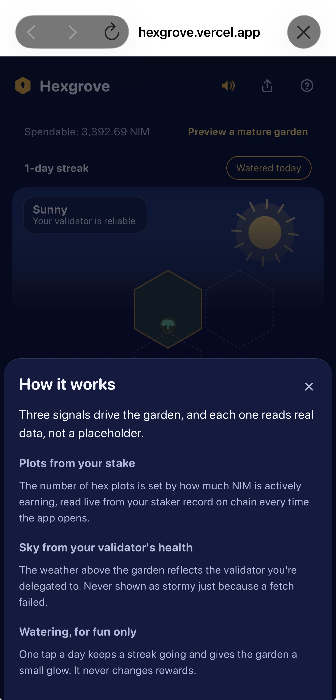

# Hexgrove

> Stake NIM. Grow a garden.

| Field | Value |
| --- | --- |
| Category | Earn |
| Pricing | Free |
| Team name | _Not provided — optional_ |
| Team members | _Not provided — optional_ |
| X account | bennytimz |
| Heard about it via | X |
| Contact email | oluwadare1803@gmail.com |
| GitHub login | @bennytimz |
| Submitted at | 2026-11-10T22:56:05.305Z |

## Links

| Link | URL |
| --- | --- |
| Repo | [https://github.com/bennytimz/hexgrove](<https://github.com/bennytimz/hexgrove>) |
| Demo | [https://hexgrove.vercel.app/](<https://hexgrove.vercel.app/>) |
| Video | [https://youtu.be/RklF3QWWHWY](<https://youtu.be/RklF3QWWHWY>) |
| Skool post | [https://www.skool.com/miniappscompetition/hexgrove-stake-nim-grow-a-garden?p=f07541b5](<https://www.skool.com/miniappscompetition/hexgrove-stake-nim-grow-a-garden?p=f07541b5>) |
| Social post | [https://x.com/bennytimz/status/2120182099713892513?s=46](<https://x.com/bennytimz/status/2120182099713892513?s=46>) |

## Description

Staking, add stake and balances verified on mainnet. Stop earning and withdraw verified end to end on testnet. Open source, MIT.

## Builder story

I'm a final-year pharmacy student and self-taught developer in Nigeria. I built Hexgrove to make staking feel less like a spreadsheet and more like something you tend. I verified the real flows myself: a live 200 NIM stake on mainnet, and the full stop-earning and withdraw cycle on testnet. Mainnet stop earning and withdraw are the one part I haven't been able to run yet, because of the 12 to 24 hour unstake wait, and I say so in the README rather than claim it. Since launch, Vercel Analytics (anonymous, no cookies, no wallet data) shows 9 visitors and 16 page views in the first day, a few of them from my own testing. The app is open source (MIT) and I plan to keep building it.

## Thumbnail

## Screenshots

---

_Generated from the submission form. `submission.yaml` in this folder is the machine-readable source of truth._
