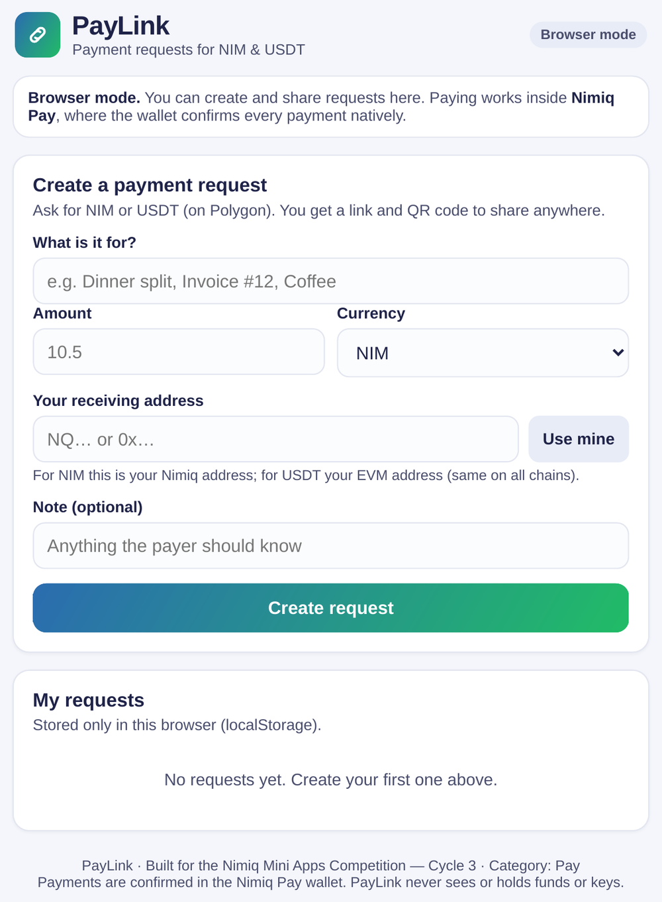
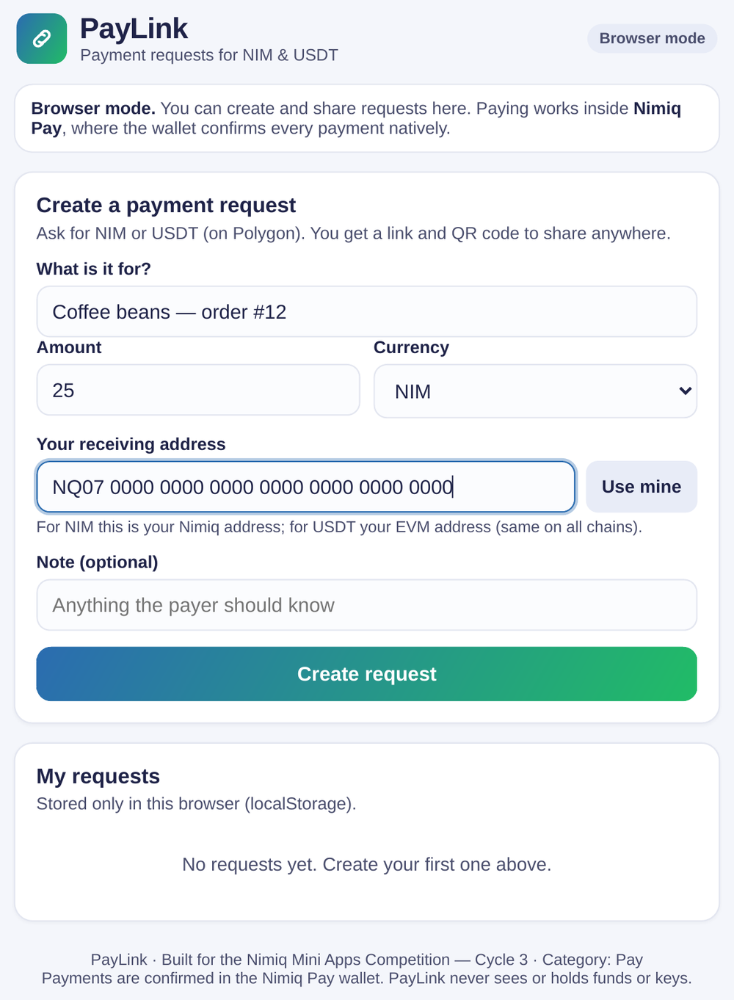
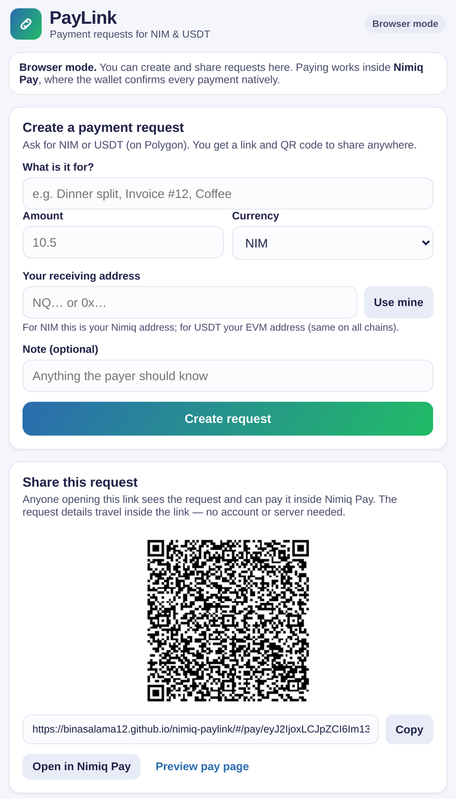
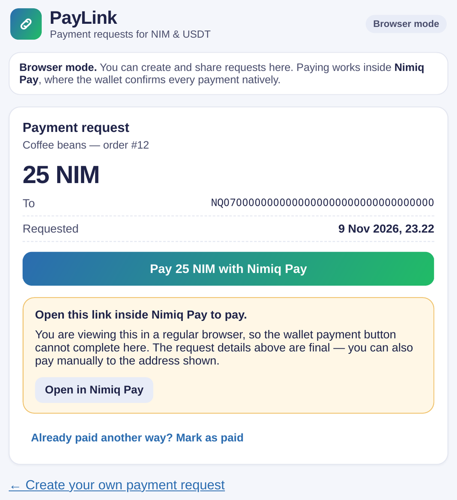
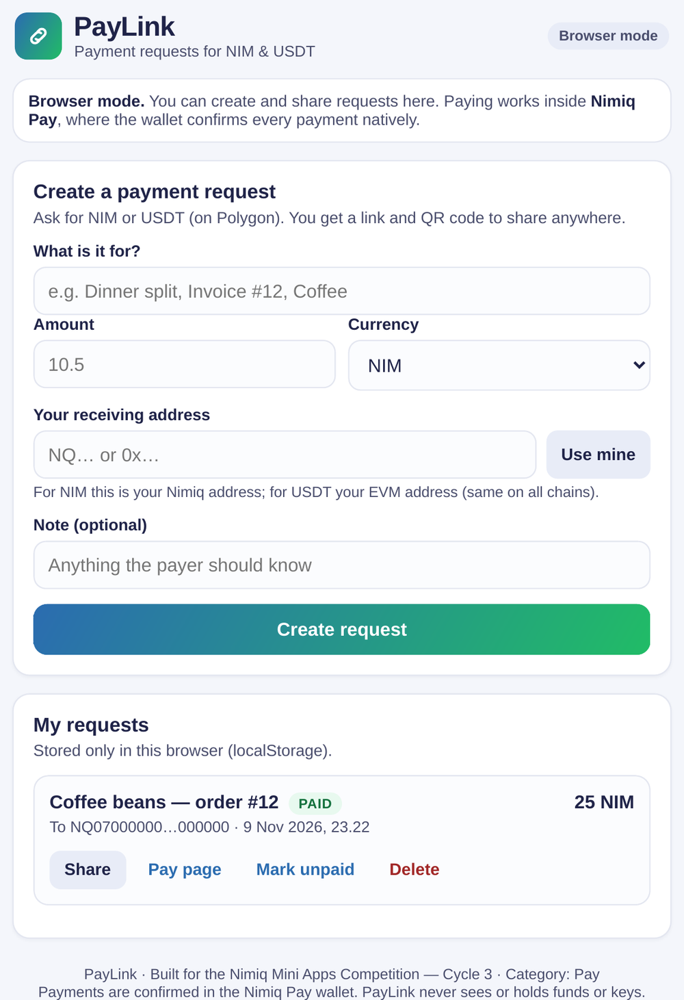

# PayLink — Nimiq Payment Requests

> Payment requests as a link: create, share, and get paid in NIM or USDT.

| Field | Value |
| --- | --- |
| Category | Pay |
| Pricing | Free |
| Team name | _Not provided — optional_ |
| Team members | _Not provided — optional_ |
| X account | Lutvi_ansyah |
| Heard about it via | X |
| Contact email | binasalama12@gmail.com |
| GitHub login | @binasalama12 |
| Submitted at | 2026-11-09T19:03:49.154Z |

## Links

| Link | URL |
| --- | --- |
| Repo | [https://github.com/binasalama12/nimiq-paylink](<https://github.com/binasalama12/nimiq-paylink>) |
| Demo | [https://binasalama12.github.io/nimiq-paylink/](<https://binasalama12.github.io/nimiq-paylink/>) |
| Video | [https://www.youtube.com/watch?v=dWHL7mJNaoo](<https://www.youtube.com/watch?v=dWHL7mJNaoo>) |
| Skool post | _Not provided — optional_ |
| Social post | _Not provided — optional_ |

## Description

PayLink turns a payment request into a link or QR code that anyone can pay inside Nimiq Pay — in NIM, or in USDT on Polygon. It's made for freelancers, small sellers, and anyone splitting a bill: create a request in seconds, share it anywhere, and track it in the app until it's p

## Builder story

I'm an independent developer based in Indonesia, and I built PayLink during Cycle 3 of the Nimiq Mini Apps Competition. I wanted to test a simple idea: a payment request should work like a link — something you can paste into a chat, print as a QR code, or put on an invoice — without a server in the middle. It was my first time building with the Nimiq Mini App SDK, and its focused surface made it practical to ship a complete flow — create, share, pay, track — within one cycle. PayLink is open source under the MIT license, and I plan to keep improving it based on feedback from users.

## Thumbnail

## Screenshots

---

_Generated from the submission form. `submission.yaml` in this folder is the machine-readable source of truth._
