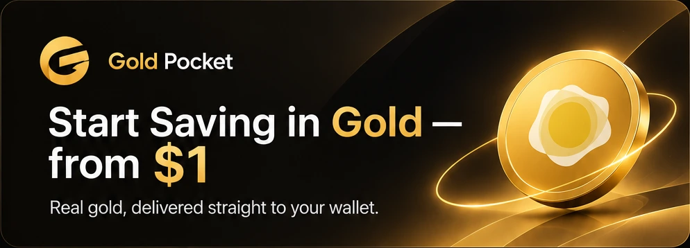
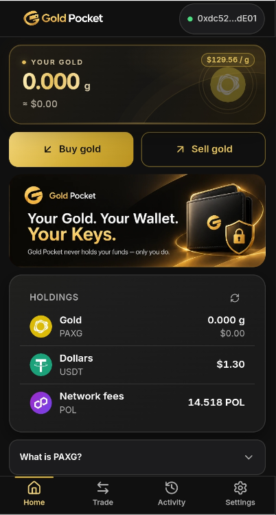
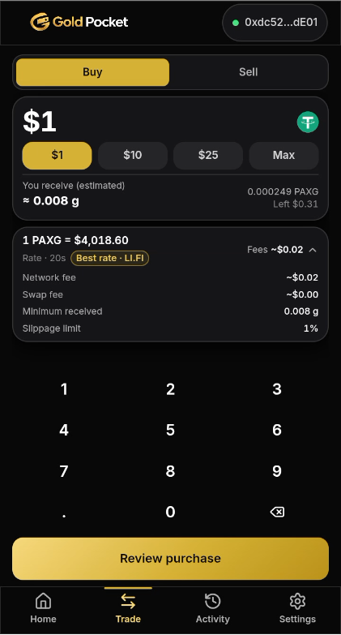
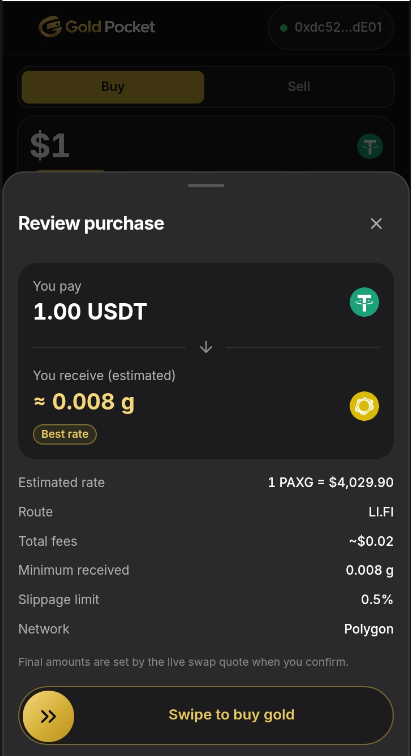
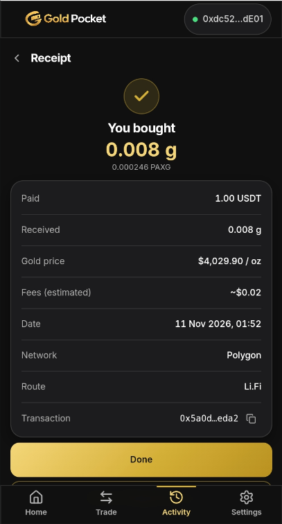
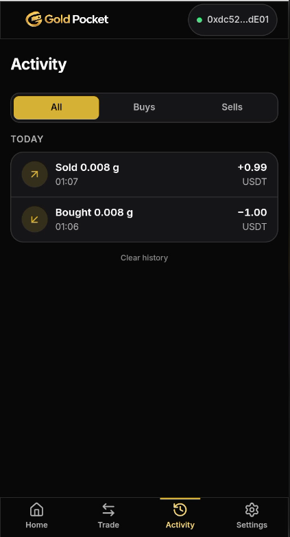

# GoldPocket

> Save in real gold, straight from your wallet. Start from $1 on Nimiq Pay.

| Field | Value |
| --- | --- |
| Category | Save |
| Pricing | Free |
| Team name | _Not provided — optional_ |
| Team members | _Not provided — optional_ |
| X account | chandraprtmar |
| Heard about it via | X |
| Contact email | chandrapratamaramadhan@gmail.com |
| GitHub login | @chandrapratamar |
| Submitted at | 2026-11-10T19:29:20.028Z |

## Links

| Link | URL |
| --- | --- |
| Repo | [https://github.com/chandrapratamar/GoldPocket](<https://github.com/chandrapratamar/GoldPocket>) |
| Demo | [https://gold-pocket.vercel.app/](<https://gold-pocket.vercel.app/>) |
| Video | [https://youtube.com/](<https://youtube.com/>) |
| Skool post | [https://www.skool.com/miniappscompetition/gold-pocket-save-in-real-gold-straight-from-your-wallet-start-from-1?p=8e1c4221](<https://www.skool.com/miniappscompetition/gold-pocket-save-in-real-gold-straight-from-your-wallet-start-from-1?p=8e1c4221>) |
| Social post | [https://x.com/chandraprtmar/status/2120235493682249810](<https://x.com/chandraprtmar/status/2120235493682249810>) |

## Description

Gold Pocket is a self-custodial mini app for Nimiq Pay that lets anyone buy and sell tokenized gold (PAXG) with USDT on Polygon PoS — no accounts, no custodians, no private-key handling. It queries Li.Fi and 1inch in parallel and auto-picks the best rate every time, showing the r

## Builder story

I've always liked investing in gold — not as a trader, but as someone who wants to save a little every month and preserve value.

But most platforms came with custody risks, confusing fees, or high minimums. So I built **Gold Pocket**.

Buy PAXG directly from your phone, hold the tokens in your own wallet, and verify every transaction on PolygonScan.

To make buying simpler, I built an aggregator that compares Li.Fi and 1inch quotes in parallel and automatically selects the better available route.

My goal for the Save Track is simple: make tokenized gold accessible. Buy small amounts, track your holdings in grams or troy ounces, and see exactly what you paid, received, and spent on fees.

**Your money. Your wallet. Your gold tokens.**

## Thumbnail

## Screenshots

---

_Generated from the submission form. `submission.yaml` in this folder is the machine-readable source of truth._
