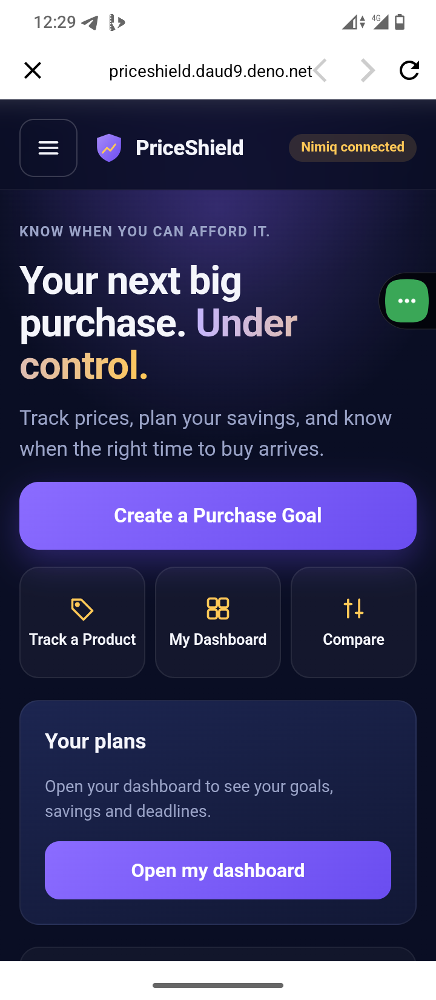
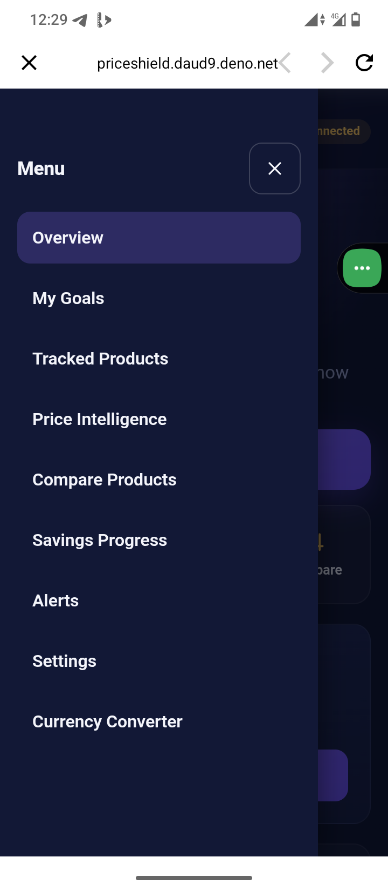
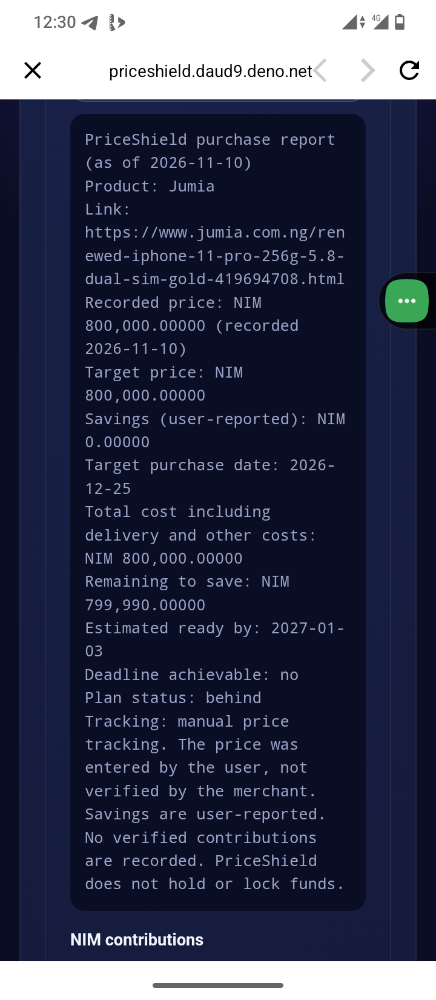
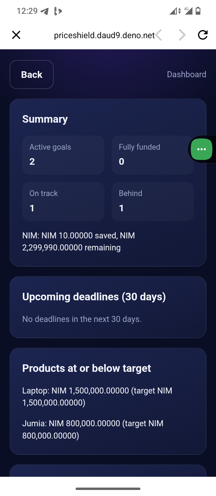
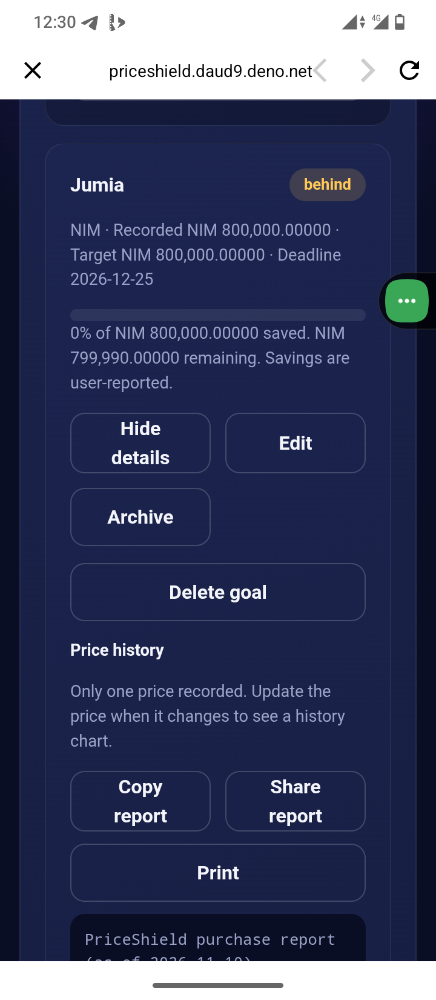

# PriceShield

> know when you can afford it.

| Field | Value |
| --- | --- |
| Category | Save |
| Pricing | Free |
| Team name | _Not provided — optional_ |
| Team members | _Not provided — optional_ |
| X account | SheikResearch |
| Heard about it via | X |
| Contact email | shinaoluwa55@gmail.com |
| GitHub login | @daud9 |
| Submitted at | 2026-11-10T11:54:40.810Z |

## Links

| Link | URL |
| --- | --- |
| Repo | [https://github.com/daud9/PriceShield](<https://github.com/daud9/PriceShield>) |
| Demo | [https://priceshield.daud9.deno.net/](<https://priceshield.daud9.deno.net/>) |
| Video | [https://youtu.be/8NUb3lJ8O1s?si=vksOgCTui7PF1TfG](<https://youtu.be/8NUb3lJ8O1s?si=vksOgCTui7PF1TfG>) |
| Skool post | [https://www.skool.com/miniappscompetition/test-my-mini-app-project?p=94d9ed63](<https://www.skool.com/miniappscompetition/test-my-mini-app-project?p=94d9ed63>) |
| Social post | [https://x.com/SheikResearch/status/2120122362897338643?a=cRDWDWrNy6eqUI-5hp4&s=20](<https://x.com/SheikResearch/status/2120122362897338643?a=cRDWDWrNy6eqUI-5hp4&s=20>) |

## Description

PriceShield tracks a product's price, locks your savings target, and lets you save in NIM through Nimiq Pay. Each contribution is verified on-chain before it counts toward your goal.

## Builder story

PriceShield was inspired by a simple problem: people often find products they want to buy, but struggle to determine the right time to purchase them, keep up with changing prices, and save consistently towards their goals.

I also recognized that people may earn, shop, and save in different currencies. Our vision is to make it easier for users to track products priced in EUR, GBP, or NGN while planning savings in digital assets as NIM.

Ultimately, PriceShield is about giving people more control over their purchasing decisions, helping them prepare financially, understand price movements, and work towards purchases with greater confidence.

I built it around one simple idea: know when you can afford it.

## Thumbnail

## Screenshots

---

_Generated from the submission form. `submission.yaml` in this folder is the machine-readable source of truth._
