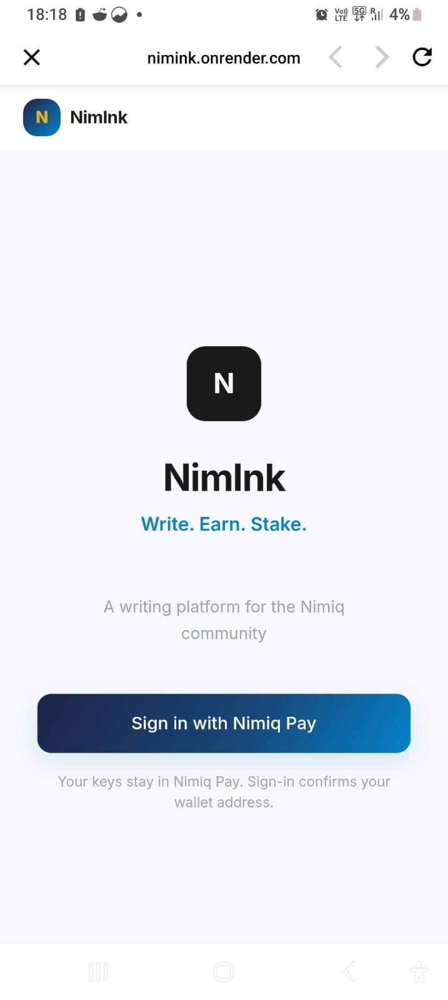
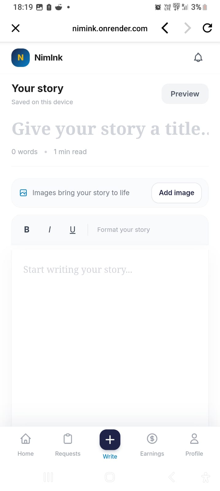
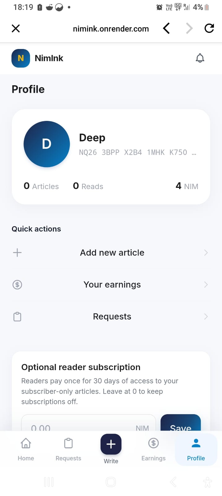

# NimInk

> Write Earn Stake

| Field | Value |
| --- | --- |
| Category | Earn |
| Pricing | Freemium |
| Team name | _Not provided — optional_ |
| Team members | _Not provided — optional_ |
| X account | infinitywarlord |
| Heard about it via | I got to know by my friend. |
| Contact email | deeprajkumarwrs@gmail.com |
| GitHub login | @deep17raj |
| Submitted at | 2026-11-11T12:55:42.798Z |

## Links

| Link | URL |
| --- | --- |
| Repo | [https://github.com/deep17raj/NimInk.git](<https://github.com/deep17raj/NimInk.git>) |
| Demo | [https://nimink.onrender.com/](<https://nimink.onrender.com/>) |
| Video | [https://youtu.be/6--6ZdpoXls](<https://youtu.be/6--6ZdpoXls>) |
| Skool post | [https://www.skool.com/miniappscompetition/nimink-is-live-write-earn-stake?p=5b678fc7](<https://www.skool.com/miniappscompetition/nimink-is-live-write-earn-stake?p=5b678fc7>) |
| Social post | [https://x.com/infinitywarlord/status/2120497937356845500?a=wI1OO3ozyU2OcwV06hE&s=19](<https://x.com/infinitywarlord/status/2120497937356845500?a=wI1OO3ozyU2OcwV06hE&s=19>) |

## Description

NimInk — a writing & earning mini app built inside Nimiq Pay. Write, read, and tip articles directly in NIM. Sell premium content, take paid requests, and stake your earnings with a validator — all with no ads, no algorithms, no middlemen.

## Builder story

I write a lot. Notes, ideas, things I’ve been learning. Most of it never gets shared because every platform I’ve tried feels like a bad deal. You write for free, hope the algorithm picks you up, and if you’re lucky you get a small cut months later.

The writer does the work. The platform takes the value.

I wanted to build something simpler. What if a reader could just pay a writer directly, the moment they found the article useful? No platform in the middle. No waiting. Just one wallet to another.

That’s where NimInk started. Tips came first. Then premium unlocks, subscriptions and paid requests, because writers need more than one way to earn. Then the staking feature, which became my favourite part. You earn NIM from your writing, and instead of letting it sit, you can put it to work in one tap. The writing earns, and then the earnings earn.

I built it because I wanted something I’d actually use myself.

## Thumbnail

## Screenshots

---

_Generated from the submission form. `submission.yaml` in this folder is the machine-readable source of truth._
