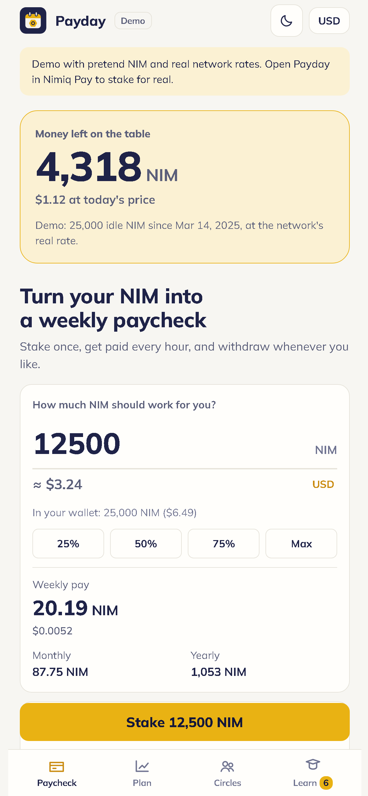
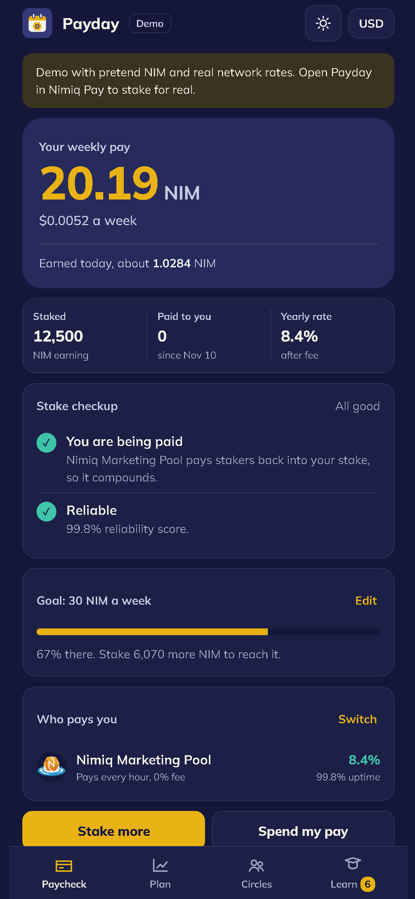
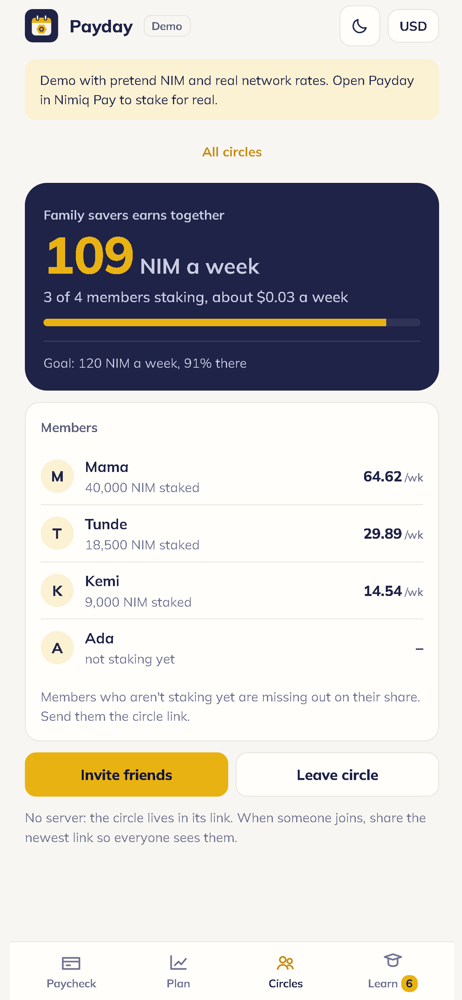
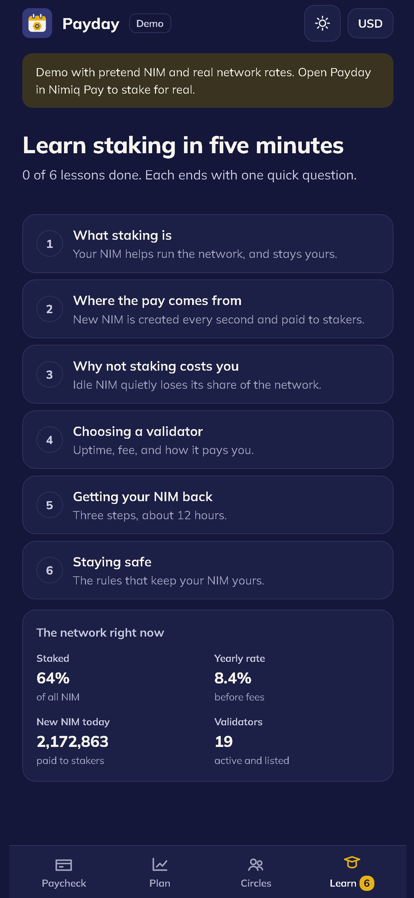

# Payday

> Turn your NIM into a weekly paycheck.

| Field | Value |
| --- | --- |
| Category | Earn |
| Pricing | Free |
| Team name | Efecode |
| Team members | _Not provided — optional_ |
| X account | efecode |
| Heard about it via | Nimiq Community |
| Contact email | efeaizesogie@gmail.com |
| GitHub login | @efeaizesogie |
| Submitted at | 2026-11-10T08:48:29.197Z |

## Links

| Link | URL |
| --- | --- |
| Repo | [https://github.com/efeaizesogie/payday](<https://github.com/efeaizesogie/payday>) |
| Demo | [https://efeaizesogie.github.io/payday/](<https://efeaizesogie.github.io/payday/>) |
| Video | [https://youtu.be/eJymB4FomPM](<https://youtu.be/eJymB4FomPM>) |
| Skool post | _Not provided — optional_ |
| Social post | [https://x.com/efecode/status/2120073323165958451?a=i316UfJZi3gw-cExJY4&s=20](<https://x.com/efecode/status/2120073323165958451?a=i316UfJZi3gw-cExJY4&s=20>) |

## Description

Payday shows the NIM you've lost by not staking, then turns staking into a weekly paycheck: a signed payslip anyone can verify, spending your interest (never savings) via Lightning, and Circles: ajo where nobody holds the money.

## Builder story

Most NIM holders never stake, and every staking app looks the same: a balance and an APY. Payday starts somewhere else: with what you've already lost. It rebuilds your idle balance from your own transactions and shows, in NIM and your currency, what it could have earned since proof-of-stake launched.

Then it makes staking feel like a job that pays: one-tap staking with a validator picked for uptime, fee and compounding; a weekly Payday reveal with your streak; a Stake checkup that flags a bad validator with one-tap fixes; and a payslip your wallet signs, which anyone can check against the live blockchain (tampering is detected).

Your pay is meant to be spent: cash out exactly what you've earned while savings stay staked, pay any Lightning invoice with NIM through Nimiq Pay's built-in swaps, or spend in AbaPay and NimShop.

Payday Circles bring the ajo/esusu tradition on-chain with no custody: everyone stakes their own NIM and the group watches one shared paycheck. There's no server; a circle lives in its link.

Plus a growth planner on Nimiq's real reward curve, six two-minute lessons, and light and dark themes.

Nimiq integration: all six staking actions, message signing and Lightning payments through the Mini App SDK, Nimiq Pay's remote HTLC balance, host network and currency, full error handling, and no backend.

## Thumbnail

## Screenshots

---

_Generated from the submission form. `submission.yaml` in this folder is the machine-readable source of truth._
