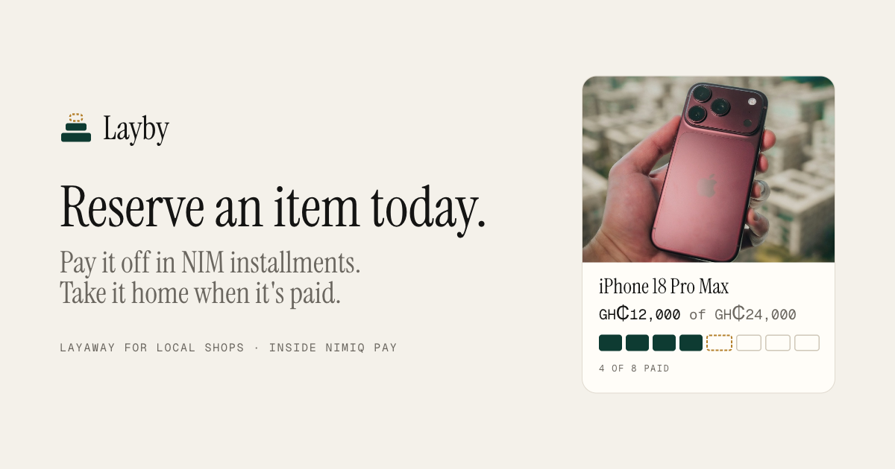
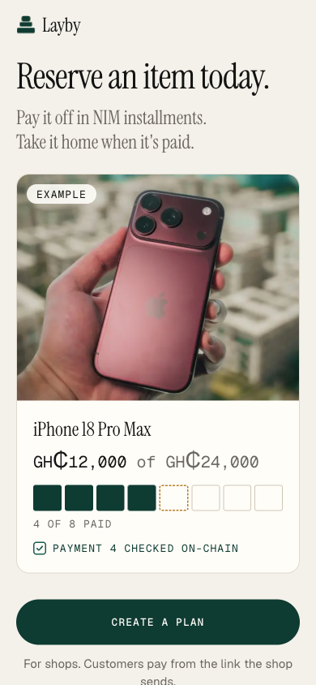
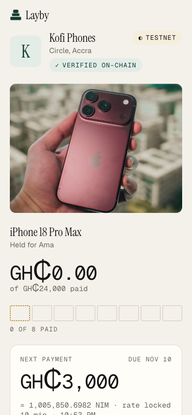
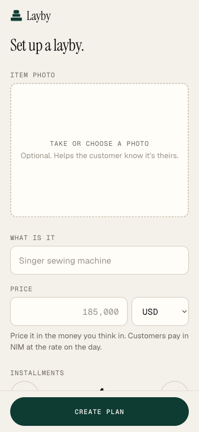
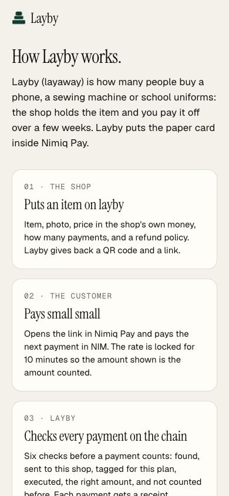

# Layaway

> Reserve an item today. Pay it off in NIM installments. Take it home when it's paid.

| Field | Value |
| --- | --- |
| Category | Save |
| Pricing | Free |
| Team name | _Not provided — optional_ |
| Team members | _Not provided — optional_ |
| X account | zanbuilds |
| Heard about it via | _Not provided — optional_ |
| Contact email | ibrahimpima76@gmail.com |
| GitHub login | @fozagtx |
| Submitted at | 2026-11-10T23:16:16.015Z |

## Links

| Link | URL |
| --- | --- |
| Repo | [https://github.com/fozagtx/layby](<https://github.com/fozagtx/layby>) |
| Demo | [https://laybyapp.vercel.app](<https://laybyapp.vercel.app>) |
| Video | [https://vimeo.com/1245618562?share=copy&fl=sv&fe=ci](<https://vimeo.com/1245618562?share=copy&fl=sv&fe=ci>) |
| Skool post | [https://www.skool.com/miniappscompetition/layby-reserve-the-new-iphone-today-pay-it-off-in-nim-installments?p=a87572d0](<https://www.skool.com/miniappscompetition/layby-reserve-the-new-iphone-today-pay-it-off-in-nim-installments?p=a87572d0>) |
| Social post | _Not provided — optional_ |

## Description

Layby is layaway for local shops inside Nimiq Pay: the shop holds an item, the customer pays it off in small NIM payments, and every payment is checked on the Nimiq chain before it counts. Built for small shops and market stalls whose customers save up for a phone, a sewing machi

## Builder story

_Not provided — optional_

## Thumbnail

## Screenshots

---

_Generated from the submission form. `submission.yaml` in this folder is the machine-readable source of truth._
