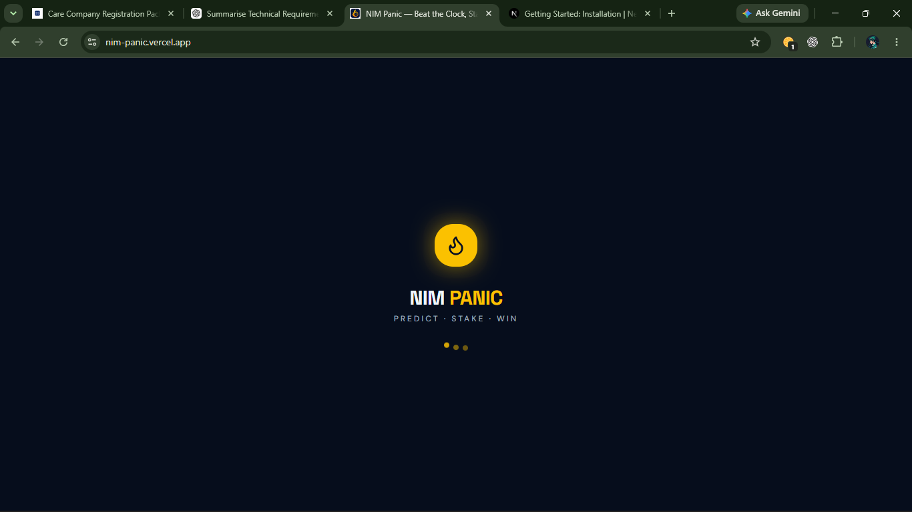
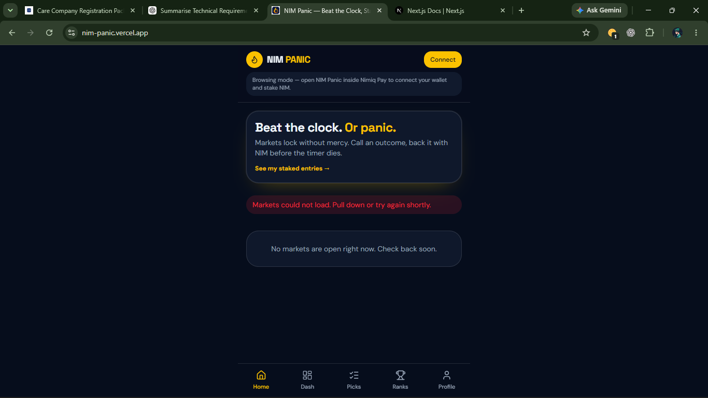
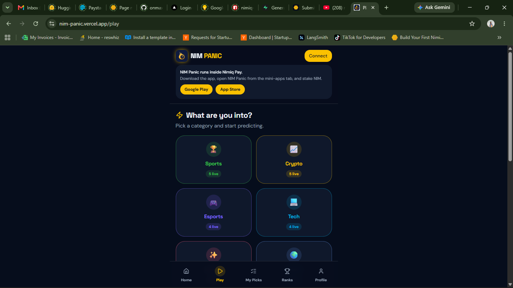
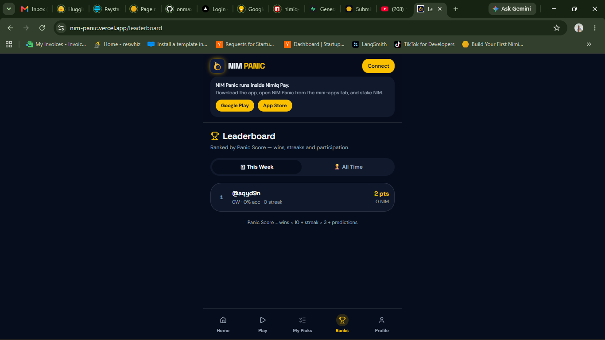

# Nimpanic

> Stake NIM · Call outcomes · Climb the ranks

| Field | Value |
| --- | --- |
| Category | Earn |
| Pricing | Free |
| Team name | _Not provided — optional_ |
| Team members | _Not provided — optional_ |
| X account | GarryMike_M |
| Heard about it via | _Not provided — optional_ |
| Contact email | garmanjimichael@gmail.com |
| GitHub login | @geemanji |
| Submitted at | 2026-11-10T14:26:55.877Z |

## Links

| Link | URL |
| --- | --- |
| Repo | [https://github.com/geemanji/nim-panic](<https://github.com/geemanji/nim-panic>) |
| Demo | [https://nimpanic.vercel.app](<https://nimpanic.vercel.app>) |
| Video | [https://youtube.com/shorts/zb_REKS09_o?si=LRA2ITW-Vg9n2Ecq](<https://youtube.com/shorts/zb_REKS09_o?si=LRA2ITW-Vg9n2Ecq>) |
| Skool post | _Not provided — optional_ |
| Social post | [https://x.com/GarryMike_M/status/2099726992069288178?s=09](<https://x.com/GarryMike_M/status/2099726992069288178?s=09>) |

## Description

A Miniapp that helps users stake, predict and earn the outcome of events across multiple events category.

## Builder story

_Not provided — optional_

## Thumbnail

## Screenshots

---

_Generated from the submission form. `submission.yaml` in this folder is the machine-readable source of truth._
