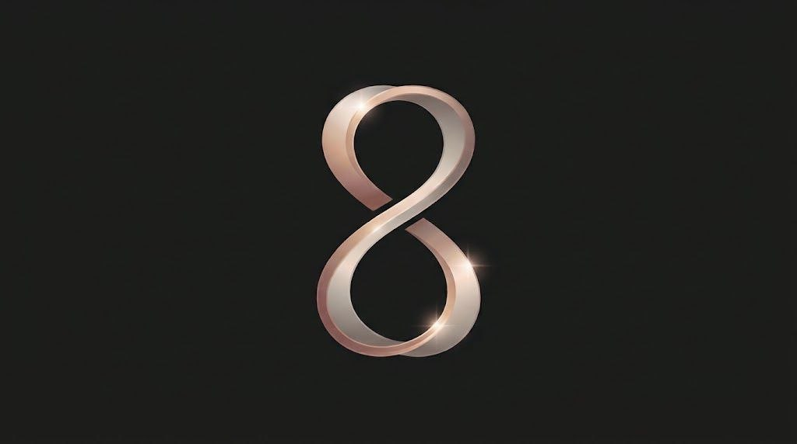
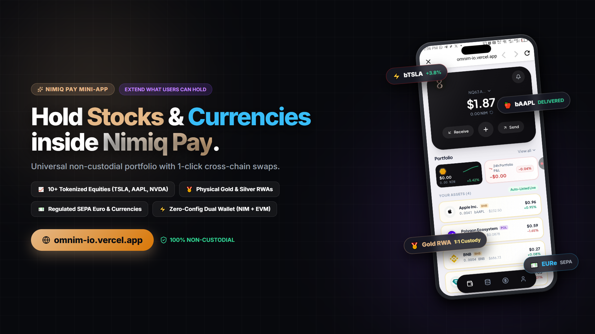
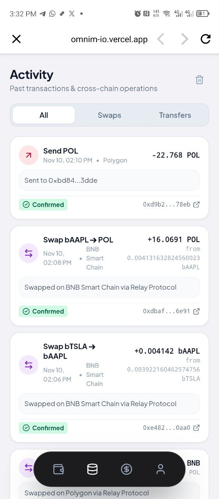
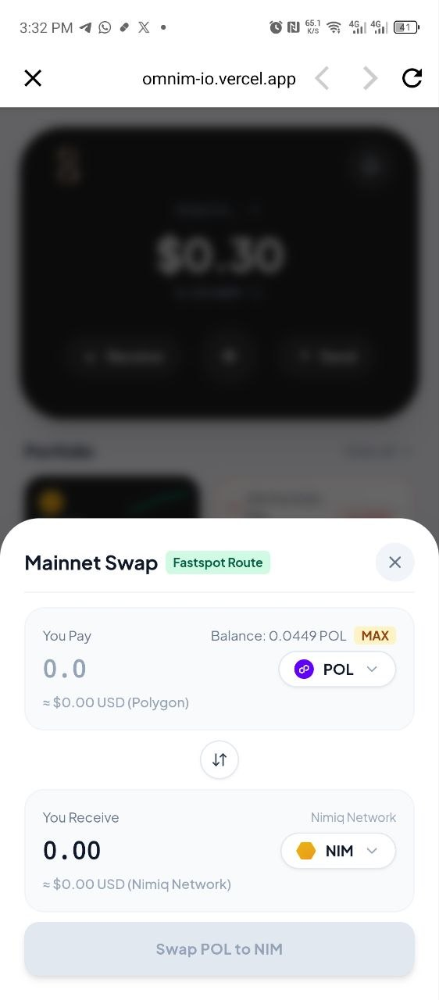
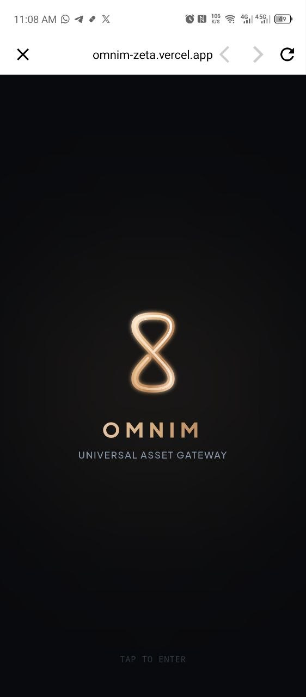
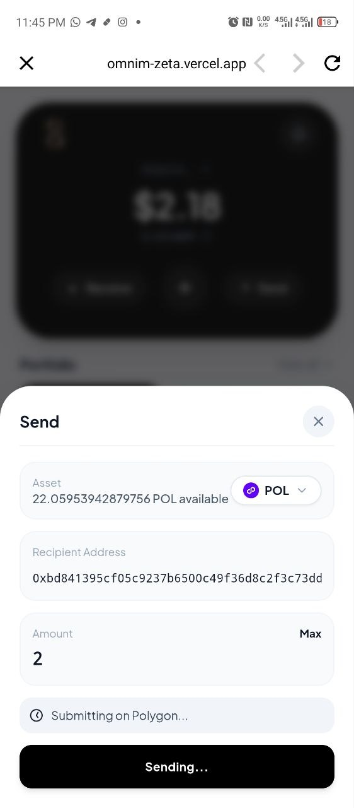

# OMNIM

> Hold more than just crypto. Own the world in Nimiq Pay.

| Field | Value |
| --- | --- |
| Category | Save |
| Pricing | Free |
| Team name | KAZZYSAX |
| Team members | _Not provided — optional_ |
| X account | saxxyweb3 |
| Heard about it via | X |
| Contact email | web3kingley@gmail.com |
| GitHub login | @kazzysax |
| Submitted at | 2026-11-10T15:53:08.471Z |

## Links

| Link | URL |
| --- | --- |
| Repo | [https://github.com/kazzysax/OMNIM](<https://github.com/kazzysax/OMNIM>) |
| Demo | [https://github.com/kazzysax/OMNIM](<https://github.com/kazzysax/OMNIM>) |
| Video | [https://x.com/saxxyweb3/status/2120182405701017696?a=s7Ita7JyZ3tux1xzUmc&s=19](<https://x.com/saxxyweb3/status/2120182405701017696?a=s7Ita7JyZ3tux1xzUmc&s=19>) |
| Skool post | [https://www.skool.com/miniappscompetition/omnim-hold-more-assets-on-nimiq-pay?p=1046aeac](<https://www.skool.com/miniappscompetition/omnim-hold-more-assets-on-nimiq-pay?p=1046aeac>) |
| Social post | [https://x.com/saxxyweb3/status/2120182405701017696?a=s7Ita7JyZ3tux1xzUmc&s=19](<https://x.com/saxxyweb3/status/2120182405701017696?a=s7Ita7JyZ3tux1xzUmc&s=19>) |

## Description

OMNIM directly extends what users can hold inside Nimiq Pay beyond NIM and USDC—unlocking 39+ real-world assets including tokenized US equities (Tesla, Apple, Nvidia), physical gold and silver, regulated on-chain fiat (EUR, GBP), and multi-chain crypto.

## Builder story

I FOUND IT REALLY FUN BUILDING THIS INNOVATION AND THE DOCS FOR NIMIQ WERE EASY TO UNDERSTAND AND IMPLEMENT. I BELIEVE WITH MORE TIME AND RESOURCES WE CAN MAKE THIS GASLESS, SUPPORT MORE TOKENIZED ASSETS AND TAKE IT TO GREATER HEIGHTS

## Thumbnail

## Screenshots

---

_Generated from the submission form. `submission.yaml` in this folder is the machine-readable source of truth._
