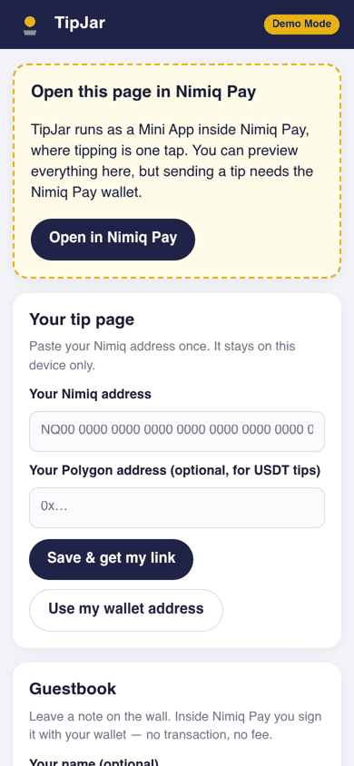
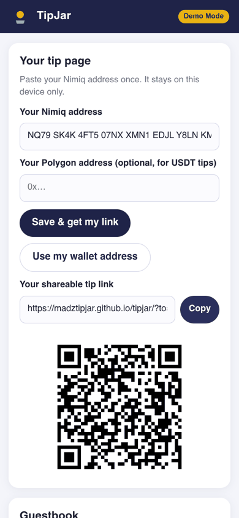
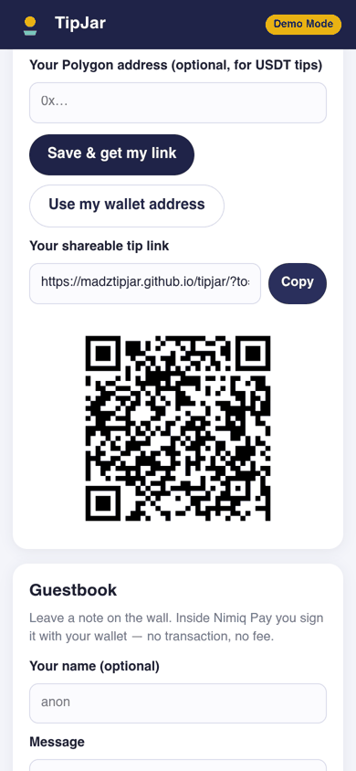

# TipJar

> Tip any creator in NIM — one link, one tap.

| Field | Value |
| --- | --- |
| Category | Pay |
| Pricing | Free |
| Team name | _Not provided — optional_ |
| Team members | _Not provided — optional_ |
| X account | _Not provided — optional_ |
| Heard about it via | _Not provided — optional_ |
| Contact email | maderzlast@gmail.com |
| GitHub login | @madztipjar |
| Submitted at | 2026-11-08T22:09:16.526Z |

## Links

| Link | URL |
| --- | --- |
| Repo | [https://github.com/madztipjar/tipjar](<https://github.com/madztipjar/tipjar>) |
| Demo | [https://madztipjar.github.io/tipjar/](<https://madztipjar.github.io/tipjar/>) |
| Video | [https://youtube.com/shorts/NMBpyCjCr88](<https://youtube.com/shorts/NMBpyCjCr88>) |
| Skool post | _Not provided — optional_ |
| Social post | _Not provided — optional_ |

## Description

TipJar turns a creator's Nimiq address into a tip page anyone can pay in seconds. The creator pastes their address once and gets a shareable link and QR code — for a stream overlay, a social bio, or a sticker on a laptop. A supporter opening the link sees preset amounts (1/5/10/2

## Builder story

I'm an independent Web3 operator from Indonesia. Most of my days go into online communities — running a Telegram group, hunting airdrops, testing new wallets — and I kept seeing the same gap: small creators in our communities had no easy way to receive a small "thank you" payment without handing out a raw address or signing up for a platform that takes a cut and a KYC form. When the Nimiq Mini Apps competition opened, NIM looked like the right tool: an address a human can actually read, a wallet people already carry on their phone, and payments that settle without an intermediary. I built TipJar to be the smallest possible version of a tip page — one static page, no server, nothing between a supporter and a creator except Nimiq Pay's own confirmation dialog. Two design decisions I'm proud of: the guestbook signs messages instead of posting them on-chain (identity without fees), and the whole app still works as a demo in a normal browser, so anyone can try the flow before installing anything. TipJar is my first Mini App, built solo, and it's MIT-licensed so any creator community can fork it and run their own.

## Thumbnail

## Screenshots

---

_Generated from the submission form. `submission.yaml` in this folder is the machine-readable source of truth._
