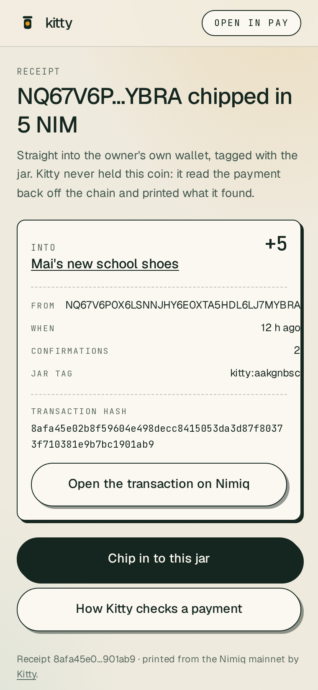
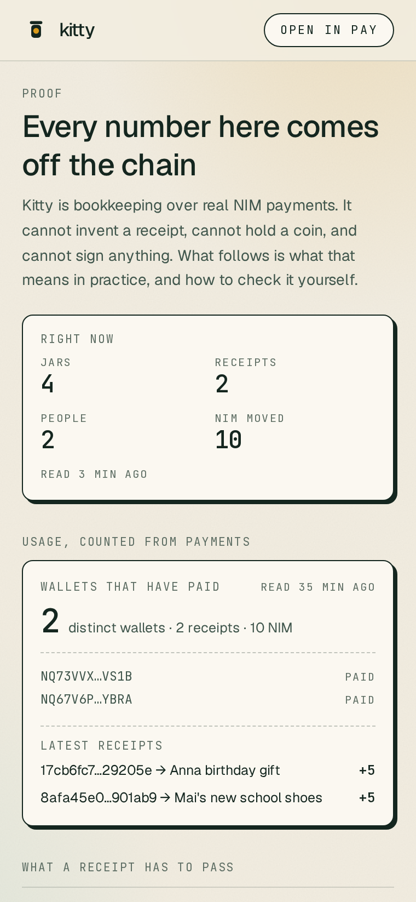
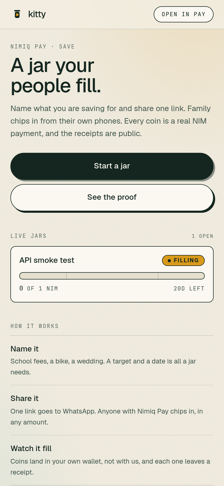
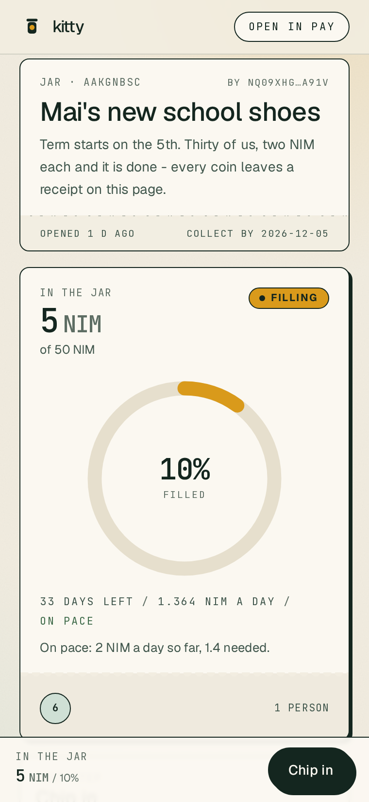
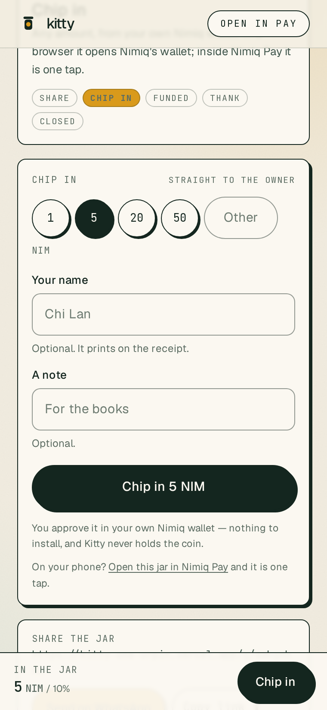

# Kitty

> A jar your people fill. Name the goal, share one link, family chips in, payment with a receipt.

| Field | Value |
| --- | --- |
| Category | Save |
| Pricing | Free |
| Team name | _Not provided — optional_ |
| Team members | _Not provided — optional_ |
| X account | 0xMemeshe |
| Heard about it via | i see the promo post on X |
| Contact email | kiter2509@gmail.com |
| GitHub login | @memeshee |
| Submitted at | 2026-11-03T17:18:45.198Z |

## Links

| Link | URL |
| --- | --- |
| Repo | [https://github.com/memeshee/kitty](<https://github.com/memeshee/kitty>) |
| Demo | [https://kitty-one-orpin.vercel.app/](<https://kitty-one-orpin.vercel.app/>) |
| Video | [https://youtu.be/IgbqfNUR9sw](<https://youtu.be/IgbqfNUR9sw>) |
| Skool post | [https://www.skool.com/miniappscompetition/kitty-is-entering-cycle-iii-in-save-a-jar-your-people-fill](<https://www.skool.com/miniappscompetition/kitty-is-entering-cycle-iii-in-save-a-jar-your-people-fill>) |
| Social post | [https://x.com/0xMemeshe/status/2117660390482235837](<https://x.com/0xMemeshe/status/2117660390482235837>) |

## Description

Kitty is a goal jar inside Nimiq Pay. Name what you save for, share one link, and the people who care chip in from their phones. Every contribution is a real NIM payment to the owner's own wallet, tagged on-chain, with a receipt anyone can check.

## Builder story

Someone in every family keeps the list. Who has paid, who still owes, and whether the money is really there. That person chases cousins, fronts the gap, and hopes the count is right.

I did not want to build another payment app. The paying was never the hard part. The hard part is the keeping track, and the trust: a group chat cannot tell you who chipped in, and a platform that holds the pot asks you to trust it with everyone's money.

Then I read the Nimiq Pay Mini Apps Framework inventory properly, and the constraint turned out to be the product. The platform gives a Mini App a 64-byte public memo on every payment, a balance read without approval, and a native approval sheet. It gives you no way to create a contract, no HTLC, no cashlink, and the wallet always picks the signing account. So there is no way to build a shared pot that holds money. The only honest shape left is: the money goes straight to the person it is for, and the app does the bookkeeping in public.

That is Kitty. You name the goal, set a target and a date, and share one link. Anyone chips in any amount from their own phone, in Nimiq Pay or from any browser through the Nimiq Hub, and the payment carries kitty:&lt;jar id> as its on-chain memo. Kitty then re-reads that transaction from mainnet before it writes a single row: does the hash exist, did the value reach the jar owner, does the memo carry this jar's tag, did the transaction execute, is the amount the chain's, and has this hash been counted before. Six checks, and a payment that fails any of them never becomes a receipt.

The first real payment was 5 NIM at block 65,891,682 (8afa45e0...901ab9), and the best moment of the build was watching the jar move on its own: the page had printed nothing, then it re-read the chain and printed what it found. Every receipt has its own page you can forward back into the chat, and every one opens on a Nimiq explorer.

What I would build next: recurring chips (the same aunt every month), a goal page that reads in the family's own language, and an owner-side nudge that is a real payment request rather than a message. What I will not build is a custodian.

MIT, no token, no AI, no contract. The whole product is public bookkeeping over payments that already happened.

## Thumbnail

## Screenshots

---

_Generated from the submission form. `submission.yaml` in this folder is the machine-readable source of truth._
