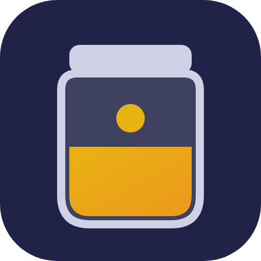
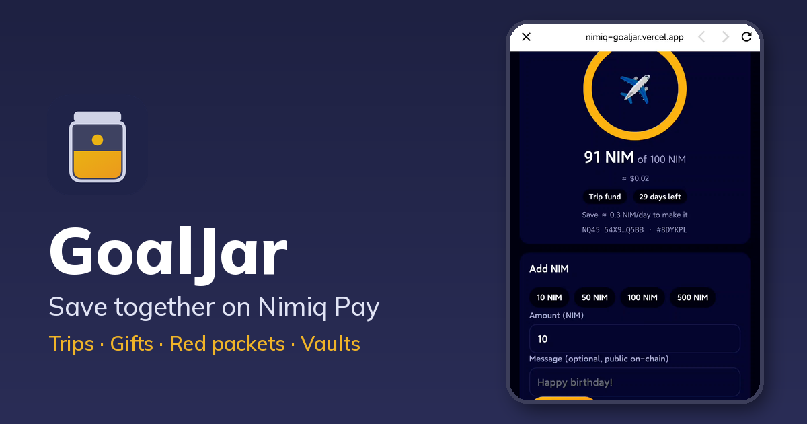
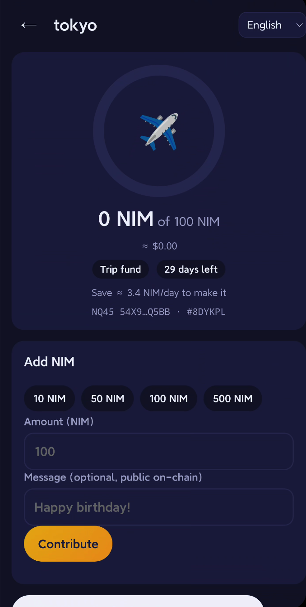
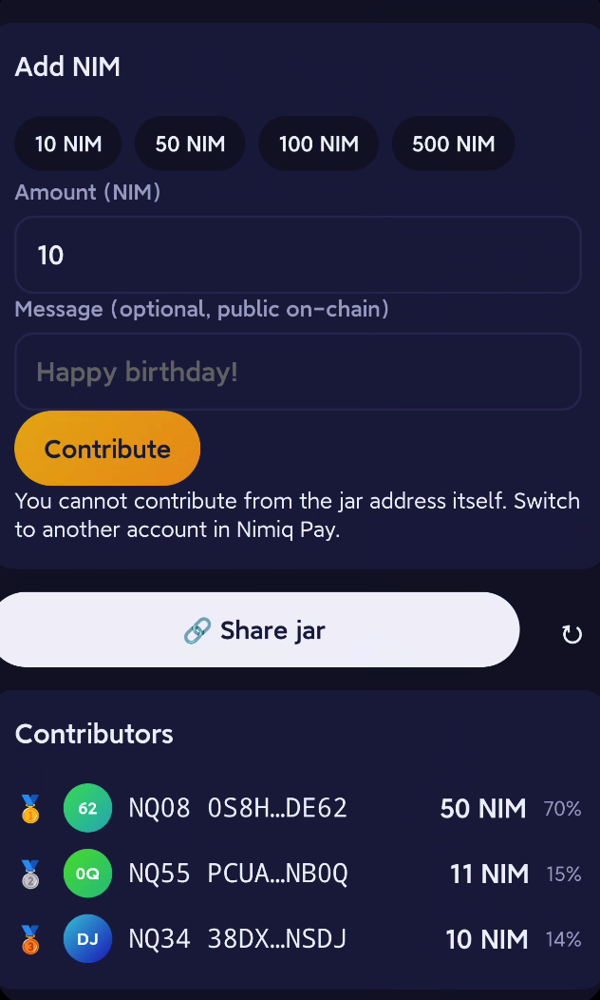
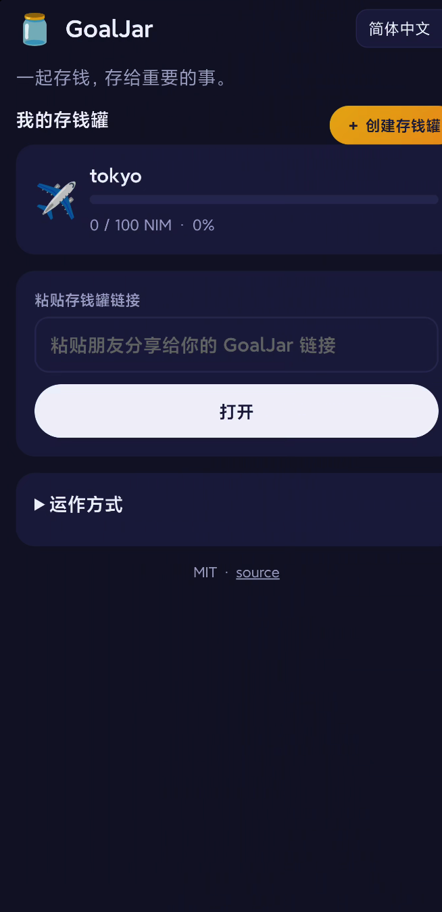
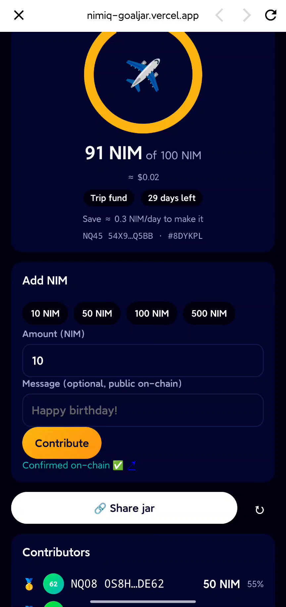

# GoalJar

> Save together for trips, gifts and red packets, right inside Nimiq Pay.

| Field | Value |
| --- | --- |
| Category | Save |
| Pricing | Free |
| Team name | _Not provided — optional_ |
| Team members | _Not provided — optional_ |
| X account | _Not provided — optional_ |
| Heard about it via | Other |
| Contact email | 407354967@qq.com |
| GitHub login | @minorCoder |
| Submitted at | 2026-11-02T01:32:40.105Z |

## Links

| Link | URL |
| --- | --- |
| Repo | [https://github.com/minorCoder/nimiq-goaljar](<https://github.com/minorCoder/nimiq-goaljar>) |
| Demo | [https://nimiq-goaljar.vercel.app](<https://nimiq-goaljar.vercel.app>) |
| Video | [https://vimeo.com/1242066692](<https://vimeo.com/1242066692>) |
| Skool post | _Not provided — optional_ |
| Social post | _Not provided — optional_ |

## Description

Shared savings jars inside Nimiq Pay. Set a goal (trip, group gift, red packets, personal vault), share one link, friends chip in NIM with one tap. Progress, leaderboard and streaks are read from the Nimiq chain. Non-custodial, no backend, 5 languages.

## Builder story

In Taiwan and across Asia, we pool money all the time: a birthday gift for a coworker, a group trip, red packets at Lunar New Year. It usually lives in a messy chat thread and one person's bank app, and nobody can see how close we are. GoalJar makes the jar itself visible: one link, one tap to contribute, and a progress ring everyone trusts because it is read directly from the Nimiq chain. No custody and no backend, just NIM payments with a tag. Next: USDT (Polygon) jars, recurring "save every Friday" reminders, and printable QR posters for real-world red-packet tables.

## Thumbnail

## Screenshots

---

_Generated from the submission form. `submission.yaml` in this folder is the machine-readable source of truth._
