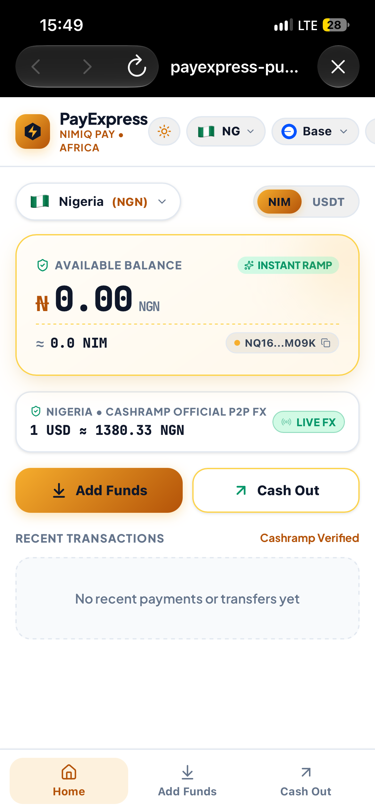
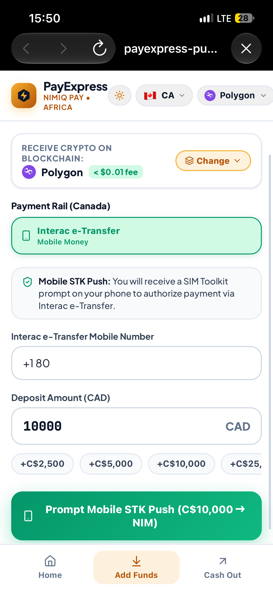
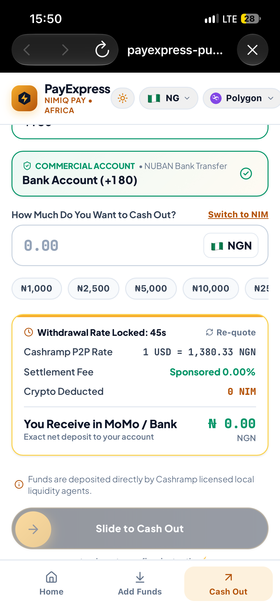

# Pay express

> Instant ramping for Nimiq pay

| Field | Value |
| --- | --- |
| Category | On/Off-Ramp |
| Pricing | Paid |
| Team name | _Not provided — optional_ |
| Team members | _Not provided — optional_ |
| X account | e_subutai |
| Heard about it via | _Not provided — optional_ |
| Contact email | 1captaineddy@gmail.com |
| GitHub login | @nimrid |
| Submitted at | 2026-11-10T20:27:48.283Z |

## Links

| Link | URL |
| --- | --- |
| Repo | [https://github.com/nimrid/payexpress](<https://github.com/nimrid/payexpress>) |
| Demo | [https://payexpress-puce.vercel.app/](<https://payexpress-puce.vercel.app/>) |
| Video | [https://youtu.be/1P8IpwovIOY?si=uzsMQmpBulRifxBK](<https://youtu.be/1P8IpwovIOY?si=uzsMQmpBulRifxBK>) |
| Skool post | [https://www.skool.com/miniappscompetition/payexpress-first-look?p=a442824e](<https://www.skool.com/miniappscompetition/payexpress-first-look?p=a442824e>) |
| Social post | [https://x.com/e_subutai/status/2120248337513230625?a=OfZ61Z-DEv1f4ueE2Eo&s=46](<https://x.com/e_subutai/status/2120248337513230625?a=OfZ61Z-DEv1f4ueE2Eo&s=46>) |

## Description

PayExpress is a native Nimiq Pay on/off-ramp connecting crypto to local African payment rails across Nigeria, Kenya, South Africa and globally. Cash out or add funds in under 60 seconds via M-Pesa and local bank transfers with zero hidden protocol fees.

## Builder story

On and offramping should be seamless within the Nimiq ecosystem. I shouldn’t have to send my USDT for instance to a centralized or decentralized exchange before I can have it in my bank account or have to follow same process to get USDT in my Nimiq pay wallet. Individuals should be able to do it within the mini app ecosystem so I set out to build the solution

## Thumbnail

## Screenshots

---

_Generated from the submission form. `submission.yaml` in this folder is the machine-readable source of truth._
