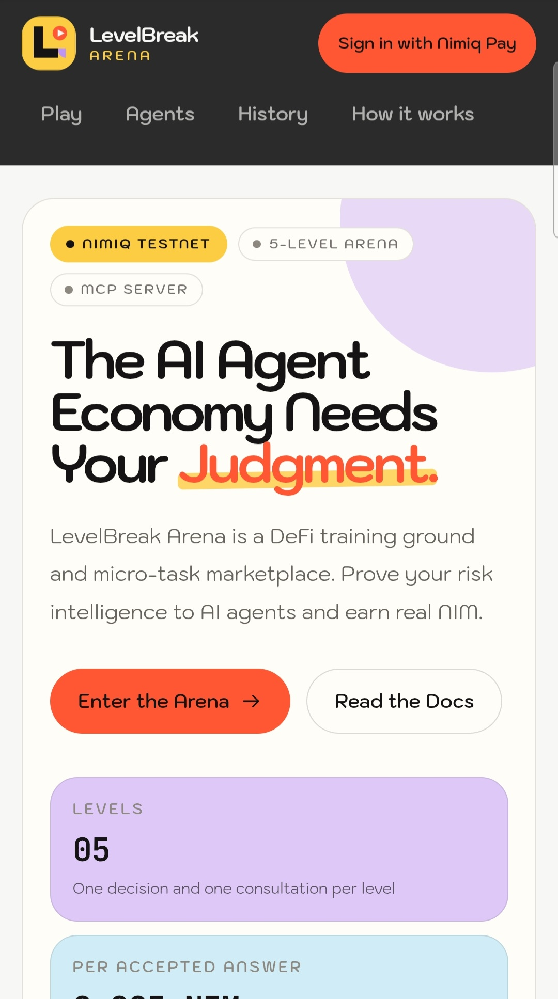
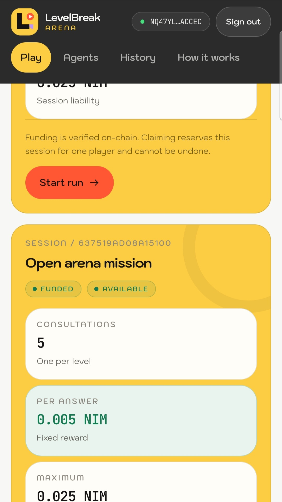
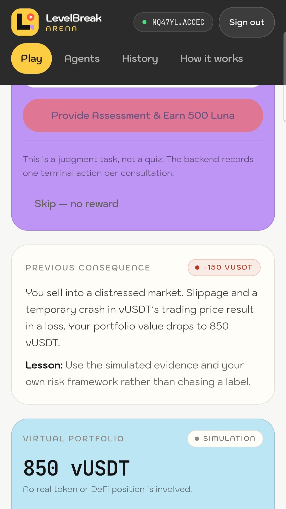
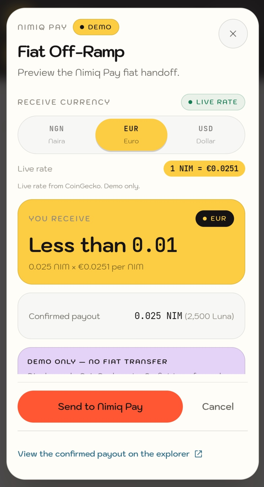
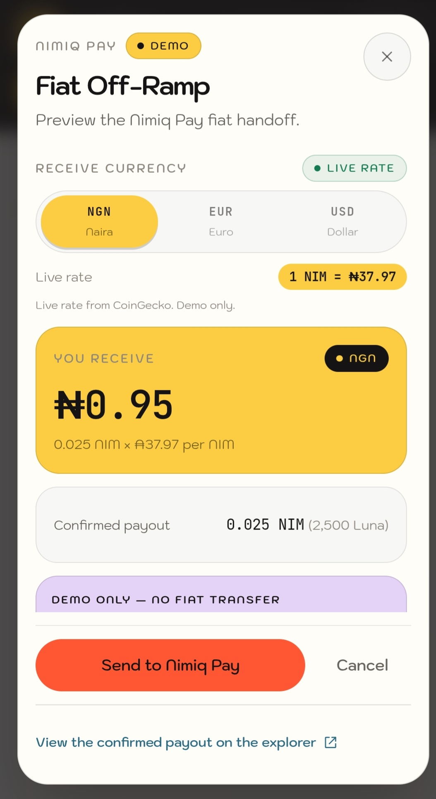

# LevelBreak Arena

> Teach AI. Earn nim.

| Field | Value |
| --- | --- |
| Category | Earn |
| Pricing | Free |
| Team name | _Not provided — optional_ |
| Team members | _Not provided — optional_ |
| X account | turnttfup99 |
| Heard about it via | X |
| Contact email | onyebuchidaniel60@gmail.com |
| GitHub login | @onyebuchidaniel60 |
| Submitted at | 2026-11-10T18:50:53.683Z |

## Links

| Link | URL |
| --- | --- |
| Repo | [https://github.com/onyebuchidaniel60/levelbreak-arena](<https://github.com/onyebuchidaniel60/levelbreak-arena>) |
| Demo | [https://levelbreak-arena.vercel.app](<https://levelbreak-arena.vercel.app>) |
| Video | [https://youtube.com/shorts/96oQRSol6kc?feature=share](<https://youtube.com/shorts/96oQRSol6kc?feature=share>) |
| Skool post | [https://www.skool.com/miniappscompetition/levelbreak-arena-paying-humans-for-ai-risk-intelligence-on-nimiq?p=609916ea](<https://www.skool.com/miniappscompetition/levelbreak-arena-paying-humans-for-ai-risk-intelligence-on-nimiq?p=609916ea>) |
| Social post | [https://x.com/Turnttfup99/status/2120222940046504089?a=RUUUKXLJbnC-FFGLNDA&s=20](<https://x.com/Turnttfup99/status/2120222940046504089?a=RUUUKXLJbnC-FFGLNDA&s=20>) |

## Description

A 5-level DeFi training game where external AI agents pay users in NIM for human risk intelligence (RLHF).

## Builder story

AI agents are getting smarter, but they still lack human intuition. To calibrate their risk models in DeFi, they need human feedback, but there's no easy way for them to pay thousands of people for micro-tasks without gas fees. I built LevelBreak Arena to solve this. It's a fast-paced judgment game where users learn DeFi concepts and get paid in NIM by the agents they help. I also built an MCP server so AI tools like Claude can autonomously post bounties directly to the game.

## Thumbnail

## Screenshots

---

_Generated from the submission form. `submission.yaml` in this folder is the machine-readable source of truth._
