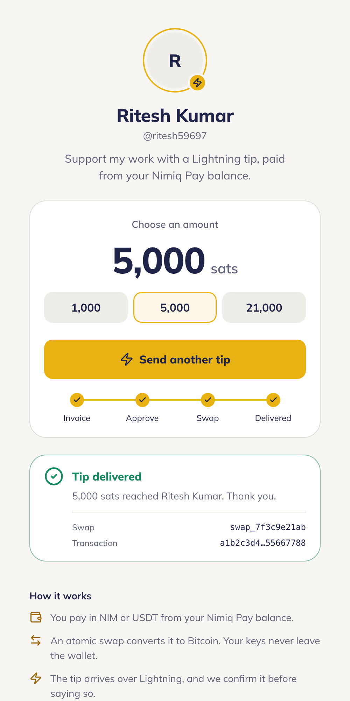
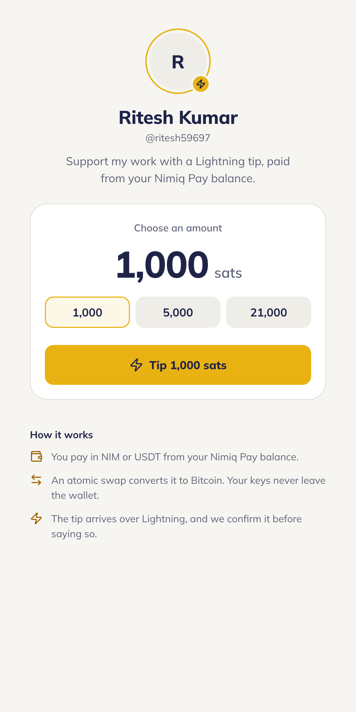
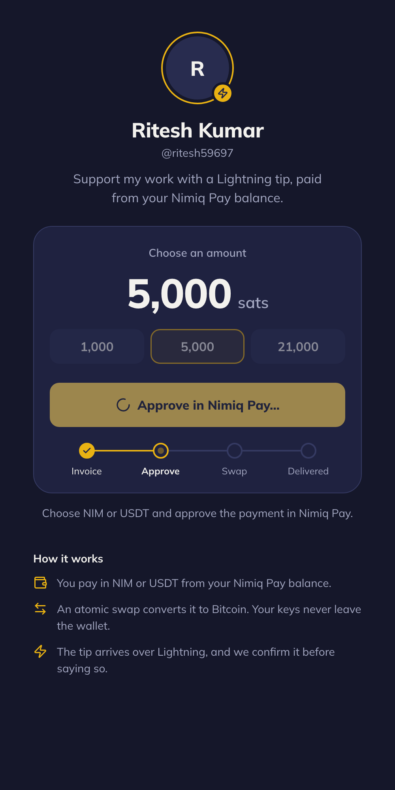
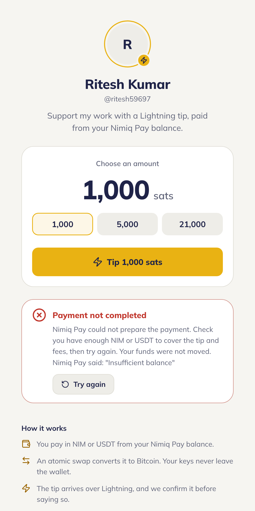

# Lightning Tips

> Tip any creator in Bitcoin over Lightning, straight from your NIM or USDT balance.

| Field | Value |
| --- | --- |
| Category | Off-theme |
| Pricing | Free |
| Team name | _Not provided — optional_ |
| Team members | _Not provided — optional_ |
| X account | ritesh5969 |
| Heard about it via | _Not provided — optional_ |
| Contact email | riteshwork5969@gmail.com |
| GitHub login | @ritesh59697 |
| Submitted at | 2026-11-10T14:04:22.522Z |

## Links

| Link | URL |
| --- | --- |
| Repo | [https://github.com/ritesh59697/nimiq-lightning-tips](<https://github.com/ritesh59697/nimiq-lightning-tips>) |
| Demo | [https://nimiq-lightning-tips.vercel.app](<https://nimiq-lightning-tips.vercel.app>) |
| Video | [https://youtube.com/shorts/d7yxK8jBi70](<https://youtube.com/shorts/d7yxK8jBi70>) |
| Skool post | [https://www.skool.com/miniappscompetition/lightning-tips-tip-creators-in-bitcoin-paid-from-your-nimiq-pay-balance](<https://www.skool.com/miniappscompetition/lightning-tips-tip-creators-in-bitcoin-paid-from-your-nimiq-pay-balance>) |
| Social post | _Not provided — optional_ |

## Description

Lightning Tips lets Nimiq Pay users tip creators in Bitcoin over Lightning, paid from their NIM or USDT balance via a self-custodial atomic swap. For streamers, writers and open-source developers who accept Lightning tips, and fans who don't have a Bitcoin wallet.

## Builder story

Nimiq Pay can pay Lightning invoices with NIM or USDT, but no Mini App was using it. Lightning tips are how much of the Bitcoin creator economy gets paid, so I built a tip jar that connects the two: pick an amount, approve once, and the creator receives Bitcoin.

I built it for real money from the start. A resolved wallet call only means the swap began, so the app checks the creator's Lightning backend and shows "Tip delivered" only once the invoice is actually paid. If a payment's outcome is unclear, it waits for settlement and never offers a retry while money may already have moved. Cancellations, low balances, expired invoices and outdated app versions each get plain-language messages that say whether funds moved. The server holds only a receive-only Lightning key, so it can never spend.

Any creator can run their own copy by setting a few environment variables. Open source under MIT.

## Thumbnail

## Screenshots

---

_Generated from the submission form. `submission.yaml` in this folder is the machine-readable source of truth._
