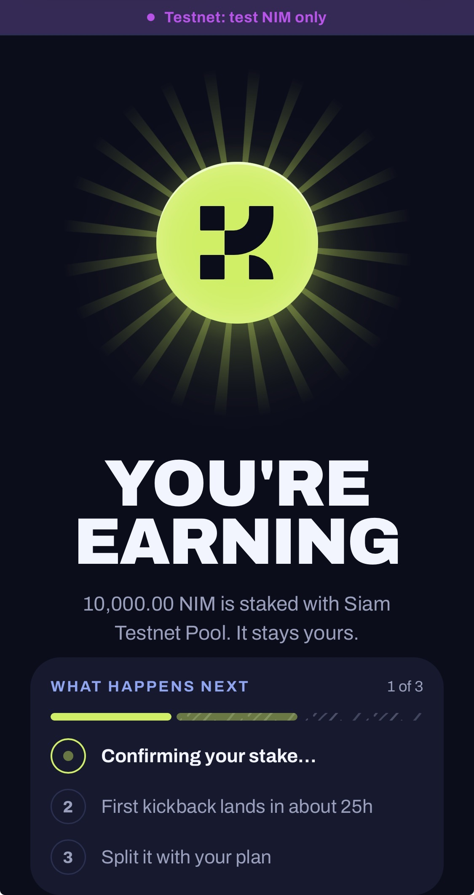
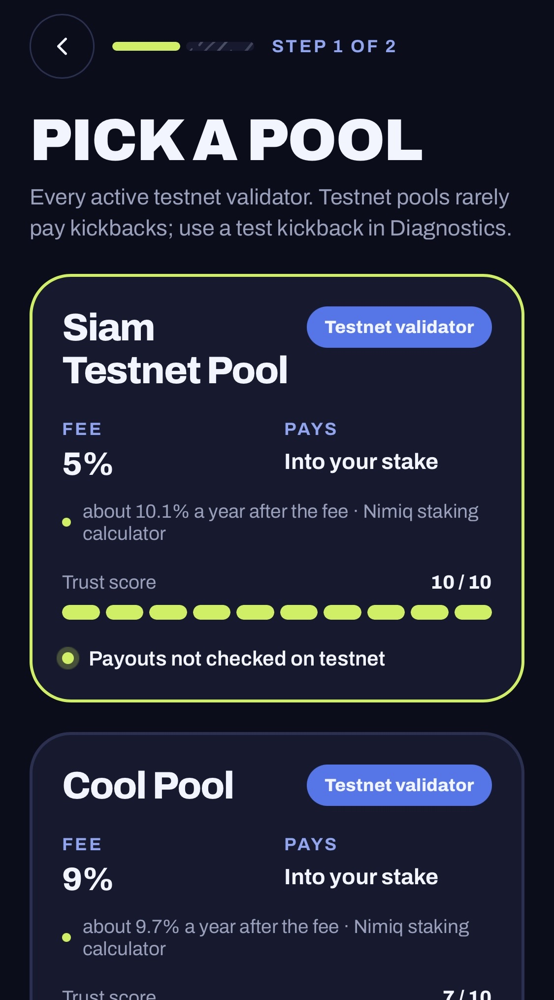
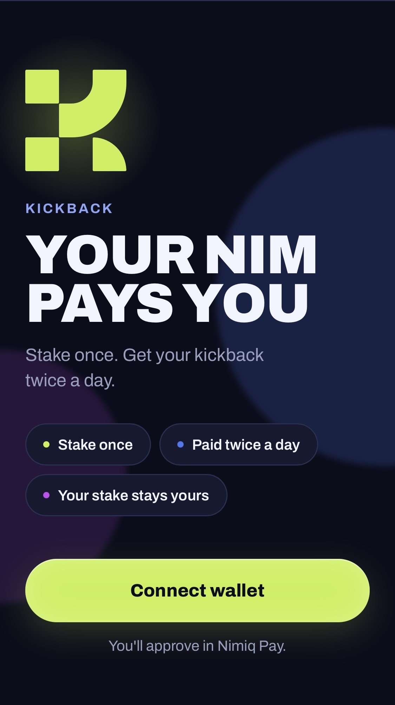
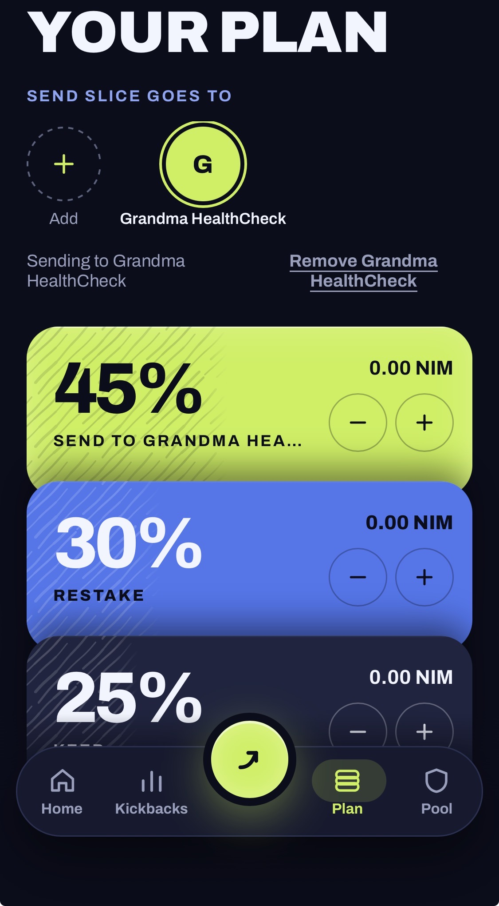

# Kickback

> Your staking rewards, shared the way you choose.

| Field | Value |
| --- | --- |
| Category | Earn |
| Pricing | Free |
| Team name | breeklayer |
| Team members | _Not provided — optional_ |
| X account | shroomsgotsol |
| Heard about it via | Nimiq Community |
| Contact email | rukevwe.eminokanju08@gmail.com |
| GitHub login | @shrooms08 |
| Submitted at | 2026-11-11T09:06:45.985Z |

## Links

| Link | URL |
| --- | --- |
| Repo | [https://github.com/shrooms08/kickback](<https://github.com/shrooms08/kickback>) |
| Demo | [https://kickback-ecru.vercel.app/](<https://kickback-ecru.vercel.app/>) |
| Video | [https://youtube.com/shorts/-LD9doYPqPE](<https://youtube.com/shorts/-LD9doYPqPE>) |
| Skool post | [https://www.skool.com/miniappscompetition/built-kickback-stake-once-split-every-payout?p=b681cf13](<https://www.skool.com/miniappscompetition/built-kickback-stake-once-split-every-payout?p=b681cf13>) |
| Social post | [https://x.com/shroomsgotsol/status/2120441650061480090?a=KRVL2ccZjtkzQorjmQ4&s=20](<https://x.com/shroomsgotsol/status/2120441650061480090?a=KRVL2ccZjtkzQorjmQ4&s=20>) |

## Description

Stake NIM once with a direct-payout pool. About every 12 hours the pool pays you a kickback, and Kickback splits it the way you choose: send part to someone you care about, restake part, keep the rest. Your stake is never touched.

## Builder story

_Not provided — optional_

## Thumbnail

## Screenshots

---

_Generated from the submission form. `submission.yaml` in this folder is the machine-readable source of truth._
