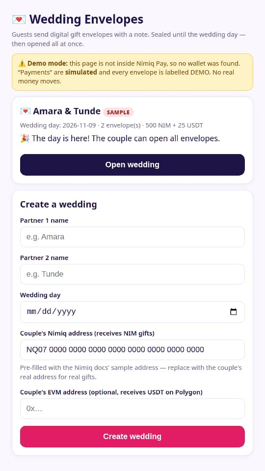
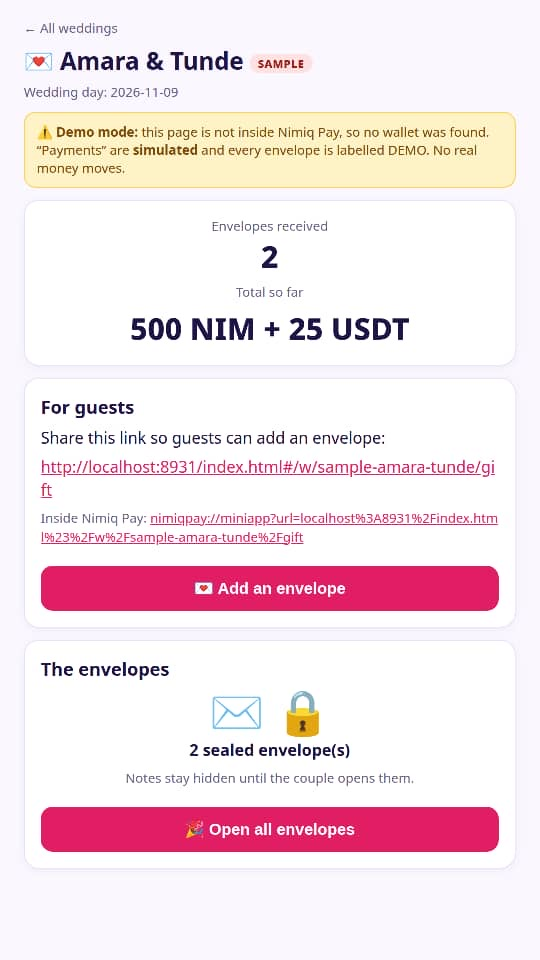
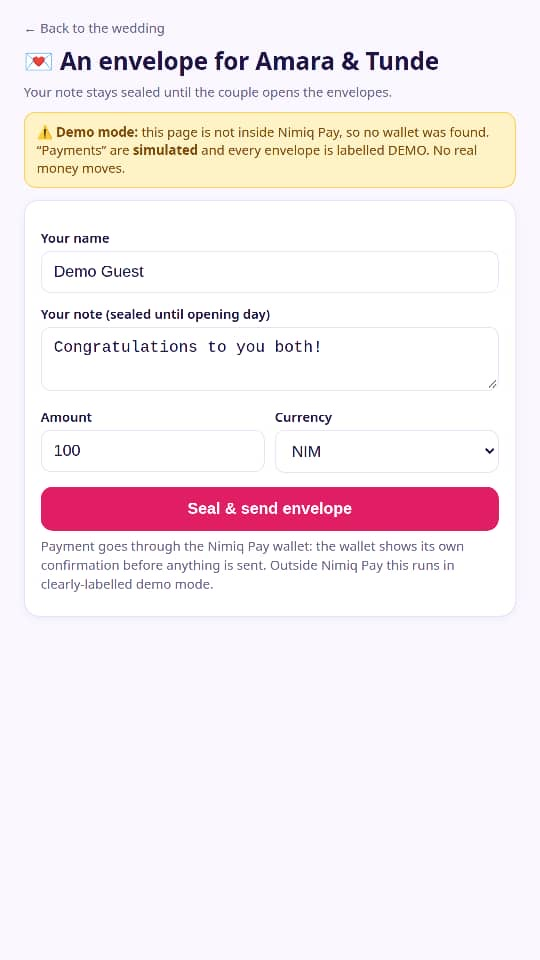
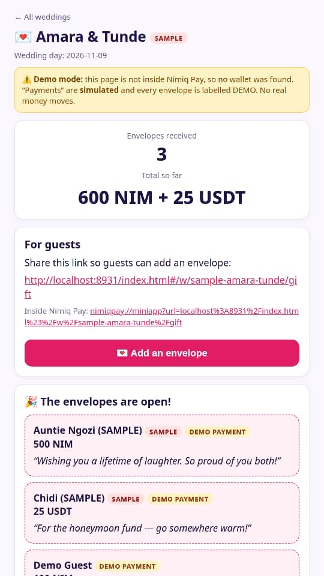

# Wedding Envelopes

> Send a gift envelope today. They open it on the wedding day

| Field | Value |
| --- | --- |
| Category | Save |
| Pricing | Free |
| Team name | _Not provided — optional_ |
| Team members | _Not provided — optional_ |
| X account | Emeraldpop15035 |
| Heard about it via | X |
| Contact email | eddiebrit4@gmail.com |
| GitHub login | @skymiller1509-blip |
| Submitted at | 2026-11-10T22:47:57.512Z |

## Links

| Link | URL |
| --- | --- |
| Repo | [https://github.com/skymiller1509-blip/Wedding-envelopes](<https://github.com/skymiller1509-blip/Wedding-envelopes>) |
| Demo | [https://muse.ai/s/wedding-envelopes-fq6xaxpxkrxuvxaxn/dZyPzHdWinzE9V82DSXJrdvz5vHhCdOVKfH54JlI59I](<https://muse.ai/s/wedding-envelopes-fq6xaxpxkrxuvxaxn/dZyPzHdWinzE9V82DSXJrdvz5vHhCdOVKfH54JlI59I>) |
| Video | [https://www.youtube.com/watch?v=PX0CjxgHNkA](<https://www.youtube.com/watch?v=PX0CjxgHNkA>) |
| Skool post | _Not provided — optional_ |
| Social post | _Not provided — optional_ |

## Description

Wedding guests send money gifts in digital envelopes with a sealed note, paid in NIM or USDT through Nimiq Pay. The couple opens every envelope at once on the wedding day and reads all the notes together.

## Builder story

Money in envelopes is how guests give at weddings in my culture, with a few words tucked inside for the couple. I built Wedding Envelopes so that tradition survives the move to digital money: the gift arrives through Nimiq Pay, but the words stay sealed until the wedding day, when the couple opens every envelope together.

## Thumbnail

## Screenshots

---

_Generated from the submission form. `submission.yaml` in this folder is the machine-readable source of truth._
