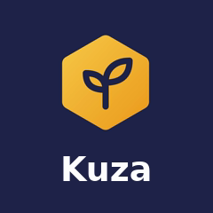
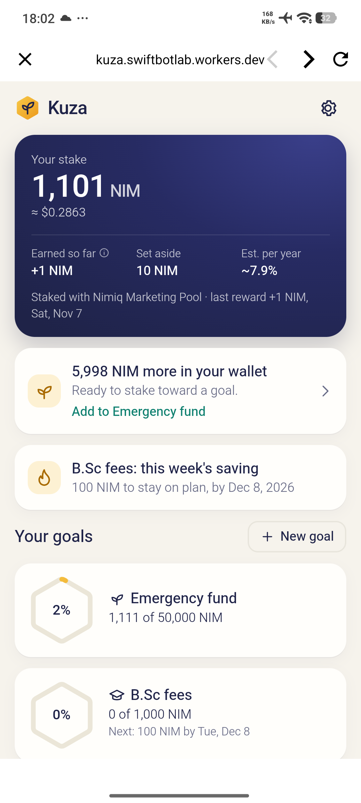
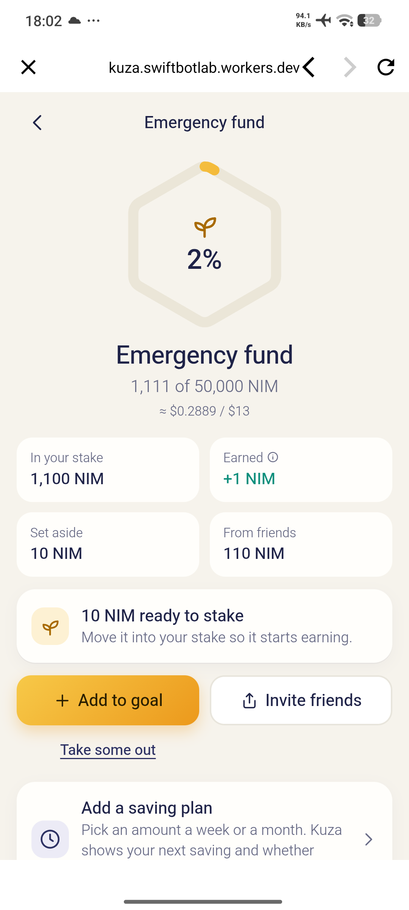
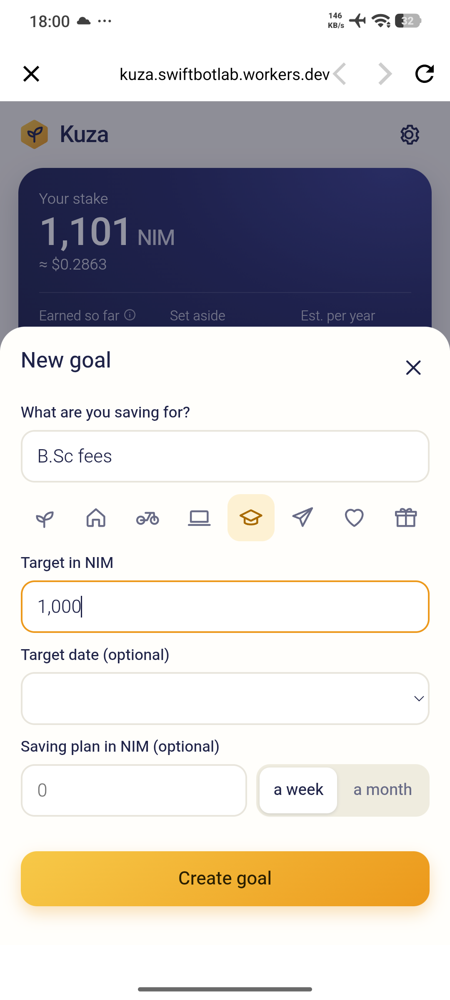
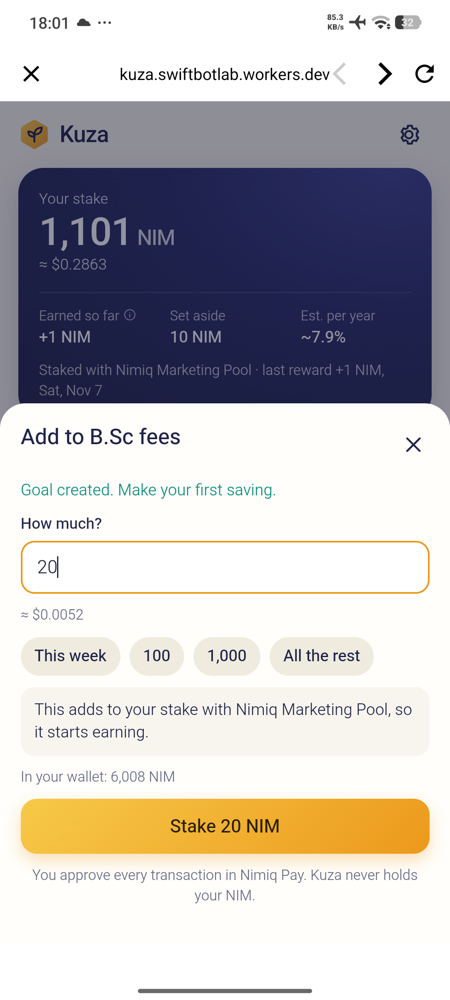
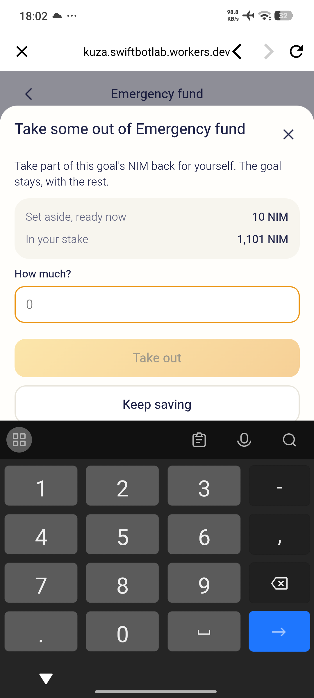

# Kuza

> Savings goals that grow in your own NIM stake. You hold it, it earns, friends can chip in.

| Field | Value |
| --- | --- |
| Category | Save |
| Pricing | Free |
| Team name | Swift Bot Labs |
| Team members | _Not provided — optional_ |
| X account | swiftbotlab |
| Heard about it via | Skool |
| Contact email | swiftbotlabs@gmail.com |
| GitHub login | @swiftbotlabs |
| Submitted at | 2026-11-10T05:54:41.711Z |

## Links

| Link | URL |
| --- | --- |
| Repo | [https://github.com/swiftbotlabs/kuza](<https://github.com/swiftbotlabs/kuza>) |
| Demo | [https://kuza.swiftbotlab.workers.dev/](<https://kuza.swiftbotlab.workers.dev/>) |
| Video | [https://youtu.be/hQ9L68Ou7Qg](<https://youtu.be/hQ9L68Ou7Qg>) |
| Skool post | [https://www.skool.com/miniappscompetition/kuza-savings-goals-in-your-own-nim-stake-testers-on-mainnet-wanted](<https://www.skool.com/miniappscompetition/kuza-savings-goals-in-your-own-nim-stake-testers-on-mainnet-wanted>) |
| Social post | [https://x.com/swiftbotlab/status/2117487943527154076](<https://x.com/swiftbotlab/status/2117487943527154076>) |

## Description

Set a goal and a weekly or monthly plan; savings go into your own stake and earn (under 100 NIM they wait in your wallet). Kuza holds nothing. Friends chip in from a link that opens in Nimiq Pay. Earned is proven from the chain. At 100%: next goal, keep growing, or take it out.

## Builder story

Most savings apps ask you to hand your money to someone. On Nimiq you don't have to: stake already sits in your own address, earns on its own, and takes a day to leave. That pause is most of what a savings habit needs, so Kuza is built on it.

You name a goal, set a target and a date, and pick a plan per week or per month. Kuza shows the next saving and when it's due, whether you're on plan, when the goal lands at this pace, and your streak. Each saving is a staking transaction you approve in Nimiq Pay. There is no pool wallet or server holding funds, and Kuza has no key to move your NIM.

Being honest about what stake is shaped the product. Staked NIM isn't held back by a rule, and the Nimiq provider can't create vesting contracts, so no Mini App can honestly promise an enforced lock. Kuza says that plainly. Breaking a goal shows the true path: stop earning, a cooling-off that ends at a block we compute from the chain, then two approvals to get back to your wallet. Under 100 NIM, the minimum for a new stake, a goal fills in your wallet and tells you how far off staking you are.

Friends are the part we like most. Your invite link is short and carries the goal, not any money. Opened on a phone, it shows the goal and one button into Nimiq Pay; on Android without Nimiq Pay, it leads to the Play Store. Inside Nimiq Pay the friend pays your own address directly with a short public note, and Kuza reads that note from the chain. Then they see the goal move and can start their own.

At 100% there are three ways on: start the next goal (the stake counts toward it, no transaction), raise the target and keep it growing, or use the money. Using it means taking it out of the stake, then paying: Kuza can hand a Bitcoin Lightning invoice to Nimiq Pay, which shows the price and asks you to approve.

Earned shows only what the chain proves: your stake minus every deposit into it from your wallet's own accounts, plus what you took out. Our test stake shows +1 NIM since its first pool payout on 7 November, and if the history can't be read, Kuza says "not known yet" instead of guessing.

Testing on a real wallet taught us things the docs don't say. Nimiq Pay pays from a second account that changes over time, not the one it shows first. A transaction the network would refuse can leave the wallet waiting, so Kuza re-reads the chain right before every approval and never retries an unknown outcome. A security review of this version led to fixes before release: a friend sees "only pay if you know who sent you this link" and the full address above the amount, a Lightning invoice handed to the wallet is never sent twice, and names or notes that read like links are refused, so the shared pages show gift amounts only.

Every staking step has run on mainnet in the real Nimiq Pay app on two Android phones: a new stake, a top-up, a friend's gift with a note, stop earning, and retire and remove back to the wallet. With this version, the invite link opened in Chrome went straight into Nimiq Pay, a 10 NIM gift reached the thank-you screen, and a reopen needed no Connect sheet. A goal then paid a real 30-sat Lightning invoice through Nimiq Pay, end to end: the swap's HTLC was redeemed with the preimage of the invoice's payment hash. Each transaction is linked in the README; every wallet in it is our own test wallet. Three outside testers then reported thirteen issues, such as a fully staked goal booking a payment it didn't hold; twelve were real and are fixed, each with a test. One opened Kuza in Nimiq Pay on an iPhone and created a goal. Not yet tried: staking from an iPhone, and the Play Store path for someone without Nimiq Pay.

Kuza works in English, Spanish, French and Swahili and shows values in your currency. It collects one thing: a one-way hash of your address, once, for a public wallet count, and you can turn that off. The code is MIT licensed, with no build step and no dependency beyond the Nimiq SDK.

Kuza means "grow" in Swahili.

## Thumbnail

## Screenshots

---

_Generated from the submission form. `submission.yaml` in this folder is the machine-readable source of truth._
