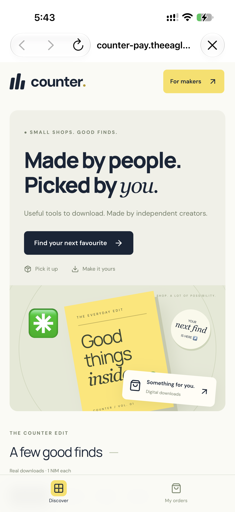
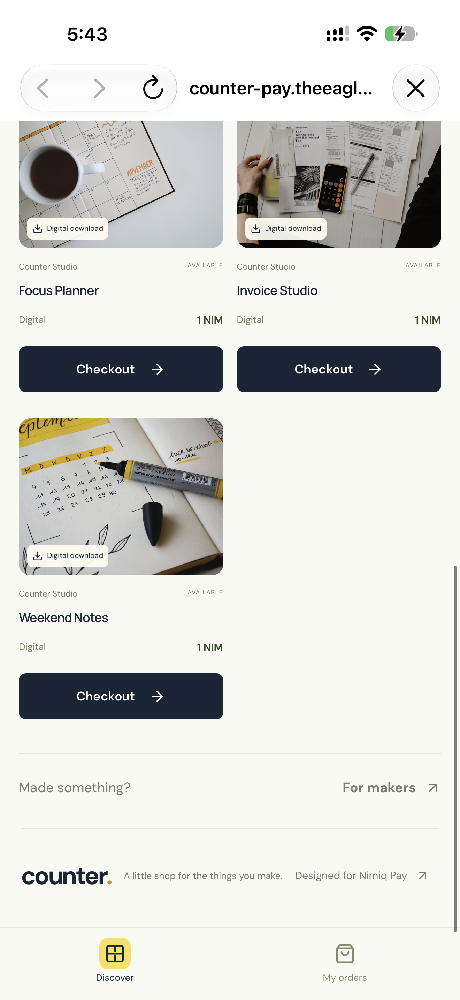
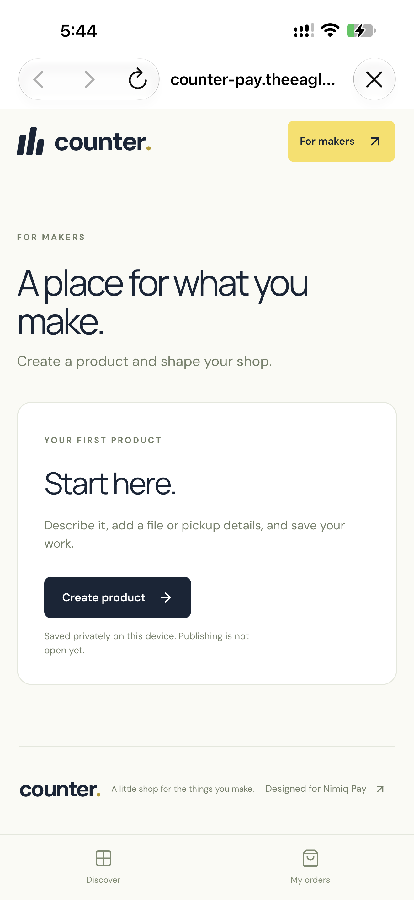
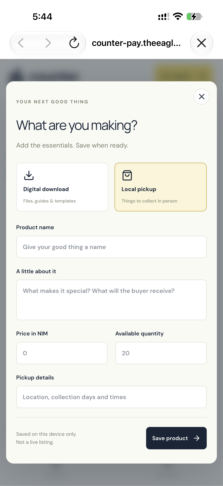

# Counter

> Good things, paid for simply.

| Field | Value |
| --- | --- |
| Category | Pay |
| Pricing | Paid |
| Team name | Eagle |
| Team members | _Not provided — optional_ |
| X account | theeagle2407 |
| Heard about it via | X |
| Contact email | elijahoreoluwa45@gmail.com |
| GitHub login | @theeagle2407 |
| Submitted at | 2026-11-08T17:24:30.014Z |

## Links

| Link | URL |
| --- | --- |
| Repo | [https://github.com/theeagle2407/counter-pay](<https://github.com/theeagle2407/counter-pay>) |
| Demo | [https://counter-pay.theeagle2407.workers.dev/](<https://counter-pay.theeagle2407.workers.dev/>) |
| Video | [https://youtube.com/shorts/9mbHcT3UWZ8?feature=share](<https://youtube.com/shorts/9mbHcT3UWZ8?feature=share>) |
| Skool post | _Not provided — optional_ |
| Social post | [https://x.com/theeagle2407/status/2119480856960287188?a=hj0PPprtgg813oJcVpg&s=20](<https://x.com/theeagle2407/status/2119480856960287188?a=hj0PPprtgg813oJcVpg&s=20>) |

## Description

Counter is a small shop inside Nimiq Pay where people can discover useful products and pay makers directly in NIM. 

Buyers approve payment in their own wallet; Counter verifies the exact amount, recipient, order reference, and finality before releasing a product.

## Builder story

I built Counter because making something valuable should be enough to start selling it. Too often, an independent maker has to piece together a storefront, a payment method and a way to deliver their work before the first customer can buy.

Counter brings those steps together inside Nimiq Pay. A buyer can find something they like, pay the maker directly, and receive it once the payment is verified. I started with digital products because I could make that promise work from beginning to end.

My hope is that Counter grows into a place where more people can earn from the things they make - including things a neighbour could pick up. The first step is simple: make one honest purchase feel effortless for both sides.

## Thumbnail

## Screenshots

---

_Generated from the submission form. `submission.yaml` in this folder is the machine-readable source of truth._
