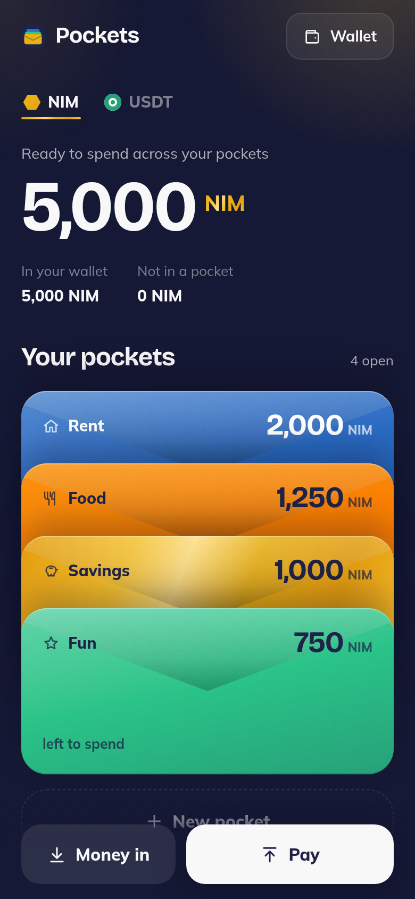
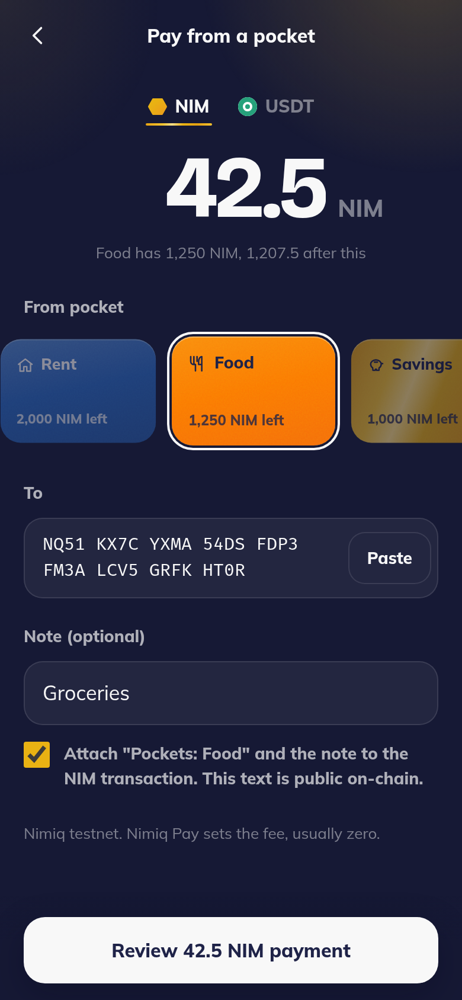
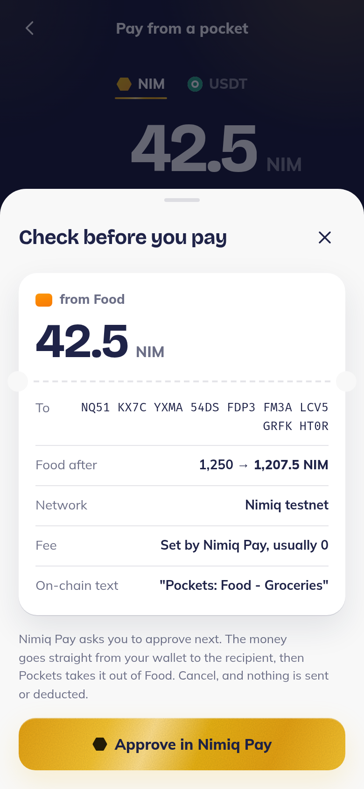
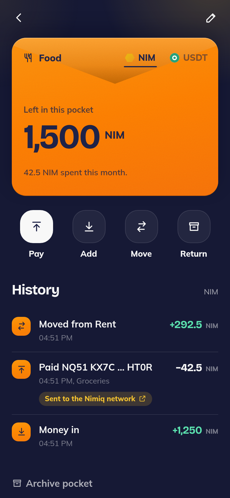

# Pockets

> Split your money into pockets. Pay from the right one.

| Field | Value |
| --- | --- |
| Category | Save |
| Pricing | Free |
| Team name | _Not provided — optional_ |
| Team members | _Not provided — optional_ |
| X account | 3amer_osama |
| Heard about it via | I'm Heard On X |
| Contact email | yendkontl@gmail.com |
| GitHub login | @yohunshadow |
| Submitted at | 2026-11-10T17:25:18.533Z |

## Links

| Link | URL |
| --- | --- |
| Repo | [https://github.com/yohunshadow/pockets_nimiq](<https://github.com/yohunshadow/pockets_nimiq>) |
| Demo | [https://pockets-topaz.vercel.app](<https://pockets-topaz.vercel.app>) |
| Video | [https://youtube.com/shorts/t5V8Jz5tGMA?si=Kj-WnP-wHtULYsmV](<https://youtube.com/shorts/t5V8Jz5tGMA?si=Kj-WnP-wHtULYsmV>) |
| Skool post | [https://www.skool.com/miniappscompetition/pockets-envelope-budgeting-inside-nimiq-pay?p=89c76107](<https://www.skool.com/miniappscompetition/pockets-envelope-budgeting-inside-nimiq-pay?p=89c76107>) |
| Social post | [https://x.com/3amer_osama/status/2120198508561269061?a=RytDhWX1H6erWGfDqBE&s=19](<https://x.com/3amer_osama/status/2120198508561269061?a=RytDhWX1H6erWGfDqBE&s=19>) |

## Description

Envelope budgeting inside Nimiq Pay: split your NIM and USDT into pockets like Rent, Food and Savings, then pay straight from the right one. Non-custodial and built for anyone paid in crypto who wants to know what they can still spend.

## Builder story

My wallet only ever showed one big number, so I never knew what was actually free to spend. Pockets brings old-school envelope budgeting to Nimiq Pay: plan your money into pockets, pay from the one you chose, and keep everything non-custodial in your own wallet.

## Thumbnail

## Screenshots

---

_Generated from the submission form. `submission.yaml` in this folder is the machine-readable source of truth._
